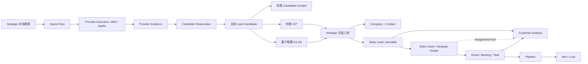
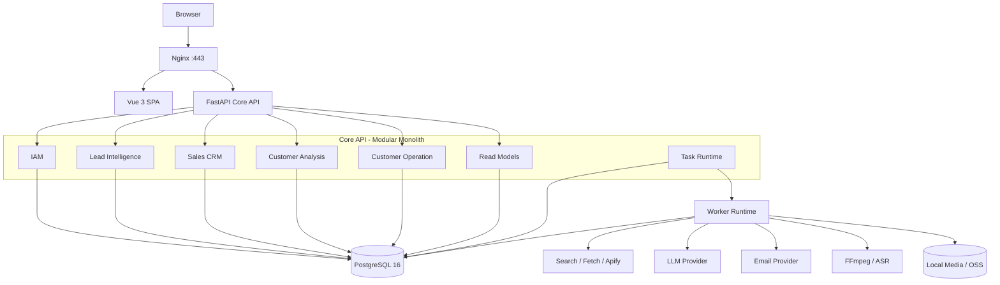
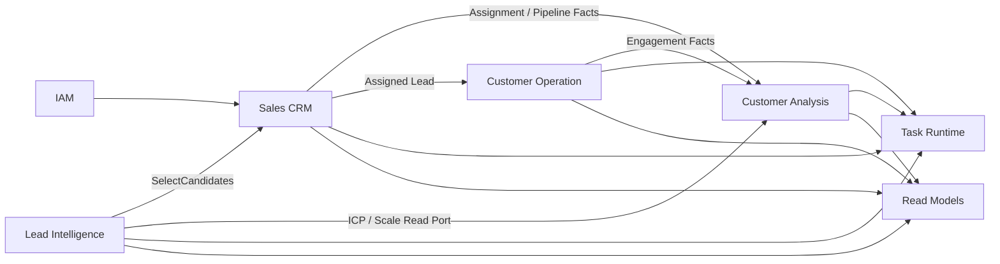
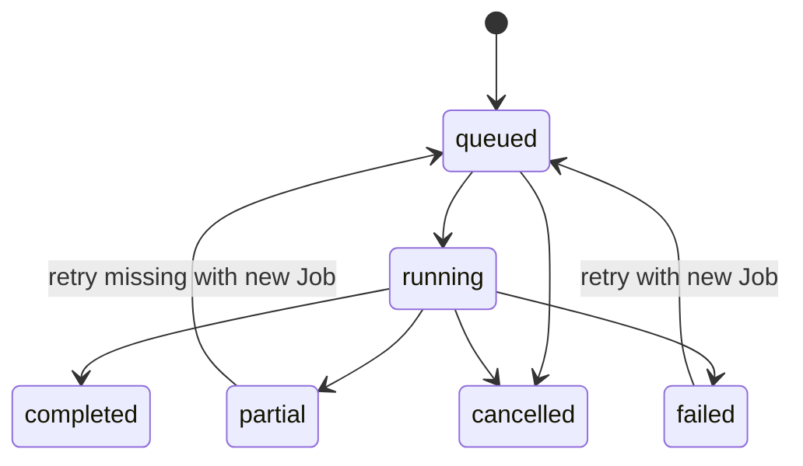
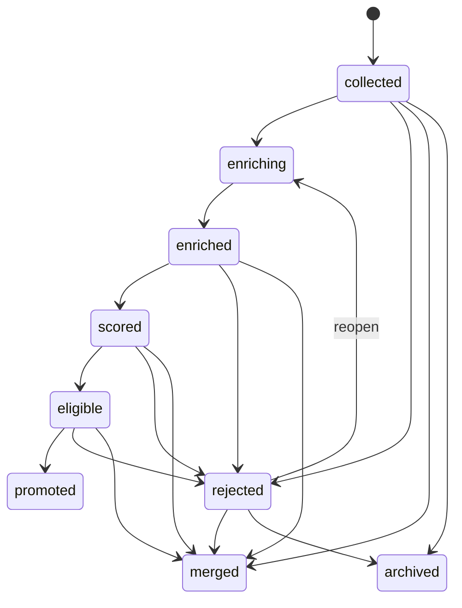
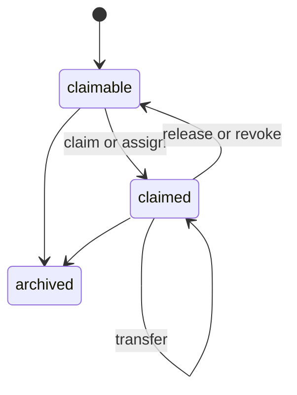
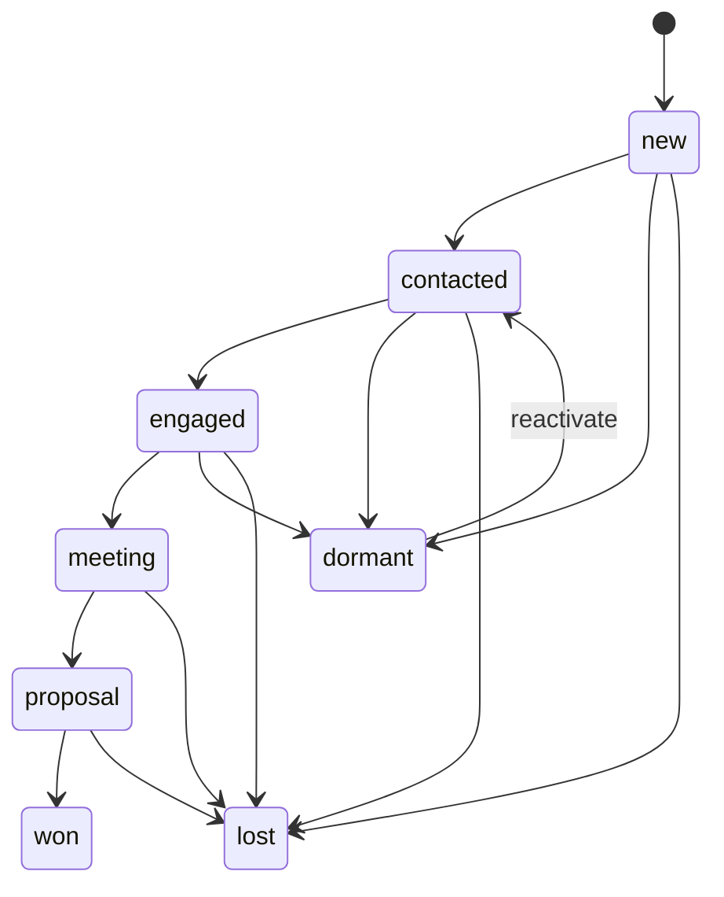
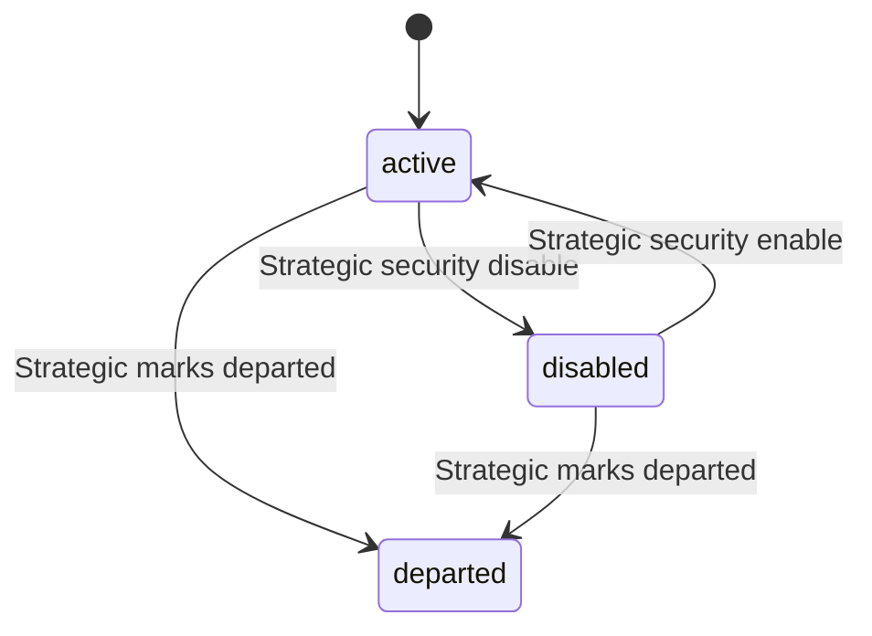

# 01 - LTC Agent 架构总览

> 版本：v3.6
> 日期：2026-07-20
> 性质：目标架构权威来源
> 约束：对话搜索是唯一线索入口；场景化四维 ICP 是唯一匹配评分；客户规模独立；允许删库和代码重构
> v3.6：账号统一为 Sales/Strategic；Strategic 直接执行离职回池；安全禁用与离职分离；S4/S5 整体 Deferred；Apollo 作为对话搜索内部 Provider
> v3.5（历史记录，冲突口径已由 v3.6 覆盖）：曾定义 S4 临时权重并将全部销售管理 Deferred；批量确认、动态意向、数据补全和自动释放等修订继续保留

---

## 1. 业务理解

### 1.1 系统定位

TGT 是 B2B eSIM 跨境通信服务商。LTC Agent 的职责不是简单做一个“线索搜索工具”，而是建立一条可追溯、可分配、可分析和可运营的 B2B 销售主链：

```text
发现企业
→ 判断是否匹配
→ 判断客户体量
→ 进入销售资源池
→ 认领或指派
→ 理解客户
→ 邮件/会议/任务跟进
→ 推进至 won/lost
```

系统当前覆盖 Sales 和 Strategic 两类账户：

| 账户类型 | 主要动作 |
|---|---|
| Sales | 查看本人区域×等级可领取池、认领、跟进、释放、同区域×同等级转交、维护客户信息 |
| Strategic | 发起对话搜索、勾选候选入池、查看全局、按目标 Sales 区域×等级指派/批量转交、规则复核，以及直接标记 Sales 离职并将其客户释放回原池 |

当前不再设置第三种管理账号或 `is_boss` 隐式角色。Strategic 的当前管理能力通过显式 Capability 控制；销售等级调整、离职申请审批、交接待办和销售健康度仍为后续范围。

### 1.2 系统覆盖的业务场景

本系统采用场景化 ICP 评分，不同场景有独立的维度名称和权重分配。当前只启用 3 个场景：

| ID | 场景 | 优先级 | 策略 | 维度数 | 权重 |
|:--:|------|:--:|------|:--:|------|
| S1 | 差旅平台（TMC） | 1 | 主攻，详细打分 | 4 | 40/30/20/10 |
| S2 | 商旅OTA | 2 | 主攻，详细打分 | 4 | 35/25/25/15 |
| S3 | 金融科技 | 3 | 主攻，详细打分 | 4 | 35/25/25/15 |

每个当前场景每个维度有 5 档评分档位（系数 0/0.25/0.5/0.75/1.0），`得分 = 权重 × 系数`。评分时优先使用高置信度量化证据（订单量、国家数、企业客户数、API 能力等），内部数据不可得时使用公开代理证据，不因缺少内部数据直接记零分。

S4 酒店航司和 S5 APP 工作室整体 Deferred：当前不配置权重、不评分、不入池，也不允许 API 创建对应 Search Run。未来纳入范围时必须先补齐各自四维定义和合计 100 的权重，再以新 `rule_version` 启用。

### 1.3 负向过滤与候选分流

在 ICP 评分之前，候选先经过负向过滤规则（X1-X6）：

- **X 类（排除）**：完全无出境场景、与 eSIM 分发无关、已拒绝且 6 个月无新变化
- **D 类（暂存）**：规模过小、无官网无联系人、无有效触达方式
- **数据补全池**：体量未知的 A 先补体量，区域未知的 A 先补区域

仅 ICP≥60 且核心硬门槛不为 0 的候选进入销售分配主流程。

### 1.4 动态意向加分

触达后根据客户行为动态加分，总分封顶 100：

| 行为 | 加分 | 含义 |
|------|:--:|------|
| 打开邮件或点击链接 | +2 | 轻微信号 |
| 回复邮件但只做普通询问 | +5 | 有互动 |
| 明确询问覆盖国家、套餐、价格、分成、API、合作模式 | +8 | 明确兴趣 |
| 愿意开会、要求方案、转给负责人 | +10 | 强意向，建议升级优先级 |

B 级（60-79）客户动态加分后达到 A 级（≥80）的，升级为 **A4 高意向动态升级客户**，24 小时内生成分析并创建销售任务。

落点与数据源（v3.5 修正）：

- 触达发生在分配之后，加分累计在 `sales_lead.dynamic_bonus_points`，动态总分 = min(100, adopted ICP 静态分 + 累计加分)；A4 标记落在 `sales_lead.a_segment`。
- I1（打开/点击）来自邮件 Provider Webhook（`external_event` 的 delivered/opened/clicked）；I2-I4 由回复意图 `intent_level` 按映射表产生（见 `03-DDD领域驱动设计.md` §6.15）。
- A4 升级保持原 owner 不重新分配；升级同事务外异步创建 Analysis Run 和跟进 Task，不是延迟 24 小时的定时任务。
- Candidate 阶段的静态 A1-A3 细分由当前 ICP 结果派生展示，不落库。

### 1.5 A 类客户细分

A 级（≥80）客户进一步细分四种处理策略：

| 细分 | 条件 | 跟进要求 |
|------|------|------|
| A1 战略大客户 | 总分≥85 且规模维度≥80% 权重；或满足任一定量条件：年国际订单≥100,000 / 企业客户≥500 / 月活≥100 万 | 大客户销售主跟，区域负责人协同，24h 首触 |
| A2 高适配客户 | 总分≥80 且跨境场景维度≥80% 权重，且增值服务/数据触达维度≥80% 权重 | 5年+销售或区域负责人主跟，24-48h 首触 |
| A3 技术可快速试点 | 总分≥75 + 技术接入维度≥80% 权重 | 方案销售+产品支持，2-4 周 POC |
| A4 高意向动态升级 | 静态 60-79 但动态加分达 A | 按区域归属分配，24h 跟进 |

### 1.6 正确的端到端业务流程



最关键的生命周期规则：

```text
候选被勾选入池
  → 创建或复用 Company
  → 晋升候选联系人为 Contact
  → 创建 Sales Lead，初始 claimable

Sales Claim / Strategic Assign
  → 只创建 Assignment 和负责人关系
  → 不创建 Company
```

旧设计中“Claim 时创建 Company”的做法必须撤回。它会让未被认领的正式线索无法分析，也会导致释放后无法正确回到资源池。

### 1.7 统一业务对象

| 对象 | 含义 | 生命周期位置 |
|---|---|---|
| Search Run | 一次用户对话搜索 | 搜索入口 |
| Provider Execution | 一次内部 Provider 调用及其状态、成本和错误；当前包括 Web Search/Apollo | 搜索批次内 |
| Search Evidence | Provider 返回的网页和内容 | 事实证据 |
| Candidate Observation | 某次搜索中模型抽取的候选快照 | 搜索批次内 |
| Lead Candidate | 跨批次去重后的候选企业 | 线索阶段 |
| Candidate Contact | 候选阶段联系人 | 线索阶段 |
| ICP Assessment | 当前 S1/S2/S3 的场景化四维匹配评分 | 线索阶段 |
| Customer Scale Assessment | 客户体量和 MA/SA/A 决策 | 线索阶段 |
| Company | 候选入池后形成的企业主数据 | CRM 阶段 |
| Contact | 可用于分析和运营的正式联系人 | CRM 阶段 |
| Sales Lead | 一次可分配、可跟进的销售周期 | CRM 阶段 |
| Assignment | 一段时间内的销售负责人关系 | 分配阶段 |
| Analysis Report | 基于快照生成的不可变报告 | 分析阶段 |
| Email/Meeting/Task/**Manual Note**/Activity | 客户运营事实 | 运营阶段 |

Company 不等于“已成交客户”。被选择进入销售资源池的企业即可成为 `lifecycle_status=prospect` 的正式 Company。

### 1.8 已确认的后续业务：战略指令和季度线索收集

管理层后续需要通过“战略指令”持续调整线索资源策略：

```text
Strategic 发布战略指令
→ 定义季度线索收集目标
→ 定义不同区域的企业客户目标比例
→ 系统自动拆分区域 Search Campaign
→ 持续更新最新资源和完成度
→ Read Model 向 Strategic 展示覆盖缺口和策略建议
```

示例：

```text
本季度目标 1,000 家候选企业
  东亚 35%
  北美 30%
  欧洲 20%
  东南亚 10%
  中东 / 其他 5%
```

Strategic 可通过新版本战略指令调整比例。后续设计必须遵守：

1. 区域比例总和必须为 100%；
2. 每个季度 Campaign 保存启用时的战略指令快照；
3. 新指令默认影响未开始和后续 Campaign，不静默篡改历史 Campaign；
4. 已运行 Campaign 需要显式 Replan 才改变剩余目标；
5. 自动收集仍复用当前对话搜索、Evidence、Candidate、ICP 和 Scale 主链；
6. 自动化只负责产生和补足 Candidate，不绕过 Strategic Selection；
7. 不自动 Claim、不自动 Assign；
8. “实时更新资源”通过 Read Model 展示资源池数量、区域占比、缺口、质量和转化，不建立第二套事实源。

该能力当前只作为后续边界保留，不在当前数据库、API 和 Worker 中实现。未来建议概念：

- Strategic Directive；
- Lead Collection Campaign；
- Campaign Region Quota；
- Campaign Replan；
- Strategy Resource Read Model。

---

## 2. 两套评分体系

### 2.1 场景化四维 ICP：业务匹配度

ICP 评分是场景化规则，不是固定维度和权重。当前只定义并启用三套完整四维规则（S1/S2/S3）。

差旅平台/TMC（S1）场景权重：

| 维度 | 含义 | 权重 |
|:--:|---|:--:|
| D1 | 跨境出行 | 40 |
| D2 | 增值服务/交叉销售 | 30 |
| D3 | 公司规模/出行频次 | 20 |
| D4 | API/技术对接能力 | 10 |

商旅OTA（S2）场景权重：

| 维度 | 含义 | 权重 |
|:--:|---|:--:|
| D1 | 跨境出行场景/用户触点 | 35 |
| D2 | 订单链路分销触点 | 25 |
| D3 | 增值服务/交叉销售 | 25 |
| D4 | API/技术对接 | 15 |

金融科技（S3）场景权重：

| 维度 | 含义 | 权重 |
|:--:|---|:--:|
| D1 | 跨境金融/出境消费场景 | 35 |
| D2 | 出境用户触点/权益分发 | 25 |
| D3 | 权益/增值服务交叉销售 | 25 |
| D4 | 支付/兑换/核销承接能力 | 15 |

S4 酒店航司和 S5 APP 工作室不属于当前规则包；数据库和 API 当前只接受 `scene_code IN ('S1','S2','S3')`。未来启用时通过新规则版本和 Migration 扩展，不保留未确认的占位权重。

数据库不按统一的 40/30/20/10 上限硬编码，而是按当前场景的权重作为各列上限。不同场景的 `d1_score` 列允许值域取决于当前 `scene_code`。

### 2.2 客户规模：销售承接等级

客户规模不是 ICP，也不允许使用 ICP 分数推导。

| 维度 | 含义 | 满分 |
|---|---|---:|
| SCALE-D1 | 规模数量 | 40 |
| SCALE-D2 | 营收/商业价值 | 35 |
| SCALE-D3 | 全球办公点/区域覆盖 | 25 |

输出：

| 客户规模 | 分值 | required_sales_tier |
|---|---:|---|
| 大客户 | 80-100 | MA |
| 中客户 | 60-79.99 | SA |
| 小客户 | 0-59.99 | A |
| unknown | 证据不足，无法给出有效分 | A（进入数据补全池） |

证据不足（公开渠道和代理证据都无法估计体量）时不强行打分，输出 `unknown`，Candidate 可入池但 Sales Lead 落入数据补全池（见 §5.2 和 `04-数据模型设计.md` §11.5.1）。区域已知的 `scale_unknown` 仅对该区域 A 级销售可见；区域未知的 Lead 对全部 Sales 隐藏，先由后台补齐区域。SCALE-D2 和 SCALE-D3 包含 8.75、17.50、26.25、6.25、12.50、18.75 等小数，数据库和 API 必须使用 decimal/numeric。

### 2.3 两套评分的职责

```text
ICP Assessment
  回答：这家公司与 TGT 业务是否匹配、优先级如何？

Customer Scale Assessment
  回答：这家公司应该进入 MA、SA 还是 A 销售池？
```

两者都要保存：

- Rule Version；
- Prompt Version；
- Input/Evidence；
- Dimension Scores；
- Confidence；
- Current Version；
- Manual Override 信息。

Candidate 的 `current` 表示最新研究结果；Sales Lead 的 `adopted` 表示本销售周期入池时采用的资格快照。Candidate 后续重评不会静默改变开放 Sales Lead 的销售等级或分析输入，新的销售周期才重新采用届时的 current Assessment。

---

## 3. 当前代码审查

### 3.1 已验证、应保留的能力

| 能力 | 当前代码位置 | 目标处理 |
|---|---|---|
| 对话搜索和流式输出 | `LTC/clue_agent/.../api_server.py`、LangGraph | 迁入 Lead Intelligence |
| 搜索回补和多模式 | `lead_discovery_service.py` | 保留 |
| 网页搜索/Apollo/正文/LLM 抽取 | `clue_agent` | 通过 Provider Port 与 Provider Execution 重构；Apollo 不暴露独立入口 |
| 四类联系人 | `decision_makers/influencers/executors/general_employees` | 结构化为 Candidate Contact |
| D1-D4 富化 | `liuqi_company_enrichment.py` | 保留规则和流程 |
| 四维 ICP | `enrichment_service.py` | 唯一 ICP 来源 |
| 客户规模 D1-D3 | `customer_tier_rules.py` | 独立 Assessment |
| 五模块分析报告 | `customer-analysis-agent` | 保留稳定 DTO |
| Profile/MEDDPICC | `customer-analysis-agent` | 持久化和可审查写回 |
| 邮件生成/翻译/发送 | `customer-operation-agent` | 接正式 Company/Contact |
| 回复意图 | `reply_intent_agent.py` | 保留 |
| 音视频/ASR/摘要 | `meeting-analysis-service` | 迁入 Meeting Worker |

### 3.2 已有代码但未接通

- 勾选候选只更新 `analysis_status=selected`，没有正式入池事务；
- Sales 资源池仍主要来自静态数组；
- Permission Check 没有参与真实 Claim 事务；
- Customer Analysis 使用 DemoStore；
- Customer Operation 使用内存或 JSON；
- Follow-up Task 无正式持久化和任务中心；
- 邮件和会议没有稳定 Company/Contact ID；
- 前端大量页面由静态数据兜底；
- 不同模块通过临时 HTTP 和名称关联。

### 3.3 必须删除的遗留

- 手工上传；
- B 端旧来源；
- GEO；
- C 端爬虫；
- Apollo 独立/占位入口（保留对话搜索内部 Apollo Provider Adapter）；
- 客户分析六维 ICP；
- 线索库旧 `lead_pool`；
- 静态 `CLAIMABLE_LEADS`；
- 固定 owner；
- 临时 `claim_*` ID；
- 前端 88/75 阈值；
- 前端基于 ICP 推导 MA/SA/A；
- SQLite 业务库；
- JSON 历史文件作为事实源；
- 各模块内存 Store；
- 8787 Node 业务代理和 Mock。

---

## 4. 架构决策

### 4.1 目标部署拓扑



部署单元：

| 单元 | 职责 |
|---|---|
| `ltc-web` | 构建后的 Vue SPA |
| `ltc-api` | 同步 API、事务、鉴权和查询 |
| `ltc-worker` | 搜索、LLM、邮件和媒体长任务 |
| PostgreSQL | 唯一业务数据库、Job Queue、Outbox |
| Media Storage | 附件、音视频、网页大正文 |
| Nginx | TLS、静态文件、反向代理 |

本地开发和 CI 统一使用 Docker Compose 复现上述部署单元，宿主机只要求 Docker/Compose，不要求安装 Python、Node 或 PostgreSQL。镜像固定 Python 3.11、Node 20 和 PostgreSQL 16 主版本；Web 通过 Nginx 同源代理 `/api/v1`。生产环境仍按表中部署单元独立配置 Secret、持久卷、备份和伸缩，不直接复用本地默认口令。

架构文档是可演进的决策基线，不是不可修改的目录模板。实施中发现新约束时，必须先记录问题、影响和取舍，再同步修改对应架构章节、契约/Migration 和自动化测试；已经分发执行的 Migration 不原地修改，而是追加新版本。业务范围硬约束若发生变化，必须由产品和架构共同确认，不能由实现代码暗中扩展。

### 4.2 为什么是模块化单体

- 候选入池、Claim、Assign、Release 和 Stage Change 需要数据库强事务；
- 当前多个服务的主要问题是数据重复和边界不稳定，不是吞吐；
- Python/FastAPI 技术栈一致；
- 一个代码库可以通过模块、Port 和表所有权形成清晰边界；
- Worker 可以独立进程扩展，不需要先拆业务微服务。

不引入：

- Kafka/RabbitMQ；
- Redis 作为必需组件；
- Elasticsearch；
- Kubernetes；
- 多数据库；
- 模块间 localhost HTTP。

异步任务使用 PostgreSQL Lease Queue 和 `FOR UPDATE SKIP LOCKED`。

### 4.3 目标模块

| 模块 | 类型 | 职责 |
|---|---|---|
| IAM | Supporting | 账户、会话、角色类型、Tier、Region、Capacity、登录锁定、区域国家参考数据（等级历史、离职交接 Deferred） |
| Lead Intelligence | Core | 搜索、证据、观察、候选、联系人、场景化 ICP、负向过滤、客户规模、候选选择 |
| Sales CRM | Core | Company、Contact、Sales Lead、Claim/Assign/Release/Transfer、Pipeline、动态意向加分与 A4 升级 |
| Customer Analysis | Core | Profile、MEDDPICC、Analysis Run、Report、Sales Guide、Suggestion、A 类细分 |
| Customer Operation | Core | Email、Meeting、Task、Activity、Manual Note |
| Task Runtime | Supporting | Job、Attempt、Progress、Outbox、幂等、审计、媒体、通知、自动释放定时任务 |
| Read Models | Supporting | Sales/Strategic Workspace、Dashboard、Customer 360（完整销售管理面板、池子健康度 Deferred） |

`Task Runtime` 和 `Read Models` 不是 Bounded Context，不使用它们承载客户业务规则。

### 4.4 Context Map



### 4.5 架构原则

1. PostgreSQL 是唯一业务事实源。
2. 每张业务表只有一个模块写入。
3. 对话搜索是唯一线索收集入口。
4. 四维 ICP 是唯一匹配评分。
5. 客户规模独立决定 MA/SA/A。
6. 候选入池先于 Claim。
7. Claim 只创建 Assignment。
8. 同步短事务，异步长任务。
9. 先落库，再执行外部副作用。
10. AI 输出保存版本、证据和输入快照。
11. 前端不拥有业务事实。
12. 模块间通过 Application Port 或 Outbox Event 协作。
13. Dashboard 只读。
14. 报告和评分按版本追加，不覆盖历史。
15. 通用 Audit 不能替代 Assignment 和 Pipeline 业务历史。

---

## 5. 核心流程

### 5.1 Search Run

```text
Create Search Run
→ Job 执行搜索
→ 保存 Search Evidence
→ 保存 Candidate Observation
→ 全局 Candidate 去重/合并
→ Candidate Contact 补全
→ D1-D4 Enrichment
→ ICP Assessment
→ Customer Scale Assessment
→ completed / partial
```

### 5.2 候选入池

```text
Strategic Select Candidate
→ 校验当前 ICP 和 Scale
→ 创建或复用 Company
→ 晋升 Contact
→ 创建 Sales Lead(claimable)
→ Candidate 标记 promoted
→ 写 Stage Transition
→ 写 Outbox
```

补全池分支：Scale `effective_tier=unknown` 或公司区域未知时，允许入池（前提仍是 ICP≥60 且硬门槛通过），Sales Lead 记 `data_completion_pool=scale_unknown/region_unknown`。`scale_unknown` 只对同区域 A 级销售可见；`region_unknown` 对全部 Sales 隐藏，仅供 Strategic 查看并由后台补全。区域补齐后若 Scale 仍 unknown，则转入对应区域 `scale_unknown` 池；否则按 adopted Scale 修正 `required_sales_tier` 并进入正式池。

### 5.3 Claim/Assign

```text
Claim:
  Sales Lead claimable
  + Sales Tier 匹配
  + Sales Region 与 Pool Region 匹配
  + Active Assignment 未达到 Capacity
  + Version 未冲突
  → Assignment active

Assign:
  Strategic 可指定 Sales
  + 目标 Sales 的 Region/Tier 与 Lead 池快照匹配
  + 未超过 Capacity
```

推荐初始策略：

- Sales 自助 Claim 必须 Region 与 Tier 同时匹配，当前版本没有关闭 Region Filter 的降级开关；
- Strategic Assign/Batch Transfer 同样校验目标 Sales 的 Region、Tier、active 状态与 Capacity，当前不提供跨区域、跨等级或超容量 Override；
- Sales 可将本人 active Lead 转交给同 Region、同 Tier 销售，原因必填；
- Capacity 使用实时 active Assignment 数，不信任缓存计数。

已领取但 3 个工作日未首触达的 Lead，由定时 Job 自动释放回 claimable 并通知原销售（编排 v0 §5.1）；SLA 口径见 `04-数据模型设计.md` §7.3。T1-T3 时间衰减与池降级为 Deferred（见 README 规则源对齐）。

### 5.4 Customer Analysis

```text
Company
+ Sales Lead 入池时采用的四维 ICP
+ Sales Lead 入池时采用的 Customer Scale
+ Profile
+ MEDDPICC
+ Contact
+ Email/Meeting/Task/Activity 截止快照
→ Analysis Run
→ Immutable Report
→ Analysis Suggestion
```

报告可以在 Sales Lead 入池后生成，不要求已经 Claim。

### 5.5 Customer Operation

```text
Email Draft → Translate/Edit → Approve → Send → Delivery/Reply
Meeting Upload → Normalize/Split → ASR → Summary → Task
Manual Note → LLM Extract → Confirm Card → Write Back → Report Refresh
Manual Call/Note/Proposal → Activity
Email/Meeting 运营事实 → Outbox Event → Sales CRM Stage Command
运营事实 → Customer Analysis Refresh
```

手动记录是 Customer Operation 的新增输入源：
- 销售用自然语言输入碎片信息，LLM 自动提取并匹配 Profile/MEDDPICC 的信息点（提取目标清单见 `03-DDD领域驱动设计.md` §6.16）
- 提取结果弹出确认卡片，采用批量确认：默认整批采纳，销售可展开逐条调整（覆盖/保留/编辑值）后一次提交，确认后写入 `customer_profile` 或 `customer_meddpicc_dimension`
- 确认后触发 Customer Analysis 报告重新生成（新版本，不覆盖旧版本）
- 提取失败时原始文本不丢失，`confirm_status=pending` 等待重试

用户显式修改 Pipeline 时由 API 同步调用 Sales CRM Command；Email/Meeting/ManualNote 自动推进只走 Outbox Event。Customer Operation 不直接写 Sales Lead，避免同一事实被同步和异步重复推进。

---

## 6. 状态机

### 6.1 Search Run



### 6.2 Lead Candidate



### 6.3 Sales Lead Allocation



### 6.4 Pipeline



### 6.5 Analysis Run

```text
queued → running → completed
                 ↘ failed
queued/running → cancelled
failed → queued(retry with new Job)
```

这里是 Analysis Run 资源重新进入 queued；旧 Job 保持终态，系统创建新 Job 并更新 `current_job_id`。

### 6.6 Email

```text
generating → draft → approved → queued → sending → sent → delivered → opened → clicked → replied
                                 ↘ cancelled   ↘ failed
                                             ↘ reconcile_required
sent → bounced
failed → queued(new send Job) → sending
reconcile_required → sent/failed
```

delivered/opened/clicked 由邮件 Provider Webhook 产生，只前进不回退；打开/点击是动态意向加分 I1 的数据源。

退订是 Suppression 状态，不覆盖历史邮件事实。

### 6.7 Meeting

```text
uploaded → queued → extracting → transcribing → summarizing → completed
                        ↘ failed → queued(new process Job)
uploaded/queued/extracting/transcribing/summarizing → cancelled
completed/failed/cancelled → deleted
```

### 6.8 销售账号生命周期与离职回池（v3.6 当前范围）

当前只实现 Strategic 直接标记 Sales 离职，不存在申请、审批、交接待办、主管确认或逐客户重新指派。



`DepartSales` 是一个同步、幂等、原子命令：

1. 按固定锁顺序锁定 Sales User → 该用户的 active Assignment → 对应 Sales Lead；
2. 将 `user_account.status` 更新为 `departed`，增加 `token_version` 并撤销全部 Session；
3. 结束全部 active Assignment，`reason_code=sales_departed`；
4. 将对应 Lead 的 `current_owner_user_id` 清空、`allocation_status` 置回 `claimable`，清空当前 Assignment/SLA 快照；
5. 保留 Lead 入池时的 `required_sales_tier`、`pool_region_code`、`pool_region_mapping_version` 和 `allocation_rule_version`，因此客户回到原区域×等级池；
6. 写 Assignment 历史、Stage Transition、Audit Log 和 Outbox 后一起提交；任一步失败全部回滚。

Depart 允许目标处于 `active` 或 `disabled`：安全禁用后仍可正式离职并回池。Claim/Assign/Transfer 只允许目标 `status=active`，并先锁定目标 User，避免离职事务与并发认领产生新的归属。`departed` 在当前版本是终态，通用 Enable 不得恢复；返聘若进入范围必须使用未来的显式命令。

安全 `DisableUser` 与离职严格分离：Disable 只阻断登录和撤销 Session，不结束 Assignment、不释放客户。完整销售管理中的等级调整、离职申请审批、交接 SLA、交接待办、销售健康度和重新指派建议继续 Deferred。

---

## 7. 目标代码结构

```text
LTC/
  apps/
    web/
      src/
        app/
        features/
          auth/
          lead-search/
          lead-analysis/
          allocation/
          customer-analysis/
          customer-operation/
          tasks/
          dashboards/
        entities/
        shared/
    api/
      src/ltc/
        modules/
          iam/
          lead_intelligence/
          sales_crm/
          customer_analysis/
          customer_operation/
          read_models/
        platform/
          db/
          jobs/
          events/
          idempotency/
          media/
          providers/
          observability/
    worker/
      src/ltc_worker/
        handlers/
  db/
    migrations/
    seeds/
  infra/
    nginx/
    systemd/
  tests/
    unit/
    integration/
    contract/
    e2e/
  archive/
    legacy/
```

---

## 8. 跨文档核心不变量

1. Candidate 与 Search Run 是多对多观察关系，不绑定单一批次。
2. Search Evidence 与 Candidate 是多对多。
3. 每个 Candidate 只有一条当前 Enrichment、ICP 和 Scale。
4. 当前 ICP 只启用 S1/S2/S3 四维规则（S1: 40/30/20/10、S2/S3: 35/25/25/15）；S4/S5 整体 Deferred。
5. Scale-D1/D2/D3 上限分别为 40/35/25。
6. Candidate 入池前先经负向过滤（X/D/数据补全），仅 ICP≥60 且硬门槛≠0 进入主分配流程。
7. 动态意向加分（+2/+5/+8/+10）累计在 Sales Lead 上，总分封顶 100，可将 B 级 Lead 升级为 A4。
8. Candidate 入池创建 Company、Contact、Sales Lead。
9. Claim 不创建 Company。
10. 每个 Sales Lead 最多一条 active Assignment。
11. 同一 Company 最多一个未关闭的 Sales Lead。
12. Release 后 Sales Lead 回到 claimable。
13. Assignment 和 Pipeline 是独立状态。
14. Pipeline 历史必须使用结构化 Transition 表。
15. Customer Analysis 不计算六维 ICP。
16. Report 不可变，新版本 supersede 旧版本。
17. AI 建议不直接覆盖人工 Profile/MEDDPICC。
18. Email Send 必须幂等，并处理 Provider 结果不确定。
19. Meeting Segment 与正式 Company/Meeting 关联。
20. 前端不得计算 Grade、Tier、Owner 或 Claim 状态。
21. 当前账号类型只有 Sales/Strategic；Sales 按区域×等级查看资源池，Strategic 执行全局管理命令。
22. Strategic 标记 Sales 离职时，账号失去登录权限，全部 active Assignment 与 Lead 在同一事务结束/回原池；不存在申请审批或交接中间态。
23. 区域为 6 个大区：北美/东亚/东南亚/欧洲/中东/其他区域，覆盖 205 个国家/地区。
24. ICP≥60 但体量 unknown 或区域未知的 Sales Lead 进入数据补全池；`scale_unknown` 仅同区域 A 级销售可见，`region_unknown` 对 Sales 隐藏；补全完成事务允许一次性修正 adopted Scale、区域×等级及其规则版本快照。
25. 已领取 3 个工作日未首触达的 Lead 由定时 Job 自动释放回 claimable，并通知原销售。
26. 动态意向加分累计在 Sales Lead 上（非 Candidate），总分封顶 100；A4 升级保持原 owner，同事务外异步创建 Analysis Run 和跟进 Task。
27. 对话搜索是唯一用户入口，但一次 Search Run 可调用多个内部 Provider；Web Search/Apollo 调用必须分别记录 Provider Execution。
28. Disable 只处理登录安全，不改变客户归属；只有 Depart 命令触发离职回池。

---

## 9. 文档索引

| 文档 | 负责回答 |
|---|---|
| `02-前后端分离设计.md` | Web、API、Worker 如何拆分，代码如何组织 |
| `03-DDD领域驱动设计.md` | 每个模块拥有什么、如何协作、哪些依赖被禁止 |
| `04-数据模型设计.md` | 表、字段、关系、约束、索引和迁移 |
| `05-API接口契约.md` | 页面和模块如何通过命令与查询联调 |
| `06-异步任务设计.md` | 搜索、LLM、邮件、会议如何可靠异步执行 |
