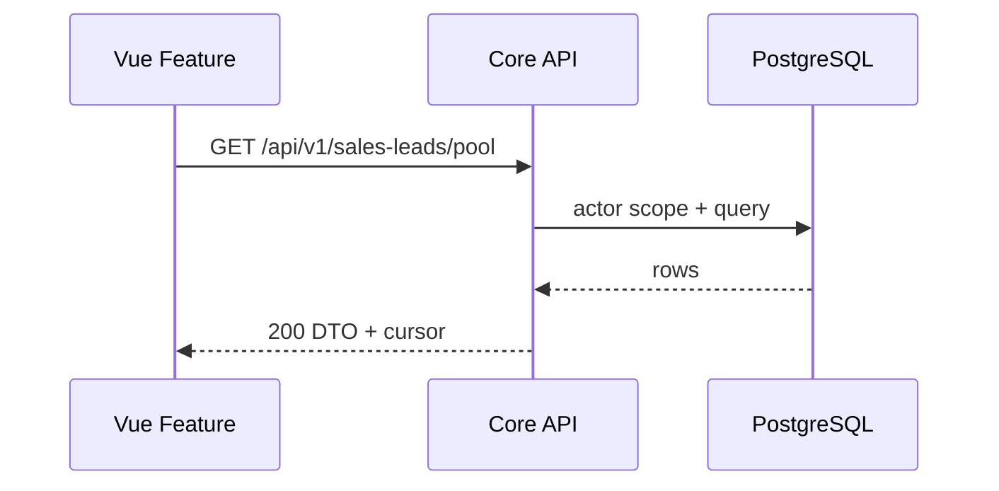
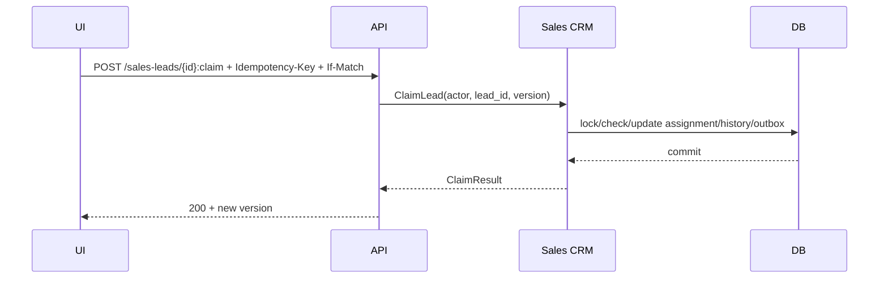
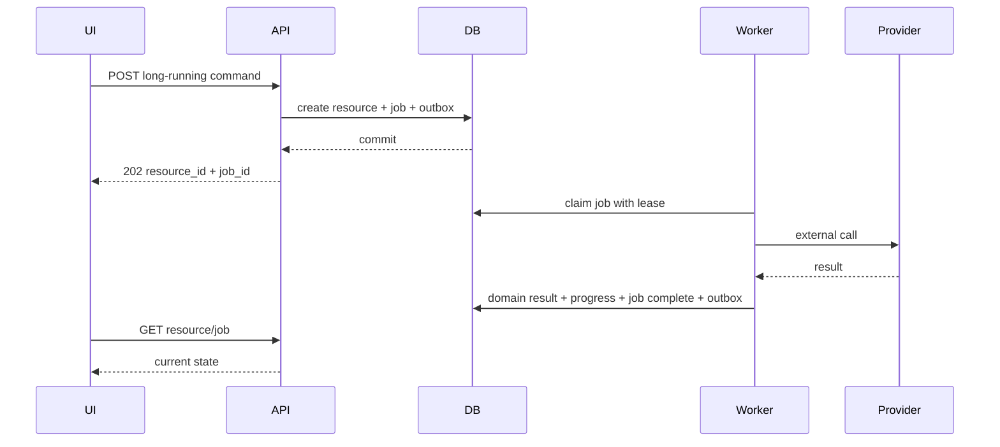
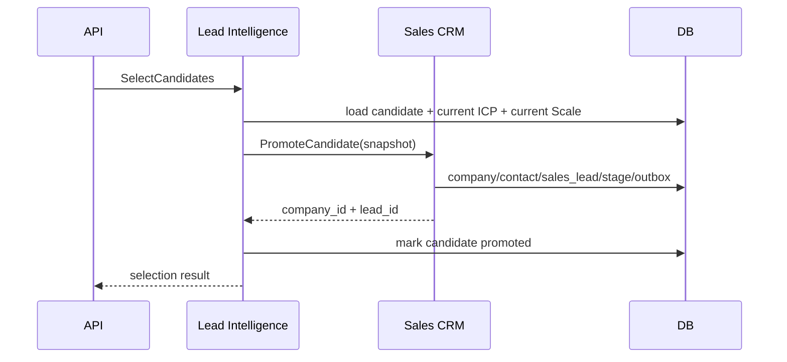

# 02 - 前后端分离设计

> 版本：v3.6
> 配套：`01-架构总览.md`、`03-DDD领域驱动设计.md`、`04-数据模型设计.md`、`05-API接口契约.md`
> v3.6：账号角色改为 Sales/Strategic；当前 Strategic 面板仅包含账号列表和直接离职回池；Apollo 作为对话搜索内部 Provider
> v3.5：Sales Management 前端特性与跨模块依赖转 Deferred；其余沿 v3.4

---

## 1. 设计结论

前端、Core API 和 Worker 是三个独立运行边界：

| 维度 | Web SPA | Core API | Worker Runtime |
|---|---|---|---|
| 工程路径 | `apps/web/` | `apps/api/` | `apps/worker/` |
| 技术 | Vue 3 + TypeScript + Vite | FastAPI + Application/Domain/Infrastructure | 同一后端代码库的 Job Handler |
| 构建 | 静态 `dist/` | Python 包/容器 | Python 包/容器 |
| 对外端口 | 由 Nginx 提供 | `/api/v1`、Webhook | 无公网端口 |
| 职责 | 页面、交互、表单和展示 | 鉴权、业务规则、事务、查询 | 搜索、LLM、邮件、ASR、媒体处理 |
| 数据 | 不保存业务事实 | PostgreSQL | PostgreSQL + Media Storage |
| 配置 | API Base、版本、UI Feature Flag | DB、Secret、Policy、Provider | Queue、Provider、并发、Lease |

前端和后端是否分离，以构建、部署、契约和职责为准，不以仓库数量为准。

---

## 2. 通信模型

### 2.1 同步查询

用于：

- 当前用户；
- 列表和详情；
- Sales Lead Pool；
- Company/Contact；
- Report/Email/Meeting/Task；
- Dashboard Read Model。



### 2.2 同步业务命令

用于纯数据库短事务：

- Candidate Select；
- Claim；
- Assign；
- Release；
- Transfer；
- Strategic Depart Sales；
- First Touch；
- Change Stage；
- Accept/Reject Suggestion；
- Task Complete。



业务命令必须由一个后端 Use Case 完成，前端不得组合多个接口模拟一个事务。

Strategic 离职同样是同步短事务：API 调 IAM `DepartSales`，IAM 在共享 UoW 内通过 Sales CRM `SalesDeparturePort` 结束 Assignment 并让 Lead 回原池。前端只提交一次命令，不循环调用 Release，也不创建审批或 Handover Job。

### 2.3 异步长任务

用于：

- 对话搜索；
- 候选重新富化；
- 四维 ICP 重评；
- 客户规模重评；
- 客户分析报告；
- 邮件草稿生成；
- 邮件发送；
- 会议处理。



对话搜索 Worker 可在一次 Run 中调用 Web Search、Apollo 等多个内部 Provider；每次调用写独立 Provider Execution。前端不展示 Provider 选择器，只读取运行状态和脱敏执行摘要。

### 2.4 进度通信

对话搜索和长分析优先使用 SSE：

```text
GET /api/v1/jobs/{job_id}/events
Accept: text/event-stream
Last-Event-ID: 42
```

事件来自持久化 `job_progress_event`，支持：

- 页面刷新后续接；
- 网络断开重连；
- 审查执行步骤；
- 用户可理解的进度和错误。

HTTP Polling 是降级方案，不使用 WebSocket 作为首选。

---

## 3. 前端职责与禁止事项

### 3.1 前端负责

- 页面路由；
- 表单校验和输入体验；
- Loading/Empty/Error/Ready；
- SSE 进度展示；
- 409 冲突提示和刷新；
- Job 状态展示；
- 生成 Idempotency-Key；
- 携带 `If-Match`；
- 对后端 DTO 做展示层适配；
- Sales/Strategic 视角导航。

### 3.2 前端禁止

| 禁止行为 | 原因 |
|---|---|
| 浏览器直接调用 Agent/Worker/Provider 端口 | 绕过鉴权、审计和配额 |
| 请求体传可信 `user_id/role/owner` | Actor 必须来自 Session |
| 根据 ICP 分数计算 A/B/C/D | Grade 由后端评分规则决定 |
| 根据 ICP 分数计算 MA/SA/A | Sales Tier 来自 Customer Scale |
| 根据 Region 硬编码负责人 | Assignment 由后端 Command 创建 |
| 静态保存可领取池 | Sales Lead Pool 是后端事实 |
| 生成 `claim_*` 临时 ID | 必须使用正式 UUID |
| 乐观 UI 宣称 Claim/Send 成功 | 可能发生并发或 Provider 不确定 |
| 使用公司名称关联报告/邮件/会议 | 必须使用 `company_id` |
| 失败后展示静态“成功报告” | 会掩盖真实错误 |
| localStorage 保存密码或长期 Token | 安全风险 |
| 按钮置灰代替授权 | 后端仍必须校验 |

---

## 4. 前端工程结构

### 4.1 技术选择

基于当前已有 `.vue` 文件，统一采用：

- Vue 3；
- TypeScript；
- Vite；
- Vue Router；
- Pinia 仅保存 Session 摘要和必要 UI 状态；
- 统一 API Client；
- 统一 SSE Client。

不同时维护 React、Vue、原生巨型 HTML 三套正式前端。

### 4.2 目录

```text
apps/web/
  src/
    app/
      router/
      layouts/
      providers/
    features/
      auth/
      lead-search/
      lead-candidate/
      sales-lead-pool/
      assignment/
      customer-analysis/
      email/
      meeting/
      task/
      dashboards/
      # sales-management/  —— Deferred（销售管理暂不做，见 01 §6.8；启用前不创建目录与菜单）
    entities/
      user/
      candidate/
      company/
      contact/
      sales-lead/
      assignment/
      report/
      email/
      meeting/
      task/
      job/
    shared/
      api/
        client.ts
        errors.ts
        idempotency.ts
        sse.ts
      components/
      composables/
      types/
      utils/
```

### 4.3 页面与后端资源映射

| 页面 | 主要资源 |
|---|---|
| Lead Search | Search Run、Job Progress、Candidate |
| Lead Analysis | Candidate、Evidence、ICP、Scale |
| Allocation Pool | Strategic：`GET /sales-leads`；Sales：`GET /sales-leads/pool`；Assignment Commands |
| My Customers | Sales Lead、Company、Pipeline |
| Customer Analysis | Profile、MEDDPICC、Report、Suggestion |
| Customer Operation | Email、Meeting、Task、Activity |
| Strategic Account Management | 当前账号列表、Sales 当前归属数量、直接离职回池按钮 |
| Full Sales Management（Deferred） | 等级调整、离职申请审批、复杂交接待办、池子健康度 |
| Sales Workspace | Read Model |
| Strategic Dashboard | Read Model |

页面名不能反向决定数据库表名。前端“客户分配列表”实际读取 `sales_lead`，不是读取 Candidate。

### 4.4 前端状态模型

每个异步资源至少包含：

```typescript
type RemoteState<T> =
  | { status: 'idle' }
  | { status: 'loading' }
  | { status: 'ready'; data: T }
  | { status: 'empty' }
  | { status: 'forbidden'; message: string }
  | { status: 'conflict'; message: string }
  | { status: 'error'; code: string; message: string }
```

写命令返回成功后，用后端响应更新缓存；不预先修改 owner、status 或 stage。

### 4.5 API Client

```typescript
type ApiError = {
  code: string
  message: string
  details?: Record<string, unknown>
}

async function api<T>(
  path: string,
  options: RequestInit & { expectedVersion?: number } = {},
): Promise<T> {
  const headers = new Headers(options.headers)
  headers.set('Accept', 'application/json')

  if (options.body && !(options.body instanceof FormData)) {
    headers.set('Content-Type', 'application/json')
  }
  if (options.expectedVersion !== undefined) {
    headers.set('If-Match', `"${options.expectedVersion}"`)
  }

  const response = await fetch(`${API_BASE}${path}`, {
    ...options,
    headers,
    credentials: 'include',
  })

  if (!response.ok) {
    throw await mapApiError(response)
  }
  return response.status === 204 ? (undefined as T) : response.json()
}
```

Idempotency-Key 由具体 Feature Command 生成，不机械地给所有 GET 或无副作用请求添加。

---

## 5. 后端工程结构

### 5.1 目录

```text
apps/api/
  src/ltc/
    main.py
    modules/
      iam/
        interfaces/
        application/
        domain/
        infrastructure/
      lead_intelligence/
        interfaces/
        application/
        domain/
        infrastructure/
      sales_crm/
        interfaces/
        application/
        domain/
        infrastructure/
      customer_analysis/
        interfaces/
        application/
        domain/
        infrastructure/
      customer_operation/
        interfaces/
        application/
        domain/
        infrastructure/
      read_models/
        interfaces/
        queries/
    platform/
      db/
      auth/
      jobs/
      events/
      idempotency/
      media/
      providers/
      observability/
```

### 5.2 四层职责

| 层 | 内容 | 禁止 |
|---|---|---|
| Interfaces | FastAPI Route、Request/Response Schema、HTTP 映射 | SQL、领域判断 |
| Application | Command、Query、Use Case、UoW、Port、DTO | Provider SDK 细节 |
| Domain | Entity、Value Object、State Machine、Policy、Event | FastAPI、SQLAlchemy、HTTP |
| Infrastructure | Repository、ORM、Provider Adapter、Storage | 跨模块业务规则 |

### 5.3 依赖方向

```text
interfaces → application → domain
infrastructure ─implements→ application/domain ports
composition root → all
```

规则：

- Domain 不 import FastAPI、SQLAlchemy、Provider SDK；
- Repository 不自行 commit；
- Application 管理事务；
- 模块只从其他模块的 `application/public.py` 获取公开 Port；
- 不 import 其他模块的 ORM、Repository 和 Infrastructure；
- Worker Handler 调 Application Use Case，不调 FastAPI Route。

---

## 6. 模块依赖

### 6.1 允许依赖

| 调用方 | 允许依赖 |
|---|---|
| 所有业务模块 | Task Runtime 的 Job/Outbox/Idempotency/Audit/Media Port |
| Sales CRM | IAM 的 Actor/Sales Eligibility；Lead Intelligence 的 Candidate/ICP/Scale Snapshot |
| IAM Application | Sales CRM 的 `SalesDeparturePort`，仅用于 Strategic Depart 的共享 UoW |
| Customer Analysis | Sales CRM 的 Company/Lead Access；Lead Intelligence 的 ICP/Scale Read Port；Customer Operation 的 Activity Snapshot |
| Customer Operation | Sales CRM 的 Company/Contact/Lead Access；Customer Analysis 的 Report Read Port |
| Read Models | 所有模块的只读 Query |

完整销售管理的 Roster History/Handover Port 继续 Deferred；当前只建立最小 `SalesDeparturePort`，不得扩展为等级调整或审批流程。

### 6.2 禁止依赖

- Lead Intelligence 直接写 Company、Sales Lead 或 Assignment；
- Sales CRM 修改 Evidence、ICP 或 Scale；
- Customer Analysis 重新计算六维 ICP；
- Customer Analysis 直接写 Sales Lead Stage；
- Customer Operation 复制 Company/Contact 主数据；
- Customer Operation 直接写 Profile/MEDDPICC；
- Read Models 写业务表；
- Platform 决定谁可 Claim、谁可发邮件；
- 模块间 HTTP 互调；
- Provider 调用发生在持有数据库锁的事务中。

### 6.3 候选入池的模块协作



对单个 Candidate，建议由 Application Coordinator 共享一个 UoW，保证 Candidate 状态和 CRM 入池结果原子提交；Coordinator 只依赖公开 Port，不越过模块直接操作表。

批量 Selection 不是一个覆盖所有 Candidate 的大事务：

```text
Batch Request
  → item 1: 独立 UoW + 独立 commit
  → item 2: 独立 UoW + 独立 commit
  → ...
  → API 聚合 succeeded/failed
```

每个 Item 必须携带 `candidate_id + expected_version`。服务端为整批保存 Batch Parent Request Hash，并为每个 Item 保存与 Promotion UoW 同事务提交的 Checkpoint。进程中断后，客户端用同一 Idempotency-Key 和完全相同的请求体重试；服务端取得批次 Advisory Lock 后只续跑未完成 Item，不能只依靠 Candidate Promotion 唯一映射猜测原批次结果。Batch Transfer 使用同一模式。

`override=true` 时 `override_reason` 必填并持久化到 Candidate Promotion 字段。

---

## 7. 认证和授权

### 7.1 Session

- HttpOnly、Secure、SameSite Cookie；
- Refresh Token 只保存 Hash；
- Access Token 短时有效；
- `token_version` 使旧 Session 失效；
- Logout 撤销 Session；
- 不存在/不可见资源统一返回 404。

### 7.2 Actor Context

```python
@dataclass(frozen=True)
class ActorContext:
    user_id: UUID
    account_type: Literal["sales", "strategic"]
    sales_tier: Literal["MA", "SA", "A"] | None
    region_code: str | None
```

容量不是 Actor Token 中可信的动态事实。Claim 时必须从数据库计算当前 active Assignment 数。

### 7.3 授权位置

| 动作 | 校验模块 |
|---|---|
| Candidate Select | Lead Intelligence + Strategic capability |
| Depart Sales | IAM Strategic capability + Sales CRM `SalesDeparturePort` |
| Claim/Assign/Release/Transfer | Sales CRM |
| Company/Contact Update | Sales CRM |
| Report Generate/View | Customer Analysis + Sales CRM Access Port |
| Email Send | Customer Operation + Sales CRM Access Port |
| Meeting View/Delete | Customer Operation + Sales CRM Access Port |

当前 Claim/Assign/Transfer 的目标 Sales 必须同时匹配 Lead 的 Region、Tier、active 状态和 Capacity；前端不展示跨 Region/Tier 或超 Capacity Override，`region_unknown` Lead 不进入 Sales Pool。

---

## 8. 给前端和后端开发 Agent 的约束

每个开发任务必须说明：

1. 所属模块；
2. 拥有的表；
3. 输入 API/Command；
4. 输出 Event；
5. 状态机；
6. 并发和幂等；
7. 错误码；
8. 当前可复用代码；
9. 必须删除的遗留；
10. 禁止依赖；
11. 单元、集成和契约测试。

如果开发 Agent 提议：

- 新建独立微服务；
- 直接共享 ORM；
- 用公司名称关联；
- 把业务状态放前端；
- 再建一套 ICP；
- 用通用 JSON 代替所有稳定字段；

必须先返回架构评审，不得直接实现。
