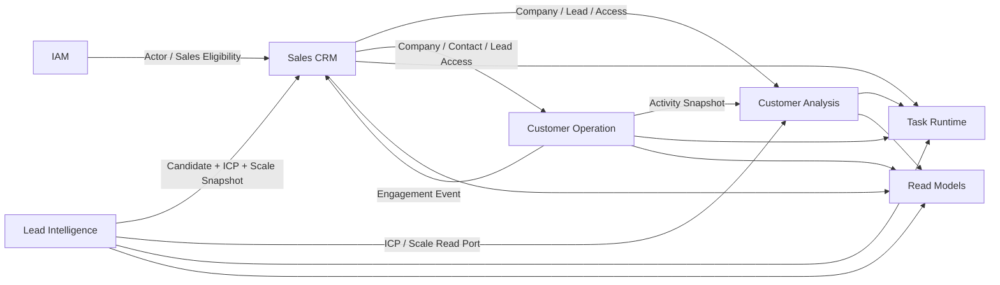

# 03 - DDD 领域驱动设计

> 版本：v3.6
> 方法：轻量 DDD + Ports and Adapters + CQRS-lite
> 不采用：业务微服务、Event Sourcing、通用动态 RBAC、跨模块 ORM 共享
> v3.6：Sales/Strategic 两类账号；Strategic 直接离职回原池进入当前范围；Disable 不再释放客户；S4/S5 与完整销售管理继续 Deferred；对话搜索增加 Provider Execution 边界
> v3.5：销售管理（§6.12/§6.13）转 Deferred；动态意向加分重写为 Sales Lead 落点；新增 §6.16 手动记录提取目录、§6.17 分配规则矩阵与 SLA、§6.18 自动释放；IAM 增加登录锁定与区域参考数据

---

## 1. 设计方法

DDD 在本项目中的用途是：

1. 固定业务语言；
2. 明确每类数据的唯一写者；
3. 明确同步事务和异步事件边界；
4. 阻止多个 Agent 各自创建一套 Customer、ICP 和 Pipeline；
5. 让开发人员和开发 Agent 能在同一业务模型下并行工作。

DDD 不意味着：

- 每张表都建一个 Aggregate；
- 每个模块都拆成服务；
- 所有对象都包装成复杂 Value Object；
- 所有跨模块协作都异步；
- 所有字段都放 JSON。

---

## 2. 模块边界

### 2.1 IAM

| 维度 | 设计 |
|---|---|
| 类型 | Supporting Module |
| 核心语言 | User Account、Session、Account Type、Sales Tier、Region、Capacity、Login Lockout、Departure、Region Country Reference |
| 拥有数据 | `user_account`、`auth_session`、`ref_region_country` |
| 不变量 | 账号只有 Sales/Strategic；Sales 必须有 Tier、Region 和正容量；Strategic 不参与 Sales 自助 Claim；Disabled/Locked/Departed 用户不能建立 Session；只有 Strategic 可执行 Depart；连续 5 次密码失败锁定 30 分钟 |
| 对外 Port | `CurrentActorPort`、`SalesUserReadPort`、`SalesEligibilityPort`、`SalesDeparturePort`、`RegionCountryReadPort` |
| Non-goals | 通用动态 RBAC、业务 Assignment、客户可见性主数据 |

权限矩阵采用代码和测试维护。只有实际出现自定义角色需求时，才增加 Role/UserRole 表。

`DisableUser` 在 IAM 本地事务中更新 User、撤销该用户全部 Session 并发布 `iam.user_disabled.v1`；该事件只表达登录安全状态变化，不结束 Assignment、不清空 Task Assignee、不取消业务 Job，也不释放客户。

当前 `DepartSales` 由 IAM Application Service 授权和锁定 User，并在同一 Unit of Work 通过 `SalesDeparturePort` 让 Sales CRM 结束 Assignment、释放 Lead；两个模块仍只写各自拥有的表。`sales_tier_history`、`handover_request`、晋升、离职申请审批、交接待办与 SLA 继续 Deferred（见 §6.12/§6.13 和 `04-数据模型设计.md` §16.2）。

### 2.2 Lead Intelligence

| 维度 | 设计 |
|---|---|
| 类型 | Core Module |
| 核心语言 | Search Run、Provider Execution、Evidence、Observation、Candidate、Candidate Contact、Enrichment、**Scene-based ICP Assessment**、Scale Assessment、**Negative Filtering**、Selection |
| 拥有数据 | `lead_search_run`、`search_provider_execution`、`search_evidence`、`lead_candidate`、`candidate_observation`、`candidate_evidence`、`candidate_contact`、`lead_enrichment_run`、`enrichment_evidence`、`lead_icp_assessment`、`customer_scale_assessment`、`lead_negative_filter_result` |
| 不变量 | 对话搜索是唯一用户入口；一次 Run 可调用 Web Search/Apollo 等多个内部 Provider 且每次调用独立落 Provider Execution；Candidate 跨 Run 全局去重；Evidence/Candidate 多对多；每 Candidate 只有一条 current ICP 和 Scale；每条 ICP 固化 rule_snapshot/checksum；当前 ICP 仅支持 S1:40/30/20/10 与 S2/S3:35/25/25/15；S4/S5 Deferred；负向过滤先于 ICP 评分；仅 ICP≥60 且硬门槛≠0 进入主分配流程；Scale 允许 unknown（证据不足） |
| 对外 Port | `CandidateReadPort`、`CandidateSelectionPort`、`LeadIcpReadPort`、`CustomerScaleReadPort`、`NegativeFilterPort` |
| Non-goals | Company owner、Assignment、Pipeline、Customer Report、Email |

#### Candidate 不是 Company

Candidate 是未进入正式销售主链的候选。Strategic 执行 Selection 后，Sales CRM 创建或复用 Company 和 Sales Lead。

#### Observation 不是 Evidence

```text
Search Evidence
  Provider 返回的可追溯事实

Provider Execution
  一次 Web Search/Apollo 调用的请求 Hash、状态、成本、延迟、外部请求 ID 和错误

Candidate Observation
  模型从一组 Evidence 中抽取出的公司/联系人快照

Lead Candidate
  多次 Observation 合并后的全局候选身份
```

### 2.3 Sales CRM

| 维度 | 设计 |
|---|---|
| 类型 | Core Module |
| 核心语言 | Company、Contact、Sales Lead、Pool、Assignment、Claim、Assign、Release、Transfer、Pipeline、**Dynamic Intent Bonus、A4 Upgrade、Auto Release** |
| 拥有数据 | `company`、`contact`、`sales_lead`、`lead_assignment`、`lead_stage_transition` |
| 不变量 | 候选入池先于 Claim；Claim 不创建 Company；每 Sales Lead 最多一条 active Assignment；每 Company 最多一个未关闭 Sales Lead；动态意向加分累计在 Sales Lead 上，A4 升级保持原 owner；3 个工作日未首触达的已领取 Lead 自动释放回池 |
| 对外 Port | `CompanyReadPort`、`ContactReadPort`、`SalesLeadAccessPort`、`ClaimCommandPort`、`PipelineCommandPort` |
| Non-goals | 搜索、四维评分、客户报告、邮件和会议处理 |

#### Company 和 Sales Lead 分离

Company 是企业主数据，可以跨多个销售周期长期存在。

Sales Lead 表示一次可被分配和推进的销售周期：

```text
Company A
  ├─ Sales Lead 1 → lost
  └─ Sales Lead 2 → new opportunity → won
```

因此 Assignment 和 Pipeline 都挂在 `sales_lead`，不直接挂 Company。

### 2.4 Customer Analysis

| 维度 | 设计 |
|---|---|
| 类型 | Core Module |
| 核心语言 | Customer Profile、MEDDPICC、Analysis Run、Report、Sales Guide、Suggestion |
| 拥有数据 | `customer_profile`、`customer_meddpicc_dimension`、`analysis_run`、`analysis_report`、`analysis_suggestion` |
| 不变量 | 只读取四维 ICP；报告不可变；相同输入防重；AI 不静默覆盖人工字段 |
| 对外 Port | `AnalysisRequestPort`、`ReportReadPort`、`AnalysisSuggestionCommandPort` |
| Non-goals | 六维 ICP、Assignment、Pipeline 写入、Email Send |

分析输入：

```text
Company Snapshot
+ Sales Lead Snapshot
+ Sales Lead Adopted Four-dimensional ICP
+ Sales Lead Adopted Customer Scale
+ Profile
+ MEDDPICC
+ Contacts
+ Engagement Snapshot
```

分析输出：

- 五模块报告；
- Sales Guide；
- Profile/MEDDPICC Suggestion；
- Health/Intention；
- Evidence References。

### 2.5 Customer Operation

| 维度 | 设计 |
|---|---|
| 类型 | Core Module |
| 核心语言 | Email Draft、Delivery、Reply Intent、Suppression、Meeting、Transcript、Task、Activity、**Manual Note、Note Extraction、Field Backfill** |
| 拥有数据 | `email_message`、`email_attachment`、`email_delivery_attempt`、`email_suppression`、`meeting`、`meeting_segment`、`follow_up_task`、`customer_activity`、**`manual_note`** |
| 不变量 | 所有运营事实关联正式 Company/Lead；发送前检查 Suppression；Provider 不确定结果不能盲重试；媒体不能跨客户访问；**手动记录原文不可丢失；AI 提取结果须经销售确认才写入 Profile/MEDDPICC；新旧值冲突时系统不自动判断** |
| 对外 Port | `EngagementActivityReadPort`、`EmailCommandPort`、`MeetingCommandPort`、`TaskCommandPort`、**`ManualNoteCommandPort`、`ManualNoteReadPort`** |
| Non-goals | Company 主数据、ICP、Assignment、Customer Profile 直接写入（**Manual Note 只通过 Customer Analysis Port 写入，不直接操作 Profile 表**） |

Meeting Analysis 是本模块的 Worker 能力：

```text
Upload
→ Video Audio Extraction
→ Normalize
→ Split
→ Parallel ASR
→ Transcript
→ Structured Summary
→ Fallback
→ Segment Persistence
```

### 2.6 Task Runtime

Task Runtime 是支撑能力，不是 Bounded Context。

| 维度 | 设计 |
|---|---|
| 核心语言 | Job、Attempt、Progress、Lease、Outbox、Idempotency、External Event、Audit、Media、Notification |
| 拥有数据 | `job`、`job_attempt`、`job_progress_event`、`outbox_event`、`external_event`、`idempotency_record`、`audit_log`、`media_asset` |
| 不变量 | Lease/Fencing；过期 Worker 不能回写；Progress/Audit 只追加；同一外部事件只处理一次 |
| Non-goals | Claim Eligibility、Email Policy、Pipeline Rule |

通知（提醒原销售、登录锁定告警等）通过 `platform.notify.v1` Job 经 Notification Provider Port（飞书 Webhook / 邮件网关，Config-as-Code 配置）发送；不建通知业务表，发送记录落在 `job_attempt` 与 `audit_log`。

### 2.7 Read Models

Read Models 是查询层，不拥有业务事实。

可提供：

- Sales Workspace；
- Strategic Workspace；
- Lead Funnel；
- Allocation/Capacity/SLA；
- Pipeline Funnel；
- Customer 360；
- Agent/Job Health。

禁止 Read Model 反向更新领域表。

### 2.8 后续扩展：Strategy Planning

“战略指令、季度自动收集、区域目标比例”是已确认的后续能力，但当前不建立新的 Bounded Context、表或 API。

未来优先作为 Lead Intelligence 上层的 Strategy Planning Application Capability：

```text
Strategic Directive
  Strategic 发布的版本化策略

Lead Collection Campaign
  某季度的一次线索收集计划

Campaign Region Quota
  每个区域的目标数量和比例

Strategy Resource Read Model
  实时展示资源量、质量、缺口和完成度
```

未来边界：

- Strategy Planning 只能创建 Search Run/Job，不能直接写 Candidate、Company 或 Assignment；
- Campaign 产生的 Candidate 仍需四维 ICP、Customer Scale 和 Strategic Selection；
- Directive 更新产生新版本，不覆盖历史；
- 已启动 Campaign 的比例调整必须通过 Replan Command；
- Read Model 只读，不作为 Campaign 或资源事实源；
- 区域比例总和必须等于 100%。

---

## 3. Context Map



### 3.1 同步协作

用于必须原子完成的业务动作：

| 调用方 | Command | 被调用模块 |
|---|---|---|
| Lead Intelligence | `PromoteSelectedCandidate` | Sales CRM |
| IAM Application Service | `DepartSales` | Sales CRM `SalesDeparturePort` |
| API | `ClaimSalesLead` | Sales CRM |
| API | `AssignSalesLead` | Sales CRM |
| API | `AcceptAnalysisSuggestion` | Customer Analysis |

候选入池建议由 Application Coordinator 共享一个 UoW：

```text
load Candidate/ICP/Scale
→ CRM create/reuse Company/Contact/Sales Lead
→ Lead Candidate mark promoted
→ Stage Transition + Outbox
→ commit
```

Coordinator 只能调用模块公开 Port，不直接操作另一个模块的 Repository。

### 3.2 异步协作

用于事务提交后的副作用：

- Sales Lead Created 触发可选首份分析；
- Lead Assigned 更新 Read Model；
- Email Reply Intent 落库时由 Customer Operation 同事务创建 Follow-up Task；事件只让 Sales CRM 幂等推进 Pipeline，并触发分析刷新；
- Meeting Summary 落库时由 Customer Operation 同事务创建 Follow-up Task；Meeting Analyzed 事件只触发 Pipeline 和分析刷新；
- Report Generated 刷新 Workspace；
- User Disabled 只刷新账号状态 Read Model，不取消 Job 或改变业务归属；
- Sales Departed 在事务完成后发送通知和刷新池统计，真正的回池已经在同步事务内完成。

Pipeline 只有两种入口：

1. 用户显式点击 Stage/Won/Lost，由 API 同步调用 Sales CRM Command；
2. Email/Meeting 等自动运营事实通过 Outbox Event，由 Sales CRM Consumer 调用同一个 Pipeline Command。

Customer Operation 不得针对同一个 Email/Meeting 既同步调用 CRM 又发布会推进 Stage 的事件。

---

## 4. Aggregate 和事务边界

不是每张表都是 Aggregate，也不把 Company 的所有联系人、邮件、会议和报告一次加载。

| Aggregate Root | 主要不变量 | 事务范围 |
|---|---|---|
| `UserAccount` | Account Type/Tier/Region/Capacity 组合合法；Depart 只允许 Strategic 操作尚未离职的 Sales（active/disabled） | 用户、Session、Disable、Depart 协调命令 |
| `LeadSearchRun` | 状态合法；统计只由 Pipeline 更新；一对多 Provider Execution 只追加 | 创建、取消、Provider 调用、完成 |
| `LeadCandidate` | 全局身份、状态、当前评估唯一 | Observation 合并、评分、Selection |
| `SalesLead` | Allocation/Pipeline 合法；当前 owner 与 active Assignment 一致；Depart 回池不重算池快照 | 入池、Claim、Release、Depart、Stage |
| `LeadAssignment` | 每 Lead 一条 active；Transfer 无无主窗口 | Claim/Assign/Release/Transfer/Depart |
| `CustomerProfile` | 人工版本和 Suggestion 应用 | Profile Patch |
| `CustomerMeddpiccDimension` | 单维更新、证据和版本 | MEDDPICC Patch |
| `AnalysisRun` | Input Hash 防重；引用固定快照 | 创建 Run、发布 Report |
| `AnalysisReport` | 内容不可变；每类型一条 current | 发布新版本 |
| `EmailMessage` | 状态、审批、Suppression、发送幂等 | Draft/Edit/Approve/Queue |
| `Meeting` | 媒体归属、状态、Transcript/Segment 一致 | Upload/Process/Retry/Cancel/Delete |
| `FollowUpTask` | 来源幂等、完成时间一致 | Create/Complete/Cancel |
| `Job` | Lease/Fencing；Attempt 追加 | Claim/Renew/Complete/Fail |

Company 是主数据实体，但不作为“加载所有客户相关数据”的大聚合。

---

## 5. 领域值对象

只为稳定不变量建值对象：

```python
UserId = UUID
CandidateId = UUID
CompanyId = UUID
ContactId = UUID
SalesLeadId = UUID
AssignmentId = UUID
JobId = UUID

class RegionCode:
    value: Literal["NA", "EA", "SEA", "EU", "ME", "OTHER"]

class SalesTier:
    value: Literal["MA", "SA", "A"]

class SceneCode:
    # 当前运行时只接受 S1-S3；S4/S5 整体 Deferred
    # industry_code（TMC/TRAVEL_OTA/...）是企业行业属性，由 ACL 映射到 SceneCode，两者不混用
    value: Literal["S1", "S2", "S3"]

class IcpScores:
    # 各维上限随 scene_code 变化：
    # S1: 40/30/20/10；S2/S3: 35/25/25/15
    # 不按 S1 硬编码固定上限
    d1: Decimal
    d2: Decimal
    d3: Decimal
    d4: Decimal

class ScaleScores:
    d1: Decimal  # 0..40
    d2: Decimal  # 0..35
    d3: Decimal  # 0..25

class DomainName:
    raw: str
    normalized: str

class EmailAddress:
    raw: str
    normalized: str

class IdempotencyKey:
    scope: str
    actor_id: UUID
    key: str
    request_hash: str

class ResourceVersion:
    value: int

class ProviderReference:
    provider: str
    provider_request_id: str | None
    provider_message_id: str | None
```

Region 归一化由 Anti-Corruption Layer 执行。`Japan`、`Tokyo`、`South Korea` 等 Provider 输入不能直接成为正式 `region_code`。

---

## 6. Domain Policy

### 6.0 Dialogue Search Provider Policy

对话搜索是唯一用户入口，不等于只使用一个外部数据源。客户端只提交 Query、场景和目标数量，不得选择或伪造 `provider_code`；服务端按版本化 `orchestration_profile` 决定调用 Web Search、Apollo 及未来 Provider。

每次外部调用都创建一条 `search_provider_execution`：调用前短事务写 `running`，外呼在事务外执行，完成后短事务写终态、结果数量、延迟、成本、外部请求 ID、脱敏错误和 Evidence。Retry 创建新 Execution 并通过 `retry_of_provider_execution_id` 关联，不覆盖历史。

同一 Search Run 可以串行或并行执行多个 Provider。某个 Provider 失败而其他 Provider 已产生有效 Evidence 时 Run 可为 `partial`；全部失败才进入 failed。Apollo 只作为内部 Provider Adapter，不暴露独立 API、页面或线索入口。

### 6.1 Candidate Identity Policy

输入：

- Normalized Domain；
- Legal Name；
- Normalized Name；
- Country；
- Provider External ID；
- Existing Candidates。

优先级：

1. Domain 精确匹配；
2. Legal Name + Country；
3. Normalized Name + Country；
4. 低置信度相似匹配进入人工 Merge Review。

禁止只按 `company_name` 自动合并。

人工 Merge：

```text
source Candidate
  → status=merged
  → merged_into_candidate_id=target Candidate
  → 保留原 Observation/Evidence/Assessment 历史

target Candidate
  → 查询时聚合 source 的 Evidence/Observation
  → assessments_stale=true
  → 创建新的 Enrichment Run + Job
  → 成功后发布新的 current ICP/Scale
```

Source Candidate 必须未 promoted；Target 必须是未 merged/archived 的 Canonical Candidate，可以已经 promoted。已经分别形成两个 Company 的合并属于独立 CRM 能力，不由 Candidate Merge 处理。

### 6.2 Candidate Eligibility Policy

判断 Candidate 能否进入 `eligible`：

- 当前 ICP 存在；
- 当前 Scale 存在（`effective_tier` 允许 unknown，unknown 时 Select 只能进入数据补全池）；
- `assessments_stale=false`；
- Validation 合法；
- 未 Rejected/Archived/Merged；
- ICP Hard Gate 通过。

Strategic 可人工覆盖 Hard Gate 或低分，但必须提供原因。覆盖不修改原评分，只写 Selection/Scale 的 Decision Source。

### 6.3 Sales Claim Eligibility Policy

输入：

- Actor；
- Sales Lead；
- Required Sales Tier；
- Pool Region；
- Active Assignment Count；
- Capacity；
- Region Access Policy Version。

规则：

- Actor 必须是 Sales；
- Lead 必须 `claimable`；
- Tier 必须匹配；
- Region 必须匹配，当前版本不得关闭 Region Filter；
- `data_completion_pool=region_unknown` 或 `pool_region_code IS NULL` 时禁止 Sales Claim/Assign；
- Active Assignment Count 必须小于 Capacity；
- Version 必须匹配。

Strategic 使用 Assign Command，不通过伪装 Claim 绕过规则。

Transfer / Assign 的补充规则：

- Sales 可将本人 active Assignment 的 Lead 转交给**同 Region、同 Tier** 销售，原因必填；
- Strategic Assign/Batch Transfer 也必须让目标 Sales 与 Lead 的 Region/Tier 匹配，且不能超过 Capacity；
- 当前不提供跨 Region、跨 Tier 或超 Capacity 的 Override；这类资源调度能力随完整销售管理 Deferred。

### 6.4 Company Matching Policy

Candidate 入池时判断：

- 复用现有 Company；
- 创建新 Company；
- 进入人工合并。

`origin_candidate_id` 是来源，不是 Company 的唯一身份约束。多个重复 Candidate 可以归并到同一 Company。

如果复用 Company 且已有未关闭 Sales Lead：

- Candidate 复用该 Sales Lead；
- 保存 `promoted_company_id + promoted_lead_id`；
- 保存本次 Selection 使用的 `selected_icp_assessment_id + selected_scale_assessment_id`；
- 不创建第二个未关闭 Lead；
- 不自动替换该 Lead 已采用的 adopted ICP/Scale；
- Candidate 自身保存 Selection/Override 决策；
- API 返回已有 `lead_id`。

新建 Sales Lead 时，Candidate selected Assessment 与 Lead adopted Assessment 相同；复用开放 Lead 时两者允许不同，从而同时保留“本次选择依据”和“当前销售周期采用依据”。

### 6.5 Pipeline Transition Policy

推荐状态：

```text
new → contacted → engaged → meeting → proposal → won/lost
new/contacted/engaged → dormant
dormant → contacted
非终态 → lost
```

Won/Lost 必须保存结构化 Reason。

### 6.6 Report Publication Policy

- Analysis Run 引用 Sales Lead adopted ICP 和 Scale；
- Input Snapshot 通过 Schema 校验；
- 相同 Input Hash 已有 Running Run 时复用；
- 相同 Input Hash 已有 Report 且非 Force Refresh 时复用；
- 新 Report 发布时 supersede 旧 current Report；
- Report 内容不可 UPDATE。

### 6.7 Analysis Suggestion Policy

AI 报告提出 Profile/MEDDPICC 修改时：

- 创建 Suggestion；
- 保存当前值快照；
- 保存 `target_version_at_creation`；
- 保存建议值和 Evidence；
- 用户 Accept 后在同一事务更新目标字段；
- Reject 后保留审查记录；
- 目标字段版本已变化时返回 409。

### 6.8 Email Send Policy

发送前：

- Actor 对 Sales Lead 有权限；
- Contact 属于 Company；
- Email Address 合法；
- Address 不在 Suppression；
- Email 为可发送状态；
- Expected Version 匹配；
- 相同 Idempotency-Key 内容一致。

Provider 超时后进入 `uncertain/reconcile_required`，不直接重复发送。

Email Message 状态：

```text
Outbound:
  generating → draft → approved → queued → sending
  sending → sent / failed / reconcile_required
  sent → delivered / bounced / replied
  draft/approved/queued → cancelled

Inbound:
  received → processing → processed / failed
```

### 6.9 Media Acceptance Policy

- MIME 和扩展名一致；
- 大小和时长在限制内；
- SHA-256 完成；
- 文件名不参与真实存储路径；
- 上传先进入隔离状态；
- 媒体访问经过 Company/Lead 授权。

### 6.10 Assessment Adoption Policy

系统明确区分两类语义：

```text
Candidate current ICP/Scale
  最新一次研究评估，Refresh 成功后切换

Sales Lead adopted ICP/Scale
  该销售周期入池时采用的资格快照，创建后不可变
```

规则：

- Candidate Refresh 只更新 Candidate current；
- 已发布 ICP/Scale 的业务内容不可原地修改，重评和人工 Override 都创建新版本；
- 已有 Sales Lead 不因后台重评而静默改变销售 Tier、Pool 或分析输入；
- Customer Analysis 使用 Sales Lead adopted Assessment；
- Reuse Open Lead 时继续使用该 Lead 原 adopted Assessment；
- 当前不提供“把新评分覆盖到开放 Lead”的命令；如未来需要，必须单独评审 Requalification、Owner/Tier 冲突和审计；
- **数据补全池 Lead 例外**：`data_completion_pool` 非空的 Sales Lead，在补全完成事务中允许一次性替换 adopted Scale（scale_unknown 补全），或同步修正 Company 的 `region_code/region_mapping_version` 与 Lead 的 `pool_region_code/pool_region_mapping_version`（region_unknown 补全）。区域补齐后若 adopted Scale 已有明确 Tier，则同步修正 `required_sales_tier/allocation_rule_version` 并将 `data_completion_pool` 置 NULL；若 Scale 仍 unknown，则转为对应区域的 `scale_unknown` 池。两条分支都追加 Stage Transition（metadata 记录补全来源 Job）；这是资格修正而非重评覆盖，除此之外 adopted Assessment 不可变；
- 新销售周期创建新 Sales Lead 时，重新采用当时 Candidate current Assessment。

### 6.11 Disabled User Security Policy

`DisableUser` 只处理登录安全：

- IAM 将用户置为 `disabled`、增加 `token_version`、撤销全部 Session，并写 Audit/Outbox；
- `iam.user_disabled.v1` 可供 Read Models 刷新账号状态，但不得驱动 Sales CRM、Customer Operation 或 Task Runtime 修改业务归属；
- 已有 Assignment、Task Assignee 和业务 Job 保持不变；
- 恢复登录只能使用显式 Enable，且 `departed` 用户不能通过 Enable 恢复；
- 需要释放客户时必须由 Strategic 执行 `DepartSales`，不能复用 Disable。

### 6.12 Sales Tier Promotion Policy（v3.3 新增，v3.5 起 Deferred）

> **Deferred**：随销售管理整体转入后续范围，当前不实现（无命令、API、表读写路径）。以下规则作为未来实现基线保留。

晋升不是自动触发，而是管理者在销售管理面板手动操作。

规则：
- `sales_tier_history` 追加新记录（from_tier → to_tier，时间戳，操作人，原因）；
- `user_account.current_tier` 更新为新值，`tier_effective_date` 记录为当前时间；
- 该销售已领取的客户列表和归属关系不受任何影响（旧客户随人走）；
- 该销售此后的资源池视图立刻切换为新等级对应的池子；
- 饱和度上限按新等级计算，但只统计晋升后新分配的客户数量（方案 A）。历史存量客户单独标注，不影响新分配额度；
- 若该销售手上已有的旧客户数量已超过新等级容量上限，不强制转移或释放，仅在其管理面板标注"历史存量（原 XX 等级客户）"。

### 6.13 Sales Departure Policy（v3.6 当前范围）

触发：Strategic 在账号管理面板执行 `DepartSales`。当前不存在离职申请、审批、交接请求或中间状态；`active` 或安全 `disabled` 的 Sales 都可直接进入 `departed`。

事务边界：

1. 校验 Actor 是 Strategic，请求携带 `Idempotency-Key` 与目标 User `expected_version`；
2. 先锁定目标 Sales User，再按 `lead_id` 稳定排序锁定其 active Assignment 和 Sales Lead；Claim/Assign/Transfer 使用同一“User → Lead/Assignment”锁顺序；
3. 再次校验目标为 `active|disabled` Sales 且尚未离职，更新为 `departed`，记录 `departed_at/departed_by/departure_reason`，增加 `token_version` 并撤销 Session；
4. Sales CRM 通过同步 `SalesDeparturePort` 结束全部 active Assignment，写 `reason_code=sales_departed`；
5. 对应 Lead 清空 owner、回到 `claimable`，保留 `required_sales_tier/pool_region_code/pool_region_mapping_version/allocation_rule_version`，不得重新计算池；
6. 每个 Lead 追加 Release/Stage 历史和 `crm.lead_released.v1`，事务最后追加 `iam.sales_departed.v1` 与 Audit；
7. User、Session、Assignment、Lead、Audit、Outbox 任一步失败时全部回滚，外部通知只在提交后由 Outbox 触发。

幂等重放返回首次成功结果；目标已 departed 且 Idempotency-Key 不同返回 `USER_ALREADY_DEPARTED`。`departed` 是当前终态，返聘不在当前范围。

### 6.14 Negative Filtering Policy（新增 v3.3）

在 ICP 评分之前，对 Candidate 执行负向过滤：

| 规则 | 条件 | 结果 |
|------|------|:--:|
| X1 | 完全无出境/跨境/旅行/海外用户场景 | 排除 |
| X2 | 只有国内本地业务，且无旅行增值服务 | 排除 |
| X3 | 客户/用户规模过小，且无明确意向 | 暂存 D |
| X4 | 无官网、无联系人、无有效触达方式 | 暂存 D |
| X5 | 与 eSIM 分发、权益、旅行服务完全无关 | 排除 |
| X6 | 已明确拒绝且 6 个月内无新变化 | 暂存 D |

过滤在 `lead_search_run` Pipeline 中执行，每次结果追加写入 `lead_negative_filter_result`（表定义见 `04-数据模型设计.md` §6.11）。规则码到结果的映射固定：X1/X2/X5=排除（X），X3/X4/X6=暂存（D）。`lead_candidate.negative_filter_result` 只保存最近一次结论：`none`（通过）或命中的规则码 `X1-X6`；不存在"D1-D6"取值。

命中排除（X）的 Candidate 不进入 ICP 评分；命中暂存（D）的保留记录，X4 进入补数据队列，X6 按季度复查。

### 6.15 Dynamic Intent Bonus Policy（v3.5 重写）

触达发生在分配之后，动态加分累计在 **Sales Lead** 上（`sales_lead.dynamic_bonus_points`），动态总分 = `min(100, adopted ICP 静态总分 + 累计加分)`。

行为、加分与数据源：

| 行为 ID | 行为 | 加分 | 数据源 |
|:--:|------|:--:|------|
| I1 | 打开邮件或点击链接 | +2 | 邮件 Provider Webhook（`external_event`：opened/clicked），每封邮件只计一次 |
| I2 | 回复邮件但只做普通询问 | +5 | 回复意图 `intent_level=product_question` |
| I3 | 明确询问覆盖国家、套餐、价格、分成、API、合作模式 | +8 | `intent_level=pricing`（价格/分成/合作模式类询问） |
| I4 | 愿意开会、要求方案、转给负责人 | +10 | `intent_level=interested`，或 Meeting Summary 出现明确合作信号 |

规则：

- `intent_level` 到 I2-I4 的映射由 Config-as-Code 维护并记录 `rule_version`；映射不确定时取较低档；
- 幂等：同一 Email 的同一档加分只计一次（幂等键 = `email_id + bonus_type`），I1 打开与点击合计每封邮件最多 +2；
- 加分由 Sales CRM 的 `ApplyDynamicIntentBonus` 在消费 engagement 事件时执行，不是 Lead Intelligence 的职责。

A4 升级：静态 B 级（60-79）Lead 动态总分 ≥80 时：

- `sales_lead.a_segment` 置为 `A4`，保持原 owner，不重新分配；
- 发布 `crm.dynamic_intent_bonus_applied.v1`，Customer Analysis 消费后创建 Analysis Run，Customer Operation 消费后创建跟进 Task（立即创建，不是延迟 24 小时的定时任务）；
- A4 只升级一次，后续加分不再重复触发 Run/Task。

静态细分：入池时按 adopted ICP 计算 A1-A3 并快照在 `sales_lead.a_segment`（不满足则为空）；Candidate 侧不落库，仅按当前 ICP 派生展示。细分条件（与 ICP 维护表一致）：A1=总分≥85 且规模维度≥80%权重，或年国际订单≥10 万/企业客户≥500/月活≥100 万；A2=总分≥80 且跨境场景维度≥80%权重且增值服务/数据触达维度≥80%权重；A3=总分≥75 且技术接入维度≥80%权重；A4 见上。

### 6.16 Manual Note 提取目标目录与批量确认（新增 v3.5）

LLM 提取的目标点位目录为 Config-as-Code（`manual_note_extraction_catalog`，带版本号）。当前工作目录 v1（PRD 的"四大维度 17 个信息点"清单未随附，以下为按现有 Schema 重建的 v1 映射，PM 确认后修订）：

| 组 | 点位 | 写入目标 |
|---|---|---|
| D1 公司与业务 | company_type / business_model / employee_scale / region_text | `customer_profile` 同名列 |
| D2 场景与方案 | esim_scenario / coverage / estimated_usage / integration / compliance | `customer_profile` 同名列 |
| D3 商务与决策 | budget_text / decision_maker_text / decision_maker_contact_id / decision_cycle_text | `customer_profile` 同名列 |
| D4 MEDDPICC 高频维 | metrics / economic_buyer / decision_process / identify_pain | `customer_meddpicc_dimension` 对应维度 |

规则：

- 点位此前为空 → action=new，直接随批量确认写入；
- 提取值与原值一致 → 静默忽略，不进入确认卡片；
- 提取值与原值冲突 → 确认卡片中给出"覆盖/保留原值"选择，**默认整批采纳提取值（批量确认）**，销售可展开逐条调整或编辑值后一次提交；
- 提取时记录每个目标字段的当前 `version`（快照进 `extracted_fields_json`）；确认请求携带该版本，目标字段已被他人更新时该项返回 409，不静默覆盖；
- 未识别内容明确标注"未识别"，不强行归类；
- 写入通过 Customer Analysis 的 Port 完成，Manual Note 不直接操作 Profile/MEDDPICC 表。

### 6.17 Allocation Rule & SLA Policy（新增 v3.5）

分配去向由 Config-as-Code 的分配规则矩阵决定（来源：区域国家对照与分配规则表 v5），不建运行时规则表：

- 维度：ICP 档（A：`total≥80`；B：`60≤total<80`）× 体量（大/中/小）× 区域（6 大区）= 36 条规则 + 2 条数据补全规则；
- 去向：`{区域}{MA/SA/A}客户池`；体量 unknown → 对应区域 A 数据补全池；区域 unknown → Sales 不可见的待补全区；
- 首触 SLA：A 档大客户 24h；其余 A 档及 B 档大/中客户 24-48h；小客户 3 个工作日；
- 决策链确认 SLA：A 档大客户 48h、其余 3 个工作日，通过自动创建 `follow_up_task` 表达，不复用 `sales_lead.sla_due_at`；
- 矩阵带版本号（如 `alloc-2026-07-v5`）；Sales Lead 入池时记录 `allocation_rule_version`，SLA 计算按入池时版本执行，规则更新不回溯存量 Lead；
- ICP<60、硬门槛=0、负向过滤命中的不进入分配。

工作日按 Asia/Shanghai 计算（配置项）。数据库只存版本号与计算结果（`sla_due_at`、`required_sales_tier`、`pool_region_code`、`pool_region_mapping_version`、`data_completion_pool`）。

### 6.18 Auto-Release Policy（新增 v3.5）

触发：`allocation_status=claimed` 且 `first_touch_at IS NULL` 且当前 active Assignment 的 `assigned_at` 已超过 3 个工作日。

执行：定时 Job（`crm.auto_release_overdue.v1`，每小时扫描）对每条命中 Lead 在独立短事务中：结束 Assignment（`reason_code=auto_release_no_first_touch`）→ Lead 回 claimable、owner 清空 → 追加 Stage Transition（`event_type=release`、`source_type=system`）→ 写 Outbox → 通过 Notification Port 通知原销售。

幂等与边界：

- 同一 Assignment 只自动释放一次（以 Assignment 终态 + reason_code 去重）；
- 单 Lead 失败不影响批次内其他 Lead；
- 已首触（`first_touch_at` 非空）不自动释放；跟进中 14 天无活动只创建提醒 Task + 通知，不释放；
- T1-T3 时间衰减与销售池降级 Deferred（README 规则源对齐）。

---

## 7. Application Command

| Command | 所属模块 | 关键结果 |
|---|---|---|
| `DisableUser` | IAM | User Disabled + Sessions Revoked + Outbox |
| `DepartSales` | IAM + Sales CRM Coordinator | Sales Departed + Sessions Revoked + active Assignment 原子结束 + Lead 回原池 + Audit/Outbox |
| `CreateLeadSearchRun` | Lead Intelligence | Search Run + Job |
| `CancelLeadSearchRun` | Lead Intelligence | Run Cancelled |
| `RefreshCandidateEnrichment` | Lead Intelligence | Enrichment Job |
| `RetryEnrichmentRun` | Lead Intelligence | 新 Job + Enrichment Run queued |
| `CancelEnrichmentRun` | Lead Intelligence | Enrichment Run/Job Cancelled |
| `MergeLeadCandidates` | Lead Intelligence | Canonical Candidate |
| `SelectLeadCandidates` | Lead + Sales CRM Coordinator | Company/Contact/Sales Lead |
| `ClaimSalesLead` | Sales CRM | Active Assignment |
| `AssignSalesLead` | Sales CRM | Active Assignment |
| `ReleaseSalesLead` | Sales CRM | Lead 回 claimable |
| `TransferSalesLead` | Sales CRM | 新 Assignment，无无主窗口 |
| `BatchTransferSalesLeads` | API Coordinator + Sales CRM | 每项独立 Transfer UoW |
| `RecordFirstTouch` | Sales CRM | first_touch + contacted |
| `ChangePipelineStage` | Sales CRM | Stage Transition |
| `AdvancePipelineFromEvent` | Sales CRM | Event 幂等单调 Stage Transition |
| `MarkSalesLeadWon/MarkSalesLeadLost` | Sales CRM | Terminal Stage + Reason |
| `GenerateAnalysisReport` | Customer Analysis | Analysis Run + Job |
| `RetryAnalysisRun/CancelAnalysisRun` | Customer Analysis | Run + 新 Job/取消当前 Job |
| `AcceptAnalysisSuggestion` | Customer Analysis | Profile/MEDDPICC 更新 |
| `CreateEmailDraft` | Customer Operation | Email + Job |
| `QueueEmailSend` | Customer Operation | Email Send Job |
| `RegisterInboundEmail` | Customer Operation | Inbound Email + Intent |
| `UploadMeeting` | Customer Operation | Media + Meeting + Job |
| `CancelMeetingProcessing` | Customer Operation | Meeting/Job Cancelled |
| `CompleteFollowUpTask` | Customer Operation | Task Completed |
| **`ApplyDynamicIntentBonus`（v3.5 移至 Sales CRM）** | **Sales CRM** | Lead 加分 + A4 升级判断 + Outbox |
| **`ReleaseOverdueLeads`（新增 v3.5）** | **Sales CRM（定时 Job）** | 3 个工作日未首触达的 Lead 自动释放回池 + 通知原销售 |
| `CreateManualNote` | **Customer Operation** | Manual Note + Extraction Job |
| `ConfirmManualNoteExtraction` | **Customer Operation** | 批量确认（可逐条调整/编辑）+ 目标版本校验 + 写入 Profile/MEDDPICC + Outbox |
| `DiscardManualNote` | **Customer Operation** | confirm_status=discarded，原文保留 |

Deferred（完整销售管理，见 §6.12/§6.13）：`ChangeSalesTier`、离职申请/审批、`ProcessHandover`、`CompleteHandover` 当前不实现；当前离职只使用 `DepartSales` 原子回池命令。

命令名称表达业务动作，不使用通用 `PATCH status` 替代 Claim、Release、Won、Lost 等含义明确的动作。

### 7.1 Pipeline Application DTO

用户显式命令：

```text
ChangePipelineStageByUser
  lead_id
  target_stage
  expected_version
  actor_user_id        ← Session
  reason_code
  reason_text?
  occurred_at
  idempotency_key
```

Event 自动推进：

```text
AdvancePipelineFromEvent
  lead_id
  target_stage
  event_id
  source_type          ← email/meeting
  source_resource_id
  occurred_at
  correlation_id
```

二者共享同一个 `PipelineTransitionPolicy`，但并发策略不同：

- 用户命令使用 `expected_version`，冲突返回 409；
- Event Consumer 先按 `lead_id` 锁行并读取当前版本，以 `event_id + consumer_name` 和 Source 唯一键幂等；
- Event 只允许单调前进；已在目标或更后阶段时幂等成功，不因没有客户端版本而绕过领域 Policy；
- 两类命令都必须追加 `lead_stage_transition`，不能直接 UPDATE Stage。

---

## 8. Domain/Integration Event

事件描述已经发生的事实，使用 Outbox 发布。

| Event | Producer | Consumer | 关键 Payload |
|---|---|---|---|
| `lead.candidate_scored.v1` | Lead Intelligence | Read Models | candidate_id, enrichment_run_id, icp_assessment_id, scale_assessment_id, assessed_at |
| `crm.sales_lead_created.v1` | Sales CRM | Analysis/Read Models | company_id, lead_id, candidate_id, icp_assessment_id, scale_assessment_id, created_at |
| `crm.lead_assigned.v1` | Sales CRM | Analysis/Operation/Read Models | company_id, lead_id, assignment_id, assignee_user_id, assigned_by, assignment_type, assigned_at |
| `crm.lead_released.v1` | Sales CRM | Operation/Read Models | company_id, lead_id, assignment_id, released_by, reason_code, reason_text, released_at |
| `crm.lead_transferred.v1` | Sales CRM | Operation/Read Models | company_id, lead_id, previous_assignment_id, new_assignment_id, from_assignee_user_id, to_assignee_user_id, transferred_by, reason_code, transferred_at |
| `crm.pipeline_changed.v1` | Sales CRM | Analysis/Read Models | company_id, lead_id, transition_id, from_stage, to_stage, source_type, source_resource_id, occurred_at |
| `analysis.report_generated.v1` | Customer Analysis | Operation/Read Models | report_id, analysis_run_id, company_id, lead_id, report_type, version_no, generated_at |
| `analysis.suggestion_accepted.v1` | Customer Analysis | Read Models | suggestion_id, report_id, company_id, target_type, target_path, target_version, accepted_at |
| `engagement.email_sent.v1` | Customer Operation | Sales CRM/Analysis | company_id, lead_id, email_id, contact_id, delivery_attempt_id, sent_at |
| `engagement.email_replied.v1` | Customer Operation | Sales CRM/Analysis | company_id, lead_id, email_id, contact_id, intent_level, replied_at |
| `engagement.meeting_analyzed.v1` | Customer Operation | Sales CRM/Analysis | company_id, lead_id?, meeting_id, meeting_version, completed_at |
| `engagement.task_completed.v1` | Customer Operation | Read Models | company_id, lead_id?, task_id, assignee_user_id?, completed_by, completed_at |
| `iam.user_disabled.v1` | IAM | Read Models | user_id, token_version, disabled_at |
| `iam.sales_departed.v1` | IAM + Sales CRM Coordinator | Read Models/Notification | user_id, departed_by, released_lead_count, returned_pools, departed_at |
| **`engagement.email_opened.v1`（新增 v3.5）** | **Customer Operation** | **Sales CRM/Read Models** | **company_id, lead_id?, email_id, contact_id, opened_at** |
| **`engagement.email_clicked.v1`（新增 v3.5）** | **Customer Operation** | **Sales CRM/Read Models** | **company_id, lead_id?, email_id, contact_id, link_url?, clicked_at** |
| **`crm.dynamic_intent_bonus_applied.v1`（新增 v3.5）** | **Sales CRM** | **Analysis/Operation/Read Models** | **company_id, lead_id, bonus_type, bonus_points, new_total, a_segment_upgraded, source_type, source_resource_id, applied_at** |
| **`manual_note.confirmed.v1`（新增 v3.4）** | **Customer Operation** | **Analysis/Read Models** | **note_id, company_id, fields_count, trace_id** |
| **`manual_note.discarded.v1`（新增 v3.4）** | **Customer Operation** | **Read Models** | **note_id, company_id, trace_id** |

Deferred（完整销售管理）：`sales.tier_change.v1`、`sales.handover_completed.v1`、`company.owner_change.v1` 当前不发布、不消费。Strategic 离职使用当前 `iam.sales_departed.v1`，每条回池 Lead 同时复用 `crm.lead_released.v1`（`reason_code=sales_departed`）；定时自动释放使用 `reason_code=auto_release_no_first_touch`。

Envelope：

```json
{
  "event_id": "uuid",
  "event_type": "crm.lead_assigned.v1",
  "schema_version": 1,
  "producer": "sales_crm",
  "aggregate_type": "sales_lead",
  "aggregate_id": "uuid",
  "aggregate_version": 5,
  "occurred_at": "2026-07-16T08:00:00Z",
  "correlation_id": "uuid",
  "causation_id": "uuid",
  "actor": {
    "type": "user",
    "id": "uuid"
  },
  "payload": {}
}
```

### 8.1 关键 Payload Schema

| Event | 字段 | 类型/可空 | 约束 |
|---|---|---|---|
| `lead.candidate_scored.v1` | `candidate_id, enrichment_run_id, icp_assessment_id, scale_assessment_id, assessed_at` | UUID×4 + RFC3339，均非空 | ICP 与 Scale 来自同一 Enrichment Run/Candidate |
| `crm.sales_lead_created.v1` | `company_id, lead_id, candidate_id, icp_assessment_id, scale_assessment_id, created_at` | UUID×5 + RFC3339，均非空 | 只在新建 Sales Lead 时发布；复用开放 Lead 不冒充 created |
| `crm.lead_assigned.v1` | `company_id, lead_id, assignment_id, assignee_user_id, assigned_by, assignment_type, assigned_at` | `assigned_by` 可空，其余非空 | Claim/Assign/Reclaim 共用，`assignment_type` 区分 |
| `crm.lead_released.v1` | `company_id, lead_id, assignment_id, released_by, reason_code, reason_text, released_at` | `released_by/reason_text` 可空；其余非空 | Assignment 已结束，Lead 已回 claimable |
| `crm.lead_transferred.v1` | `company_id, lead_id, previous_assignment_id, new_assignment_id, from_assignee_user_id, to_assignee_user_id, transferred_by, reason_code, transferred_at` | UUID×7 + text + RFC3339，均非空 | 旧、新 Assignment 在同一事务完成 |
| `crm.pipeline_changed.v1` | `company_id, lead_id, transition_id, from_stage, to_stage, source_type, source_resource_id, occurred_at` | `from_stage/source_resource_id` 可空，其余非空 | `transition_id` 全局唯一 |
| `analysis.report_generated.v1` | `report_id, analysis_run_id, company_id, lead_id, report_type, version_no, generated_at` | UUID×4 + text + integer + RFC3339，均非空 | Report 已发布并成为该类型 current |
| `analysis.suggestion_accepted.v1` | `suggestion_id, report_id, company_id, target_type, target_path, target_version, accepted_at` | UUID×3 + text×2 + bigint + RFC3339，均非空 | Target 已按乐观锁成功更新 |
| `engagement.email_sent.v1` | `company_id, lead_id, email_id, contact_id, delivery_attempt_id, sent_at` | UUID×5 + RFC3339，均非空 | 只在 Provider 明确 accepted 后发布 |
| `engagement.email_replied.v1` | `company_id, lead_id, email_id, contact_id, intent_level, replied_at` | UUID×4 + text + RFC3339，均非空 | Intent 处理完成后发布 |
| `engagement.meeting_analyzed.v1` | `company_id, lead_id, meeting_id, meeting_version, completed_at` | `lead_id` 可空；version 为 bigint；其余非空 | 任意无 Lead 的会议只进 Company Timeline/Analysis |
| `engagement.task_completed.v1` | `company_id, lead_id, task_id, assignee_user_id, completed_by, completed_at` | `lead_id/assignee_user_id` 可空；其余非空 | Task 状态已为 completed |
| `iam.user_disabled.v1` | `user_id, token_version, disabled_at` | UUID + integer + RFC3339，均非空 | Session 已由 IAM 撤销；不得改变 Assignment、Task 或业务 Job |
| `iam.sales_departed.v1` | `user_id, departed_by, released_lead_count, returned_pools, departed_at` | UUID×2 + integer + object[] + RFC3339，均非空 | User 已 departed，全部 active Assignment 已结束，Lead 已按原区域×等级回池 |
| `engagement.email_opened.v1` | `company_id, lead_id, email_id, contact_id, opened_at` | `lead_id` 可空，其余非空 | 每封邮件只发布一次；`lead_id` 为空时只进 Timeline，不产生加分 |
| `engagement.email_clicked.v1` | `company_id, lead_id, email_id, contact_id, link_url, clicked_at` | `lead_id/link_url` 可空，其余非空 | 同一邮件同一链接只发布一次 |
| `crm.dynamic_intent_bonus_applied.v1` | `company_id, lead_id, bonus_type, bonus_points, new_total, a_segment_upgraded, source_type, source_resource_id, applied_at` | `source_resource_id` 可空，其余非空 | 幂等键 = 来源资源 + bonus_type；`a_segment_upgraded=true` 时触发 Analysis Run + 跟进 Task |

Payload 只携带稳定 ID 和决策所需摘要；邮件正文、完整 Transcript、Report Payload 由 Consumer 通过授权 Read Port 获取，不复制到 Event。

### 8.2 Consumer 幂等与 Pipeline 规则

- Consumer 以 `consumer_name + event_id` 写入 `idempotency_record`；
- Dispatcher 从静态 Registry 取得该 Event 的全部必需 Consumer；
- 全部 Consumer 领域写入、各自幂等记录和 Outbox published 标记在同一短 PostgreSQL 事务提交；
- 任一 Consumer 失败则整体回滚；Consumer 事务内只能写数据库或创建后续 Job，不调用外部 Provider；
- `crm.pipeline_changed.v1.transition_id` 全局唯一；
- `email_sent` 只有在 `first_touch_at IS NULL` 时创建 First Touch Transition；
- 重复 `email_sent` 不重复推进 Contacted；
- `email_sent`、`email_replied` 和 `meeting_analyzed` 使用各自专用 Source FK + `target_stage` 防重；
- 任意 `lead_id=NULL` 的 Meeting 只进入 Company Timeline/Analysis，不推进 Pipeline；
- Pipeline Consumer 调用与用户显式 Stage Command 相同的 `PipelineTransitionPolicy`；
- Consumer 再次验证 Event 中 Contact/Email/Meeting/Task 与 Company、Sales Lead 同源；
- 事件不能使 Stage 倒退，除非使用显式 Reopen/Reactivate Command。

---

## 9. Anti-Corruption Layer

### 9.1 Search/Provider ACL

负责：

- URL/Domain 归一化；
- Country/Region 归一化；
- Provider 字段转换；
- 网页内容清理；
- External ID 转换；
- Provider Error 归一化。

### 9.2 LLM Output ACL

流程：

```text
Raw LLM Output
→ JSON Extract
→ Pydantic Schema
→ Score Range/Allowed Gear
→ Evidence Reference Validation
→ Sensitive Data Filter
→ Domain DTO
```

LLM 输出不能直接写稳定业务字段。

### 9.3 Legacy ACL

迁移时：

- `raw_dialog_web_search` 视为 Legacy Extracted Row，不伪装为网页证据；
- `company_validation` 映射 Candidate；
- 四组联系人 JSON 映射 Candidate Contact；
- `enriched_company_validation` 映射 Enrichment 和 Scale；
- `company_icp_scores` 仅在分值校验通过时迁移；
- 六维 ICP 不迁移；
- 仅有 Company Name 的邮件/会议进入 Quarantine，不自动合并。

---

## 10. 开发 Agent 边界检查

开发 Agent 提交模块代码前必须回答：

1. 修改属于哪个模块？
2. 修改了哪些本模块表？
3. 是否写了其他模块的表？
4. 是否引入新跨模块依赖？
5. 是否新增业务状态？
6. 是否有合法状态转换测试？
7. 是否处理并发和幂等？
8. 是否把 Provider 调用放在事务外？
9. 是否保存 Rule/Prompt/Schema Version？
10. 是否删除旧路径而不是继续叠加兼容层？

以下行为直接退回：

- Claim 时创建 Company；
- 把 Candidate 当可领取 Sales Lead；
- 把 ICP 当客户规模；
- 新增六维 ICP；
- 让 Analysis/Operation 复制 Company 主数据；
- 用 Audit Log 替代 Pipeline/Assignment 历史；
- 用公司名称作为关联键；
- 在前端决定 owner、grade、tier 或 status；
- 模块间通过 localhost HTTP 调用。
