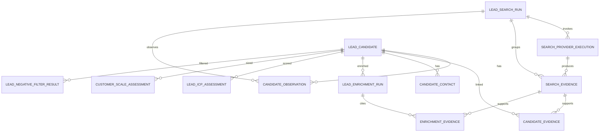
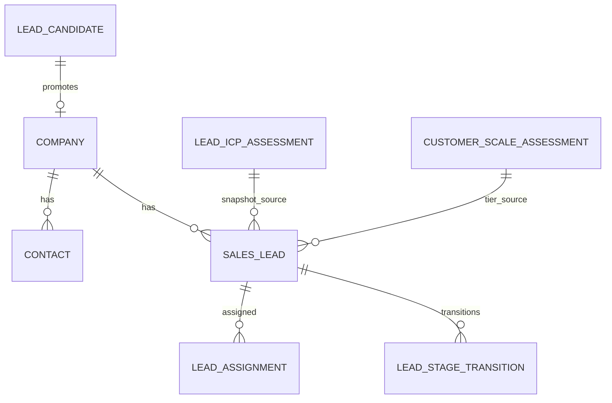
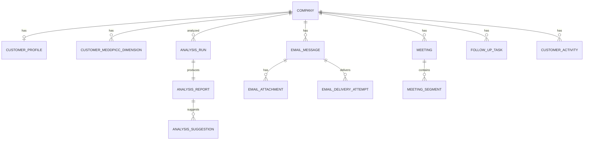

# 04 - 数据模型设计与字段字典

> 版本：v3.6
> 数据库：PostgreSQL 16
> Schema：`ltc`
> 性质：独立数据库评审基线
> 说明：当前允许删除开发数据库并重建，不要求在错误的 v2 表上做复杂增量兼容
> v3.6：`user_account` 改为 Sales/Strategic；离职回池使用既有 Assignment/Lead/Audit/Outbox 原子记录，不建审批/交接表；S4/S5 全部 Deferred；新增 `search_provider_execution` 表表达 Apollo 等内部 Provider 调用
> v3.5：架构评审修订——`sales_tier_history`/`handover_request` 转 Deferred（§16.2）；补齐 `lead_negative_filter_result` 字段字典；`lead_icp_assessment` 补 `prompt_version/confidence`；`customer_scale_assessment` 新增 unknown 分支；`lead_candidate` 移除动态加分列（迁至 `sales_lead`）；`email_message` 增加 opened/clicked；`manual_note` 补乐观锁与目标版本；新增 `ref_region_country` 参考表；`user_account` 补登录锁定字段

---

## 1. 结论

本模型包含 **45 张核心表**（v3.6 + v3.3 telemetry）。42 不是目标数字，而是根据真实生命周期自然拆分的结果：

| 模块 | 表数 | 说明 |
|---|---:|---|
| IAM | **2** | 账户、会话（等级历史、离职审批/交接请求转 Deferred，见 §16.2） |
| Task Runtime | 8 | Job、Attempt、Progress、Outbox、幂等、外部事件、审计、媒体 |
| Lead Intelligence | **12** | Search、Provider Execution、Evidence、Observation、Candidate、Contact、Enrichment、ICP、Scale、负向过滤 |
| Sales CRM | **5** | Company、Contact、Sales Lead、Assignment、Stage History |
| Customer Analysis | 5 | Profile、MEDDPICC、Run、Report、Suggestion |
| Customer Operation | **9** | Email、Delivery、Suppression、Meeting、Task、Activity、Manual Note |
| Telemetry (v3.3) | **3** | AI Event、Tool Event、Lead Lifecycle Event |
| 参考数据 | **1** | 区域国家对照（v5，205 个国家/地区） |

表数量不应继续为了”少”而压缩，也不应为了”企业级”增加无业务用途的表。

v3.3 新增：
- `ai_event` — 每次 LLM/Agent 调用追踪（模型、token、成本、置信度）
- `tool_event` — 每次外部 API/Provider 调用追踪（延迟、缓存命中、降级）
- `lead_lifecycle_event` — 线索从入池到成交的 25 个生命周期事件

v3.6 当前核心修正：

1. 当前账号只有 Sales/Strategic；Strategic 直接离职回池进入当前事务模型，等级调整、离职申请审批和复杂交接继续 Deferred，不创建 `sales_tier_history`/`handover_request`。
2. 新增 `search_provider_execution`，将一次对话 Search Run 与 Web Search/Apollo 等内部 Provider 调用分开。
3. 当前 ICP 只支持 S1/S2/S3；S4/S5 整体 Deferred，不进入 CHECK、DTO 或当前规则包。
4. Disable 只处理登录安全；Depart 才结束 Assignment 并将 Lead 原子释放回原区域×等级池。
5. ICP 固化规则快照/校验和，区域归属固化映射版本，保证规则换版后仍可审计。
6. `job.concurrency_key` 使用 active 部分唯一索引，数据库硬性保证单资源单活。
7. `claimed SalesLead ↔ active Assignment ↔ Sales Region/Tier` 使用 Deferred Constraint Trigger 在事务提交时校验；Depart 若未先结束 active Assignment 并回池，事务不能提交。
8. `departed` 为数据库终态；Assignment、Stage History、Analysis Report 禁止硬删除，Report 只允许一次性设置 `superseded_at`。
9. 区域国家 v5 的 205 条数据作为独立、幂等 seed 交付，并纳入 PostgreSQL 16 一键验收。

v3.5 已完成且继续保留的修正：

1. 完整销售管理的等级历史和审批/交接请求移至 §16.2，不计入核心表；`sales_lead.handover_status` 不进入当前模型。
2. 客户规模新增 `unknown` 分支：证据不足时不强行打分，Lead 进入数据补全池，补全完成事务允许一次性修正资格快照。
3. 动态意向加分/A 类细分落点由 `lead_candidate` 迁至 `sales_lead`；`email_message` 增加 opened/clicked 状态作为 I1 数据源。
4. 补齐 `lead_negative_filter_result` 字段字典（v3.3 引用了未定义的表）。
5. 新增 `ref_region_country` 参考表（区域国家对照 v5）。
6. `user_account` 补登录锁定字段；`manual_note` 补 `version` 与目标字段版本快照；`lead_icp_assessment` 补 `prompt_version/confidence`。
7. 保留 v3.3/v3.4 全部修正（场景化 ICP 四维、Candidate 不绑定单一 Run、入池先于 Claim、手动记录等）。

---

## 2. 建模规范

### 2.1 通用类型

| 类型 | 规范 |
|---|---|
| 主键 | `uuid`，默认 `gen_random_uuid()` |
| 时间 | `timestamptz`，统一 UTC |
| 乐观锁 | `version bigint NOT NULL DEFAULT 0` |
| 分数 | `numeric(6,2)` |
| 置信度/完整度 | `numeric(5,4)`，范围 0-1 |
| JSON | `jsonb`，只存可变结构、快照、Provider Raw Payload |
| 枚举 | `text + CHECK`，避免 PostgreSQL ENUM 迁移困难 |
| 金额不确定文本 | 保留文本和结构化 JSON，不强行转换错误币种 |
| 邮箱 | 同时保存显示值和 normalized value |
| Domain | 去 scheme/path/www，lower 后存储 |

### 2.2 通用字段

可更新业务表通常包含：

```text
version
created_at
updated_at
```

追加式事实表通常只包含：

```text
created_at / occurred_at
```

以下表禁止业务 UPDATE/DELETE：

- `job_attempt`
- `job_progress_event`
- `audit_log`
- `lead_stage_transition`
- 已发布的 `lead_icp_assessment`
- 已发布的 `customer_scale_assessment`
- 已发布的 `analysis_report`
- 已完成的 `email_delivery_attempt`

ICP/Scale 发布后分数、等级、规则、解释和 Payload 不允许原地修改。版本切换只能由专用发布事务更新旧行的 `is_current/superseded_at`；人工 Scale Override 也必须创建新 Assessment 版本。

落地要求：

- Repository 不提供 Assessment Update；
- 数据库 Trigger 拒绝除 `is_current/superseded_at` 之外的业务列 UPDATE；
- 迁移/修复使用独立受控数据库角色；
- 集成测试直接执行非法 UPDATE，确认数据库拒绝。

### 2.3 JSONB 使用规则

适合 JSONB：

- Provider Raw Payload；
- LLM 输入/输出快照；
- 报告模块；
- Evidence Reference；
- 不同场景变化较大的规则明细；
- 低频扩展字段。

不适合只用 JSONB：

- Company Name/Domain/Region；
- Sales Tier；
- Allocation/Pipeline Status；
- Profile 高频筛选字段；
- MEDDPICC Dimension；
- Email Status/Recipient；
- Meeting Status/Transcript；
- Task Status/Due Time。

### 2.4 删除规则

- 业务主数据默认 `ON DELETE RESTRICT`；
- Session 可随 User 删除，但正式环境推荐 Disabled 而不是删除 User；
- Email Attachment、Meeting Segment 可跟父记录受控清理；
- Media 使用逻辑删除和 Retention；
- Report、Assignment、Stage History 不硬删除。

---

## 3. 关系总览

### 3.1 Lead Intelligence



### 3.2 Sales CRM



### 3.3 Analysis 和 Operation



---

## 4. IAM 字段字典

### 4.1 `user_account`

用途：系统用户、销售等级、区域和容量。

| 字段 | 类型 | 可空 | 约束/索引 | 说明 |
|---|---|---:|---|---|
| `user_id` | uuid | 否 | PK | 用户 ID |
| `username` | text | 否 | `UNIQUE(lower(username))` | 登录名 |
| `password_hash` | text | 否 | - | Argon2id/Bcrypt Hash |
| `display_name` | text | 否 | - | 展示名 |
| `email` | text | 是 | `UNIQUE(lower(email)) WHERE NOT NULL` | 账户邮箱 |
| `account_type` | text | 否 | sales/strategic | 当前只保留两类账户 |
| `sales_tier` | text | 是 | MA/SA/A | Sales 必填，Strategic 为空 |
| `region_code` | text | 是 | **NA/EA/SEA/EU/ME/OTHER（v3.3 新增 ME 中东）** | Sales 必填 |
| `capacity_limit` | integer | 是 | `>0` | Sales 当前容量；推荐默认 MA15/SA25/A40 |
| `status` | text | 否 | active/disabled/departed | 账户生命周期；临时登录锁不写入本列 |
| `failed_login_attempts` | smallint | 否 | `>=0` | **新增 v3.5：连续密码失败次数，登录成功清零** |
| `locked_until` | timestamptz | 是 | - | **新增 v3.5：锁定期满时间，到期自动恢复** |
| `departed_at` | timestamptz | 是 | index | Strategic 标记离职时间 |
| `departed_by` | uuid | 是 | FK user_account | 执行离职的 Strategic 用户 |
| `departure_reason` | text | 是 | - | 离职原因；departed 时必填 |
| `token_version` | integer | 否 | `>0` | 全局撤销旧 Session |
| `last_login_at` | timestamptz | 是 | - | 最近登录 |
| `version` | bigint | 否 | `>=0` | 乐观锁 |
| `created_at` | timestamptz | 否 | - | 创建时间 |
| `updated_at` | timestamptz | 否 | - | 更新时间 |

核心 CHECK：

```text
account_type=sales
  → sales_tier/region_code/capacity_limit 必填

account_type=strategic
  → sales_tier/region_code/capacity_limit 为空

status=departed
  → departed_at/departed_by/departure_reason 必填

status<>departed
  → departed_at/departed_by/departure_reason 为空
```

`departed_by` 必须引用 Strategic 账号，由 Application Policy 与集成测试保证。`status=departed` 后立即失去登录权限，且不能通过通用 Enable 恢复；数据库 Trigger 拒绝任何从 `departed` 返回 `active/disabled` 的更新。

生命周期：`active ↔ disabled` 只表达登录安全；`active → departed` 与 `disabled → departed` 都合法，`departed` 为终态。

登录锁定：连续 5 次密码失败 → `locked_until=now()+30 分钟`、`failed_login_attempts=5`，但不改变 `status`；到期后首次认证请求清零锁定计数。登录成功同样清零。只有 `status=active AND (locked_until IS NULL OR locked_until<=now())` 才能建立 Session。锁定事件写 `audit_log` 并经 Notification Port 告警。

### 4.2 `auth_session`

| 字段 | 类型 | 可空 | 约束/索引 | 说明 |
|---|---|---:|---|---|
| `session_id` | uuid | 否 | PK | Session ID |
| `user_id` | uuid | 否 | FK user_account；index | 所属用户 |
| `refresh_token_hash` | text | 否 | unique | 不保存明文 Refresh Token |
| `issued_token_version` | integer | 否 | `>0` | 创建时用户 Token Version |
| `ip_address` | inet | 是 | - | 来源 IP |
| `user_agent` | text | 是 | - | 浏览器信息 |
| `expires_at` | timestamptz | 否 | index | 过期时间 |
| `revoked_at` | timestamptz | 是 | - | 撤销时间 |
| `revoke_reason` | text | 是 | - | logout/disabled/departed/security |
| `last_seen_at` | timestamptz | 是 | - | 最近使用 |
| `created_at` | timestamptz | 否 | - | 创建时间 |

### 4.3 `ref_region_country`（新增 v3.5）

用途：区域-国家对照参考数据（来源：区域国家对照与分配规则表 v5，6 大区 205 个国家/地区）。由 `db/seeds/0001_region_country_v5.sql` 导入，随对照表版本整体替换；业务表的 `country_code`/`region_code` 归一化以本表为准（IAM 拥有，经 `RegionCountryReadPort` 只读共享）。Seed 在事务中校验 205 条/6 区并支持幂等重跑；源表 48 个无业务含义的 `7` 标记规范化为 NULL，6 个时区括注移动到 `note`，`default_timezone` 只保留合法 IANA 标识。

| 字段 | 类型 | 可空 | 约束/索引 | 说明 |
|---|---|---:|---|---|
| `country_code` | text | 否 | PK | ISO 3166-1 alpha-2（科索沃用 XK） |
| `country_name` | text | 否 | - | 国家/地区中文名 |
| `region_code` | text | 否 | index；NA/EA/SEA/EU/ME/OTHER | 所属大区 |
| `subregion` | text | 是 | - | 子区域（仅参考，不参与分配） |
| `default_timezone` | text | 是 | - | 默认 IANA 时区 |
| `data_version` | text | 否 | index | 对照表版本（如 region-country-v5） |
| `note` | text | 是 | - | 备注 |

`lead_candidate.country_code`、`company.country_code` 由应用层校验必须存在于本表；不建 FK（参考数据整体换版时避免阻塞），由 ACL 与集成测试保证一致。

---

## 5. Task Runtime 字段字典

### 5.1 `job`

用途：持久化长任务和 Lease。

| 字段 | 类型 | 可空 | 约束/索引 | 说明 |
|---|---|---:|---|---|
| `job_id` | uuid | 否 | PK | Job ID |
| `job_type` | text | 否 | index | 版本化 Job Type |
| `queue_name` | text | 否 | claim index | lead/analysis/mail/media/event/data/llm |
| `aggregate_type` | text | 是 | composite index | 关联聚合类型 |
| `aggregate_id` | uuid | 是 | composite index | 关联聚合 ID |
| `concurrency_key` | text | 是 | active partial unique | 单资源单活键；如 `meeting:{meeting_id}:process`，无需单活的 Job 为空 |
| `retry_of_job_id` | uuid | 是 | self FK；index | 人工/策略重试的旧 Job |
| `status` | text | 否 | claim/lease index | queued/running/retry_wait/succeeded/failed_final/cancelled/reconcile_required/dead |
| `priority` | smallint | 否 | 0-1000 | 越小越优先 |
| `payload` | jsonb | 否 | object | Job 输入 |
| `result_summary` | jsonb | 是 | object | 只保存结果摘要 |
| `progress_percent` | numeric(5,2) | 否 | 0-100 | 当前进度 |
| `attempt_count` | integer | 否 | `>=0` | 已执行次数 |
| `max_attempts` | integer | 否 | `>0` | 最大次数 |
| `run_after` | timestamptz | 否 | claim index | 最早执行时间 |
| `locked_by` | text | 是 | - | Worker ID |
| `lock_token` | uuid | 是 | - | Fencing Token |
| `locked_until` | timestamptz | 是 | lease index | 租约到期 |
| `last_error_code` | text | 是 | - | 最后错误码 |
| `last_error_message` | text | 是 | - | 脱敏错误 |
| `correlation_id` | uuid | 是 | index | 链路 ID |
| `created_by` | uuid | 是 | FK user_account | 发起人 |
| `created_at` | timestamptz | 否 | - | 创建时间 |
| `started_at` | timestamptz | 是 | - | 首次开始 |
| `completed_at` | timestamptz | 是 | - | 终态时间 |
| `updated_at` | timestamptz | 否 | - | 更新时间 |
| `version` | bigint | 否 | `>=0` | Job 版本 |

### 5.2 `job_attempt`

| 字段 | 类型 | 可空 | 约束/索引 | 说明 |
|---|---|---:|---|---|
| `attempt_id` | uuid | 否 | PK | Attempt ID |
| `job_id` | uuid | 否 | FK job；index | 所属 Job |
| `attempt_no` | integer | 否 | unique(job_id, attempt_no) | 第几次 |
| `worker_id` | text | 否 | - | 执行 Worker |
| `lock_token` | uuid | 否 | - | 本次 Fencing Token |
| `status` | text | 否 | started/succeeded/failed/lease_lost | 结果 |
| `provider_code` | text | 是 | - | 主 Provider/Adapter；一次 Attempt 涉及多个 Provider 时为编排主 Provider |
| `provider_request_id` | text | 是 | index | 主请求 ID；完整脱敏 ID 列表放 response_summary.provider_request_ids |
| `request_summary` | jsonb | 是 | object | 脱敏请求摘要 |
| `response_summary` | jsonb | 是 | object | 脱敏响应摘要 |
| `metrics` | jsonb | 否 | metrics-v1 schema CHECK | 本 Attempt 内全部 Provider 调用的累计 Token、成本状态和耗时；固定结构见下文 |
| `error_code` | text | 是 | - | 错误码 |
| `error_message` | text | 是 | - | 脱敏错误 |
| `started_at` | timestamptz | 否 | - | 开始 |
| `completed_at` | timestamptz | 是 | - | 完成 |

`metrics-v1` 固定结构，金额必须用十进制定点字符串，禁止 JSON float：

```json
{
  "schema_version": 1,
  "input_tokens": 1200,
  "output_tokens": 350,
  "cached_input_tokens": 0,
  "total_tokens": 1550,
  "latency_ms": 842,
  "cost_amount": "0.012345",
  "currency": "USD",
  "cost_status": "confirmed"
}
```

Token 和 latency 均为非负整数且 `total_tokens=input_tokens+output_tokens`；它们汇总该 Attempt 内搜索、LLM、ASR、分片等所有 Provider 调用，失败中途也必须落已发生用量。`response_summary.provider_request_ids` 保存脱敏后的全部外部请求 ID。

`cost_status` 只能是 `confirmed/estimated/unknown`：全部调用 confirmed 才为 confirmed；无 unknown 且至少一项 estimated 时为 estimated；任一调用 unknown 则整体 unknown。`confirmed/estimated` 要求 `cost_amount` 和 ISO-4217 `currency` 非空，`unknown` 时二者为空。当前统一核算币种为 USD；如引入非 USD Provider，Adapter 必须同时保存原币种金额、换算为 USD 的汇率和汇率时间快照后才能进入 Run 汇总。

Migration 定义纯函数 `ltc.validate_job_attempt_metrics_v1(jsonb) RETURNS boolean IMMUTABLE`，`job_attempt` 使用 CHECK 调用它；函数验证必需 Key、禁止额外 Key、类型、数值范围、Token 求和和 Cost 条件。Schema 演进新增 v2 Validator，不原地改变 v1 语义。

### 5.3 `job_progress_event`

用途：SSE 重连和用户可理解的进度。

| 字段 | 类型 | 可空 | 约束/索引 | 说明 |
|---|---|---:|---|---|
| `progress_event_id` | bigint identity | 否 | PK | SSE Event ID |
| `job_id` | uuid | 否 | FK job；index | Job |
| `sequence_no` | integer | 否 | unique(job_id, sequence_no) | Job 内顺序 |
| `event_type` | text | 否 | - | progress/step_started/step_completed/candidate_upserted/candidate_scored/warning/error/completed（与 SSE 事件类型一一对应） |
| `step_code` | text | 是 | index | search/extract/enrich/score/scale 等 |
| `progress_percent` | numeric(5,2) | 是 | 0-100 | 进度 |
| `message` | text | 是 | - | 用户可理解文本 |
| `payload` | jsonb | 否 | object | Candidate/统计/错误摘要 |
| `created_at` | timestamptz | 否 | index | 时间 |

不保存模型敏感内部推理，只保存 Decision Summary 和执行进度。

### 5.4 `idempotency_record`

| 字段 | 类型 | 可空 | 约束/索引 | 说明 |
|---|---|---:|---|---|
| `idempotency_id` | uuid | 否 | PK | 记录 ID |
| `scope` | text | 否 | unique principal/scope/key | select/claim/assign/meeting_upload/send/consumer 等 |
| `principal_type` | text | 否 | user/system/event_consumer | 幂等主体类型 |
| `principal_id` | text | 否 | unique principal/scope/key | User ID、系统名或 Consumer 名 |
| `actor_user_id` | uuid | 是 | FK user_account | 用户请求时的 Actor；系统消费可空 |
| `idempotency_key` | text | 否 | unique principal/scope/key | 客户端 Key 或 event_id |
| `request_hash` | text | 否 | sha256 | 内容 Hash |
| `state` | text | 否 | in_progress/completed/failed | 执行状态 |
| `resource_type` | text | 是 | - | 结果资源 |
| `resource_id` | uuid | 是 | - | 结果资源 ID |
| `response_status` | integer | 是 | 100-599 | HTTP 状态 |
| `response_body` | jsonb | 是 | object | 可重放响应 |
| `expires_at` | timestamptz | 否 | cleanup index | 过期 |
| `created_at` | timestamptz | 否 | - | 创建 |
| `updated_at` | timestamptz | 否 | - | 更新 |

唯一约束：

```text
UNIQUE(principal_type, principal_id, scope, idempotency_key)
```

HTTP 命令使用 `principal_type=user`；Outbox Consumer 使用 `principal_type=event_consumer`、`principal_id=consumer_name`、`idempotency_key=event_id`。

主体约束：`principal_type=user` 时 `actor_user_id` 非空且 `principal_id=actor_user_id::text`；`principal_type IN (system,event_consumer)` 时 `actor_user_id` 为空。Strategic 代为分配某个销售时，Strategic 仍是 Principal/Actor，目标销售是 Command 业务参数，不伪造成另一 Principal。

HTTP `request_hash` 统一使用 canonical JSON 计算，覆盖 Route Path 参数、业务请求体、`If-Match`，Multipart 额外覆盖文件 SHA-256；不包含 Cookie、Request ID、Trace ID 等瞬时值。同一 Principal/Scope/Key：

- Hash 不同直接返回 409 `IDEMPOTENCY_KEY_REUSED`；
- `state=completed` 重放已保存的状态码和响应体；
- 普通命令 `state=in_progress` 返回 409 `IDEMPOTENCY_IN_PROGRESS`；可恢复批次命令是唯一例外：同 Hash 请求先取得 session-level PostgreSQL Advisory Lock，取得后从 Item Checkpoint 续跑，未取得锁仍返回 409；
- 只有确认领域事务未提交的可重试基础设施失败才写 `state=failed`，相同 Hash 可通过 CAS 重新取得执行权；
- 业务 4xx 属于已确定结果，按 completed 保存并重放；
- 领域写入、completed 状态和可重放响应必须在同一数据库事务提交。

### 5.5 `outbox_event`

| 字段 | 类型 | 可空 | 约束/索引 | 说明 |
|---|---|---:|---|---|
| `event_id` | uuid | 否 | PK | 事件 ID |
| `event_type` | text | 否 | index | 带版本的事件名 |
| `schema_version` | smallint | 否 | `>0` | Payload Schema |
| `producer` | text | 否 | - | 发布模块 |
| `aggregate_type` | text | 否 | index | 聚合类型 |
| `aggregate_id` | uuid | 否 | index | 聚合 ID |
| `aggregate_version` | bigint | 否 | - | 聚合版本 |
| `payload` | jsonb | 否 | object | 事件数据 |
| `headers` | jsonb | 否 | object | Trace/Actor |
| `status` | text | 否 | pending/processing/published/dead | 投递状态 |
| `available_at` | timestamptz | 否 | claim index | 可投递时间 |
| `attempt_count` | integer | 否 | `>=0` | 次数 |
| `locked_by` | text | 是 | - | Dispatcher |
| `lock_token` | uuid | 是 | - | Lease |
| `locked_until` | timestamptz | 是 | index | Lease 过期 |
| `published_at` | timestamptz | 是 | - | 完成 |
| `last_error` | text | 是 | - | 错误 |
| `correlation_id` | uuid | 是 | index | 链路 |
| `causation_id` | uuid | 是 | - | 原因 |
| `created_at` | timestamptz | 否 | - | 创建 |

逻辑事件唯一约束：

```text
UNIQUE(
  producer,
  aggregate_type,
  aggregate_id,
  aggregate_version,
  event_type
)
```

`status=published` 表示静态 Registry 中该 Event 的全部必需 Consumer 已在同一事务成功，不表示“任意一个 Consumer 成功”。当前不增加按 Consumer 的 Delivery 表。

### 5.6 `external_event`

用途：Email Webhook 等外部事件验签、去重和处理。

| 字段 | 类型 | 可空 | 约束/索引 | 说明 |
|---|---|---:|---|---|
| `external_event_id` | uuid | 否 | PK | 内部 ID |
| `provider_code` | text | 否 | unique pair | Provider |
| `provider_event_id` | text | 否 | unique pair | Provider Event ID |
| `event_type` | text | 否 | index | 事件类型 |
| `payload_hash` | text | 否 | sha256 | 原始 Hash |
| `payload` | jsonb | 否 | object | 原始 Payload |
| `signature_valid` | boolean | 否 | - | 验签 |
| `status` | text | 否 | received/processing/processed/quarantined/dead | 状态 |
| `linked_resource_type` | text | 是 | - | Email 等 |
| `linked_resource_id` | uuid | 是 | index | 资源 ID |
| `attempt_count` | integer | 否 | `>=0` | 次数 |
| `last_error` | text | 是 | - | 错误 |
| `received_at` | timestamptz | 否 | work index | 接收 |
| `processed_at` | timestamptz | 是 | - | 完成 |

### 5.7 `audit_log`

| 字段 | 类型 | 可空 | 约束/索引 | 说明 |
|---|---|---:|---|---|
| `audit_id` | bigint identity | 否 | PK | 审计 ID |
| `actor_user_id` | uuid | 是 | FK user；index | 操作人 |
| `action` | text | 否 | index | 动作 |
| `resource_type` | text | 否 | composite index | 资源类型 |
| `resource_id` | uuid | 是 | composite index | 资源 ID |
| `request_id` | text | 是 | index | 请求 |
| `job_id` | uuid | 是 | FK job；index | Job |
| `before_data` | jsonb | 是 | object | 脱敏前值 |
| `after_data` | jsonb | 是 | object | 脱敏后值 |
| `metadata` | jsonb | 否 | object | 原因/IP 等 |
| `occurred_at` | timestamptz | 否 | index | 时间 |

Audit 只做技术和合规审计，不能替代 `lead_stage_transition`。

### 5.8 `media_asset`

| 字段 | 类型 | 可空 | 约束/索引 | 说明 |
|---|---|---:|---|---|
| `media_asset_id` | uuid | 否 | PK | 媒体 ID |
| `company_id` | uuid | 是 | FK company；index | 运营媒体所属 Company；搜索内容可为空 |
| `parent_media_asset_id` | uuid | 是 | self FK + composite same-company FK；index | 转码/分片来源 |
| `asset_kind` | text | 否 | index | search_content/email_attachment/meeting_source/normalized_audio/chunk/export |
| `storage_backend` | text | 否 | local/oss/s3 | 存储 |
| `storage_key` | text | 否 | unique backend/key | 内部 Key |
| `original_filename` | text | 是 | - | 原文件名 |
| `mime_type` | text | 否 | - | MIME |
| `size_bytes` | bigint | 否 | `>=0` | 大小 |
| `sha256` | text | 否 | index | Hash |
| `status` | text | 否 | quarantined/ready/rejected/deleted | 状态 |
| `validation_payload` | jsonb | 否 | object | 校验结果 |
| `retention_until` | timestamptz | 是 | cleanup index | 保留期 |
| `deleted_at` | timestamptz | 是 | - | 删除 |
| `created_by` | uuid | 是 | FK user | 创建人 |
| `created_at` | timestamptz | 否 | - | 创建 |

---

## 6. Lead Intelligence 字段字典

### 6.1 `lead_search_run`

| 字段 | 类型 | 可空 | 约束/索引 | 说明 |
|---|---|---:|---|---|
| `search_run_id` | uuid | 否 | PK | Search Run |
| `dialogue_session_id` | text | 是 | index | 对话会话 |
| `query_text` | text | 否 | - | 用户需求 |
| `search_mode` | text | 否 | company_only/contact_only/both | 模式 |
| `target_count` | integer | 否 | 1-200 | 目标数量 |
| `scene_code` | text | 否 | S1/S2/S3；index | 当前启用的 ICP 场景；S4/S5 请求拒绝 |
| `orchestration_profile` | text | 否 | - | 服务端选择的 Provider 编排配置名 |
| `orchestration_profile_version` | text | 否 | - | 编排配置版本 |
| `prompt_version` | text | 否 | - | 抽取 Prompt |
| `config_checksum` | text | 否 | - | Provider 编排/规则配置 Hash |
| `status` | text | 否 | status index | queued/running/completed/partial/failed/cancelled |
| `evidence_count` | integer | 否 | `>=0` | Evidence 数 |
| `candidate_count` | integer | 否 | `>=0` | Candidate 数 |
| `enriched_count` | integer | 否 | `>=0` | 富化数 |
| `scored_count` | integer | 否 | `>=0` | 评分数 |
| `duplicate_count` | integer | 否 | `>=0` | 去重数 |
| `rejected_count` | integer | 否 | `>=0` | 驳回数 |
| `current_job_id` | uuid | 否 | FK job；index | 当前 Pipeline Job；历史通过 job.retry_of_job_id 查询 |
| `last_error_code` | text | 是 | - | 错误 |
| `last_error_message` | text | 是 | - | 脱敏错误 |
| `requested_by` | uuid | 是 | FK user；index | 发起人 |
| `created_at` | timestamptz | 否 | - | 创建 |
| `started_at` | timestamptz | 是 | - | 开始 |
| `completed_at` | timestamptz | 是 | - | 结束 |
| `version` | bigint | 否 | `>=0` | 版本 |

不保留长期业务字段 `run_d1_d4`。正式链路四维 ICP 是必经步骤；测试跳过使用调试配置。

六个计数是 Search Run 的执行统计快照，不是对当前全局 Candidate 状态的实时 COUNT：

- `evidence_count`：Collection 阶段被该 Run 接受的唯一 Evidence 数；
- `candidate_count`：该 Run 观察到的唯一 Canonical Candidate 数，包含复用已有 Candidate；
- `enriched_count`：该 Run 内完成 D1-D4 富化的唯一 Candidate 数；
- `scored_count`：该 Run 内成功发布 ICP + Scale 的唯一 Candidate 数；
- `duplicate_count`：该 Run 内被身份去重吸收到已有 Candidate 的抽取结果数；
- `rejected_count`：该 Run Pipeline 因校验/身份失败拒绝的抽取结果数，不含后续 Strategic Reject。

Worker 在受 Fencing Token 保护的 Run 终态事务中写入六个**绝对值**，不得用 `count=count+1` 累加。Evidence/Observation/Assessment 从持久化事实汇总，Duplicate/Rejected 集合由当前 Job 的确定性 `result_summary` 提供；人工 Retry 必须重新计算整组绝对值并原子替换。Run 进入终态后冻结，后续 Candidate Merge、Refresh、Promote 或 Reject 不回写历史统计。

客户端不得传 `provider_code`。服务端根据 `orchestration_profile/version` 决定调用 Web Search、Apollo 及未来 Provider；一次 Run 可产生多条 Provider Execution。

### 6.1.1 `search_provider_execution`（新增 v3.6）

用途：记录一次对话 Search Run 内部的一次外部 Provider 调用。它是业务可观测事实，不以通用 `job_attempt` 替代。

| 字段 | 类型 | 可空 | 约束/索引 | 说明 |
|---|---|---:|---|---|
| `provider_execution_id` | uuid | 否 | PK | Provider 调用 ID |
| `search_run_id` | uuid | 否 | FK lead_search_run；index | 所属对话搜索 |
| `job_id` | uuid | 否 | FK job；index | 所属 Pipeline Job |
| `job_attempt_id` | uuid | 是 | FK job_attempt；index | 发起外呼的 Worker Attempt |
| `retry_of_provider_execution_id` | uuid | 是 | self FK；index | 重试来源；重试新建行，不覆盖历史 |
| `provider_code` | text | 否 | web_search/apollo；index | 内部 Provider |
| `provider_operation` | text | 否 | search/company_lookup/contact_lookup | 调用类型 |
| `request_hash` | text | 否 | index | 脱敏规范化请求 Hash |
| `request_payload` | jsonb | 否 | object | 脱敏请求摘要，不含密钥 |
| `status` | text | 否 | running/succeeded/failed/cancelled；index | 调用状态 |
| `result_count` | integer | 否 | `>=0`；default 0 | Provider 返回并被接收的结果数 |
| `latency_ms` | integer | 是 | `>=0` | 外呼耗时 |
| `cost_amount` | numeric(12,6) | 是 | `>=0` | 可获得时记录调用成本 |
| `cost_currency` | text | 是 | ISO 4217 | 成本币种 |
| `external_request_id` | text | 是 | provider/request index | Provider 请求 ID |
| `error_code` | text | 是 | - | 归一化错误码 |
| `error_message` | text | 是 | - | 脱敏错误摘要 |
| `started_at` | timestamptz | 否 | index | 调用开始 |
| `completed_at` | timestamptz | 是 | - | 终态时间 |
| `created_at` | timestamptz | 否 | - | 创建时间 |

约束：

```text
status=running   → completed_at IS NULL
status IN (succeeded,failed,cancelled) → completed_at IS NOT NULL
provider_code='apollo' → Apollo 只可由服务端编排创建，不存在对应公开 API
UNIQUE(provider_execution_id, provider_code)
UNIQUE(provider_code, external_request_id) WHERE external_request_id IS NOT NULL
```

调用前短事务插入 `running`，外部 HTTP 在事务外执行，完成后短事务写终态和 Evidence。单 Provider 失败而其他 Provider 成功时 Search Run 可为 `partial`；全部 Provider 失败才是 `failed`。

### 6.2 `search_evidence`

| 字段 | 类型 | 可空 | 约束/索引 | 说明 |
|---|---|---:|---|---|
| `evidence_id` | uuid | 否 | PK | Evidence ID |
| `search_run_id` | uuid | 是 | FK run；index | 对话搜索证据；重富化可为空 |
| `provider_execution_id` | uuid | 是 | FK search_provider_execution；index | 对话搜索来源调用；重富化证据可为空 |
| `job_id` | uuid | 否 | FK job；index | 产生证据的 Job |
| `search_phase` | text | 否 | collection/icp_enrichment/scale_assessment | 用途 |
| `attempt_no` | integer | 否 | `>0` | 搜索尝试 |
| `query_text` | text | 否 | - | 实际 Query |
| `provider_code` | text | 否 | index | Provider |
| `provider_result_id` | text | 是 | - | 外部 ID |
| `rank_no` | integer | 是 | `>0` | 排名 |
| `url` | text | 是 | - | 原 URL |
| `canonical_url` | text | 是 | index | 归一 URL |
| `domain` | text | 是 | index | Domain |
| `title` | text | 是 | - | 标题 |
| `snippet` | text | 是 | - | 摘要 |
| `content_asset_id` | uuid | 是 | FK media_asset | 大正文 |
| `raw_payload` | jsonb | 否 | object | Provider Payload |
| `content_hash` | text | 否 | index | 证据语义去重 Hash；计算规则见下文。它不是存储对象完整性 Hash，不要求与 `media_asset.sha256` 相等 |
| `fetched_at` | timestamptz | 是 | - | 抓取 |
| `created_at` | timestamptz | 否 | - | 创建 |

同一 URL 在不同 Search Run 中允许保留不同观察，不做全局唯一。

对话搜索产生的 Evidence 必须满足 `search_run_id/provider_execution_id` 同时非空，并以 `(provider_execution_id, provider_code)` 复合 FK 保证 Provider 一致；重富化产生的 Evidence 允许两者为空，但仍通过 `job_id/provider_code` 追溯。

Hash 口径必须固定：

- `media_asset.sha256` = 实际存储对象原始字节的 SHA-256，用于上传、下载和防篡改校验；
- `search_evidence.content_hash` = 规范化证据文本的 SHA-256，用于内容去重；
- 有完整正文时，规范化输入为抽取后的主正文；只有摘要时，输入为 `canonical_url + "\n" + title + "\n" + snippet`；
- 文本统一 UTF-8、Unicode NFKC、CRLF 转 LF、去除行尾空白后再计算；
- 因 HTML 清洗、编码、压缩和媒体封装会改变字节，两个 Hash 即使关联同一内容也不建立相等约束。

### 6.3 `lead_candidate`

| 字段 | 类型 | 可空 | 约束/索引 | 说明 |
|---|---|---:|---|---|
| `candidate_id` | uuid | 否 | PK | 全局 Candidate |
| `dedupe_key` | text | 否 | unique | 应用层生成身份 Key |
| `company_name` | text | 否 | index lower | 展示名 |
| `normalized_company_name` | text | 否 | index | 归一名称 |
| `legal_name` | text | 是 | - | 法定名 |
| `website` | text | 是 | - | 官网 |
| `normalized_domain` | text | 是 | partial unique | Domain |
| `company_intro` | text | 是 | - | 简介 |
| `industry_code` | text | 是 | index；CHECK | 当前业务的单值标准行业代码：TMC/TRAVEL_OTA/FINTECH/OTHER；酒店航司和 APP 工作室 Deferred，当前不预留枚举值 |
| `employee_count` | integer | 是 | `>=0` | 未知用 NULL，不用 0 |
| `region_code` | text | 是 | index | 归一区域 |
| `country_code` | text | 是 | index | ISO Country |
| `region_mapping_version` | text | 是 | - | 本次 `country_code → region_code` 使用的对照版本；区域已知时必填 |
| `city` | text | 是 | - | 城市 |
| `identity_confidence` | numeric(5,4) | 是 | 0-1 | 身份置信度 |
| `validation_status` | text | 否 | valid/incomplete/review_required/rejected | 校验 |
| `processing_status` | text | 否 | work index | collected/enriching/enriched/scored/eligible/promoted/rejected/merged/archived |
| `negative_filter_result` | text | 是 | **none/X1-X6；v3.5 修正；index** | **最近一次负向过滤结论：none=通过；X1-X6=命中的规则码（X1/X2/X5=排除，X3/X4/X6=暂存）；历史见 `lead_negative_filter_result`** |
| `assessments_stale` | boolean | 否 | default false；selection index | Evidence/Identity 变化后是否必须重评；true 时禁止 Select |
| `promoted_company_id` | uuid | 是 | FK company；index | 入池后 Company |
| `promoted_lead_id` | uuid | 是 | FK sales_lead；index | 入池后 Sales Lead，可复用已有开放 Lead |
| `selected_icp_assessment_id` | uuid | 是 | composite FK with candidate | 本次 Select 使用的 Candidate ICP |
| `selected_scale_assessment_id` | uuid | 是 | composite FK with candidate | 本次 Select 使用的 Candidate Scale |
| `promotion_result` | text | 是 | created_lead/reused_open_lead/created_completion_lead | 本次入池结果 |
| `promotion_decision_source` | text | 是 | computed/strategic_override | 入池决策来源 |
| `promotion_override_reason` | text | 是 | required if strategic_override | 覆盖原因 |
| `promoted_by` | uuid | 是 | FK user | 选择人 |
| `promoted_at` | timestamptz | 是 | - | 入池时间 |
| `merged_into_candidate_id` | uuid | 是 | self FK；index | 合并到的 Canonical Candidate |
| `merged_at` | timestamptz | 是 | - | 合并时间 |
| `reject_reason` | text | 是 | - | 驳回原因 |
| `first_seen_at` | timestamptz | 否 | - | 首见 |
| `last_seen_at` | timestamptz | 否 | index | 最近观察 |
| `version` | bigint | 否 | `>=0` | 乐观锁 |
| `created_at` | timestamptz | 否 | - | 创建 |
| `updated_at` | timestamptz | 否 | - | 更新 |

### 6.4 `candidate_observation`

| 字段 | 类型 | 可空 | 约束/索引 | 说明 |
|---|---|---:|---|---|
| `observation_id` | uuid | 否 | PK | Observation |
| `candidate_id` | uuid | 否 | FK candidate；index | Candidate |
| `search_run_id` | uuid | 是 | FK run；index | 来源 Run |
| `source_kind` | text | 否 | live_extraction/legacy_extracted_row | 来源 |
| `observation_hash` | text | 否 | unique run/candidate/hash | 去重 |
| `extraction_model` | text | 是 | - | 模型 |
| `prompt_version` | text | 否 | - | Prompt |
| `company_snapshot` | jsonb | 否 | object | 当次公司抽取 |
| `contact_groups_payload` | jsonb | 否 | object | 当次四组联系人 |
| `raw_extraction_payload` | jsonb | 否 | object | 原始输出 |
| `observed_at` | timestamptz | 否 | index | 观察时间 |
| `created_at` | timestamptz | 否 | - | 创建 |

### 6.5 `candidate_evidence`

候选和网页证据的多对多关系。

| 字段 | 类型 | 可空 | 约束/索引 | 说明 |
|---|---|---:|---|---|
| `candidate_evidence_id` | uuid | 否 | PK | Link ID |
| `candidate_id` | uuid | 否 | FK candidate；index | Candidate |
| `evidence_id` | uuid | 否 | FK evidence；index | Evidence |
| `observation_id` | uuid | 是 | composite FK(observation_id, candidate_id) | 由哪次抽取建立 |
| `relation_type` | text | 否 | discovery/identity/contact/validation | 关系 |
| `confidence` | numeric(5,4) | 是 | 0-1 | 置信度 |
| `is_primary` | boolean | 否 | default false | 主证据 |
| `created_at` | timestamptz | 否 | - | 创建 |

唯一约束按 `(candidate_id, evidence_id, relation_type, observation_id)` 实现；Observation 为空时使用 Partial Unique Index。

### 6.6 `candidate_contact`

| 字段 | 类型 | 可空 | 约束/索引 | 说明 |
|---|---|---:|---|---|
| `candidate_contact_id` | uuid | 否 | PK | 候选联系人 |
| `candidate_id` | uuid | 否 | FK candidate；index | Candidate |
| `observation_id` | uuid | 是 | composite FK(observation_id, candidate_id) | 来源观察 |
| `full_name` | text | 否 | - | 姓名 |
| `normalized_name` | text | 否 | - | 归一姓名 |
| `title` | text | 是 | - | 职位 |
| `title_normalized` | text | 是 | index | 归一职位 |
| `department` | text | 是 | - | 部门 |
| `relationship_role` | text | 否 | decision_maker/influencer/executor/general_employee | 四类角色 |
| `priority` | text | 是 | P1/P2/P3 | 联系优先级 |
| `email` | text | 是 | - | 原邮箱 |
| `normalized_email` | text | 是 | index | 归一邮箱 |
| `email_status` | text | 是 | unknown/valid/invalid/risky | 状态 |
| `email_type` | text | 是 | - | work/personal/generic |
| `email_score` | numeric(6,2) | 是 | 0-100 | 置信分 |
| `email_pattern` | text | 是 | - | 推断模式 |
| `phone` | text | 是 | - | 电话 |
| `linkedin_url` | text | 是 | index | LinkedIn |
| `identity_hash` | text | 否 | unique per candidate | 去重 |
| `source_payload` | jsonb | 否 | object | Provider 数据 |
| `status` | text | 否 | active/rejected/promoted/merged | 状态 |
| `merged_into_candidate_id` | uuid | 是 | composite FK with source/target Candidate | 合并目标 Candidate |
| `merged_into_candidate_contact_id` | uuid | 是 | self FK；index | Candidate 合并时映射到的目标联系人 |
| `first_seen_at` | timestamptz | 否 | - | 首见 |
| `last_seen_at` | timestamptz | 否 | - | 最近 |
| `created_at` | timestamptz | 否 | - | 创建 |
| `updated_at` | timestamptz | 否 | - | 更新 |

### 6.7 `lead_enrichment_run`

| 字段 | 类型 | 可空 | 约束/索引 | 说明 |
|---|---|---:|---|---|
| `enrichment_run_id` | uuid | 否 | PK | 富化版本 |
| `candidate_id` | uuid | 否 | FK candidate；index | Candidate |
| `version_no` | integer | 否 | unique candidate/version | 版本 |
| `status` | text | 否 | queued/running/completed/failed/cancelled/superseded | 状态 |
| `scene_code` | text | 否 | index | 评分场景 |
| `rule_version` | text | 否 | - | D1-D4 规则 |
| `prompt_version` | text | 否 | - | Prompt |
| `config_checksum` | text | 否 | - | 配置 Hash |
| `model_name` | text | 是 | - | 模型 |
| `d1_payload` | jsonb | 是 | object | 完成前可空；D1 原始结构 |
| `d2_payload` | jsonb | 是 | object | 完成前可空；D2 |
| `d3_payload` | jsonb | 是 | object | 完成前可空；D3 |
| `d4_payload` | jsonb | 是 | object | 完成前可空；D4 |
| `output_hash` | text | 是 | index | 输出 Hash |
| `current_job_id` | uuid | 否 | FK job；index | 当前 Job；Retry 创建新 Job |
| `error_code` | text | 是 | - | 错误 |
| `error_message` | text | 是 | - | 错误 |
| `is_current` | boolean | 否 | partial unique candidate | 当前版本 |
| `created_at` | timestamptz | 否 | - | 创建 |
| `started_at` | timestamptz | 是 | - | 开始 |
| `completed_at` | timestamptz | 是 | - | 完成 |
| `superseded_at` | timestamptz | 是 | - | 退役 |
| `version` | bigint | 否 | `>=0` | Retry/Cancel 乐观锁 |

Customer Scale 不再放在本表。

Current 切换语义：

- 新 Enrichment Run 创建时 `is_current=false`；
- 旧 completed Run 在新 Run 执行期间继续 current；
- 新 Run 成功后，在一个事务中 supersede 旧 Run，再将新 Run 设为 current；
- 新 Run 失败不影响旧 current；
- 创建 Refresh 时 Candidate.assessments_stale=true；只有新 ICP/Scale 发布成功后才恢复 false；
- Candidate 已 promoted 时，Refresh 仍只更新 Candidate current，不修改现有 Sales Lead 的 adopted Assessment；
- `is_current=true` 只允许 `status=completed AND superseded_at IS NULL`。

### 6.8 `enrichment_evidence`

| 字段 | 类型 | 可空 | 约束/索引 | 说明 |
|---|---|---:|---|---|
| `enrichment_evidence_id` | uuid | 否 | PK | Link |
| `enrichment_run_id` | uuid | 否 | FK enrichment；index | 富化版本 |
| `evidence_id` | uuid | 否 | FK evidence；index | Evidence |
| `dimension_code` | text | 否 | D1/D2/D3/D4 | 维度 |
| `evidence_role` | text | 否 | primary/supporting/contradictory | 角色 |
| `is_proxy` | boolean | 否 | - | 是否代理证据 |
| `confidence` | numeric(5,4) | 是 | 0-1 | 置信度 |
| `excerpt` | text | 是 | - | 短摘录，不复制整页 |
| `created_at` | timestamptz | 否 | - | 创建 |

唯一 `(enrichment_run_id, evidence_id, dimension_code, evidence_role)`。

### 6.9 `lead_icp_assessment`

> ⚠️ v3.3 变更：维度权重按场景不同，数据库不硬编码固定上限。CHECK 约束按 `scene_code` 切换。

| 字段 | 类型 | 可空 | 约束/索引 | 说明 |
|---|---|---:|---|---|
| `icp_assessment_id` | uuid | 否 | PK | ICP 版本 |
| `candidate_id` | uuid | 否 | FK candidate；index | Candidate |
| `enrichment_run_id` | uuid | 否 | FK enrichment | 输入富化 |
| `version_no` | integer | 否 | unique candidate/version | 版本 |
| `scene_code` | text | 否 | S1/S2/S3；index | 当前启用场景；S4/S5 Deferred |
| `rule_version` | text | 否 | - | 规则 |
| `rule_snapshot` | jsonb | 否 | object | 当次四维代码、权重、档位、硬门槛和等级阈值的不可变快照 |
| `rule_checksum` | text | 否 | index | `rule_snapshot` 规范化 JSON 的 SHA-256，用于跨服务校验同一规则包 |
| `prompt_version` | text | 否 | - | **新增 v3.5：评分 Prompt 版本** |
| `d1_score` | numeric(6,2) | 否 | **上限取决于 scene_code（S1:40/S2:35/S3:35）** | D1 |
| `d2_score` | numeric(6,2) | 否 | **上限取决于 scene_code（S1:30/S2:25/S3:25）** | D2 |
| `d3_score` | numeric(6,2) | 否 | **上限取决于 scene_code（S1:20/S2:25/S3:25）** | D3 |
| `d4_score` | numeric(6,2) | 否 | **上限取决于 scene_code（S1:10/S2:15/S3:15）** | D4 |
| `total_score` | numeric(6,2) | 否 | 0-100；等于所有非空维度之和 | 总分 |
| `grade` | text | 否 | A/B/C/D | 等级 |
| `hard_gate_passed` | boolean | 否 | - | D1 等硬门槛 |
| `confidence` | numeric(5,4) | 是 | 0-1 | **新增 v3.5：整体置信度；分段置信度存 `score_breakdown`** |
| `score_breakdown` | jsonb | 否 | object | 规则档位（包含每维度的 0/0.25/0.5/0.75/1.0 评估系数） |
| `explanations` | jsonb | 否 | object | 解释 |
| `evidence_sources` | jsonb | 是 | **新增 v3.3: object** | **每维度证据来源、置信度和是否代理证据** |
| `job_id` | uuid | 是 | FK job；index | Job |
| `is_current` | boolean | 否 | partial unique candidate | 当前 |
| `scored_at` | timestamptz | 否 | index | 评分 |
| `superseded_at` | timestamptz | 是 | - | 退役 |

数据库强制区间和总分；应用层按 `rule_version + rule_checksum` 校验合法档位。`rule_snapshot` 必须保存评分当时的四维权重和阈值，规则换版不得修改旧行；S4/S5 当前没有合法规则快照，因此不能插入 Assessment。

Current 切换语义：

- ICP Assessment 只在评分成功后插入，不保存 running/failed 半成品；
- 新版本和 Scale 在同一结果事务中生成；
- 事务先锁定旧 current，再退役旧版本并写入新 current；
- 评分失败不插入 Assessment，旧 current 保持不变；
- `is_current=true` 当且仅当 `superseded_at IS NULL`。

### 6.10 `customer_scale_assessment`

| 字段 | 类型 | 可空 | 约束/索引 | 说明 |
|---|---|---:|---|---|
| `scale_assessment_id` | uuid | 否 | PK | Scale 版本 |
| `candidate_id` | uuid | 否 | FK candidate；index | Candidate |
| `source_enrichment_run_id` | uuid | 否 | composite FK(enrichment_run_id, candidate_id) | 输入 |
| `version_no` | integer | 否 | unique candidate/version | 版本 |
| `rule_version` | text | 否 | - | 规则 |
| `prompt_version` | text | 否 | - | **新增 v3.5：评估 Prompt 版本** |
| `d1_scale_score` | numeric(6,2) | 否 | 0-40 | 规模数量 |
| `d2_commercial_score` | numeric(6,2) | 否 | 0-35 | 商业价值 |
| `d3_coverage_score` | numeric(6,2) | 否 | 0-25 | 覆盖 |
| `total_score` | numeric(6,2) | 否 | 等于三维和 | 总分 |
| `computed_tier` | text | 否 | large/medium/small/unknown | 计算结果；unknown=证据不足无法定级 |
| `effective_tier` | text | 否 | large/medium/small/unknown | 生效结果 |
| `required_sales_tier` | text | 否 | GENERATED STORED；MA/SA/A | 从 `effective_tier` 生成：large→MA、medium→SA、small→A、unknown→A；可参与唯一约束和复合 FK，应用层不得赋值 |
| `decision_source` | text | 否 | computed/manual_override | 决策来源 |
| `override_reason` | text | 是 | required if manual | 原因 |
| `override_by` | uuid | 是 | FK user | 操作人 |
| `override_at` | timestamptz | 是 | - | 时间 |
| `assessment_payload` | jsonb | 否 | object | Evidence/说明 |
| `job_id` | uuid | 是 | FK job；index | Job |
| `is_current` | boolean | 否 | partial unique candidate | 当前 |
| `assessed_at` | timestamptz | 否 | index | 评估 |
| `superseded_at` | timestamptz | 是 | - | 退役 |

映射：

```text
large → MA
medium → SA
small → A
unknown → A（证据不足，Lead 进入数据补全池）
```

unknown 由规则引擎在证据不足时输出（`assessment_payload` 必须记录缺口说明），不属于人工覆盖；`decision_source` 仍为 computed。unknown 的 Assessment 与正常版本一样参与 current 切换，后续重评成功即 supersede。

人工覆盖必须同时有 `override_reason/override_by/override_at`。

Current 切换与 ICP 相同：评估失败不插入半成品，旧 current 保持不变；成功时在同一事务中退役旧版本并插入新 current。

### 6.11 `lead_negative_filter_result`（v3.5 补全定义）

用途：负向过滤（X1-X6）的追加式结果历史。每次 Search Pipeline 的负向过滤步骤对每个 Candidate 写一行；`lead_candidate.negative_filter_result` 只保存最近一次结论。

| 字段 | 类型 | 可空 | 约束/索引 | 说明 |
|---|---|---:|---|---|
| `filter_result_id` | uuid | 否 | PK | 结果 ID |
| `candidate_id` | uuid | 否 | FK candidate；index | Candidate |
| `search_run_id` | uuid | 是 | FK run；index | 产生结果的 Run；重富化执行时可为空 |
| `enrichment_run_id` | uuid | 是 | FK enrichment；index | 随重富化执行时的 Enrichment Run |
| `job_id` | uuid | 否 | FK job；index | 执行的 Job |
| `rule_code` | text | 否 | X1/X2/X3/X4/X5/X6/none | 命中的规则；none=通过 |
| `verdict` | text | 否 | pass/exclude/defer | pass=通过；exclude=排除（X1/X2/X5）；defer=暂存（X3/X4/X6） |
| `evidence_summary` | text | 是 | - | 判定依据摘要 |
| `payload` | jsonb | 否 | object | 规则命中明细 |
| `rule_version` | text | 否 | - | 过滤规则版本 |
| `created_at` | timestamptz | 否 | index | 判定时间 |

约束：

```text
rule_code=none  ↔  verdict=pass
rule_code IN (X1,X2,X5)  ↔  verdict=exclude
rule_code IN (X3,X4,X6)  ↔  verdict=defer
search_run_id / enrichment_run_id 至少一个非空
```

---

## 7. Sales CRM 字段字典

### 7.1 `company`

| 字段 | 类型 | 可空 | 约束/索引 | 说明 |
|---|---|---:|---|---|
| `company_id` | uuid | 否 | PK | Company |
| `origin_candidate_id` | uuid | 是 | FK candidate；index；非 unique | 初始来源 |
| `company_name` | text | 否 | index lower | 展示名 |
| `normalized_company_name` | text | 否 | index | 归一名 |
| `legal_name` | text | 是 | - | 法定名 |
| `primary_domain` | text | 是 | partial unique active | Domain |
| `website` | text | 是 | - | 官网 |
| `country_code` | text | 是 | index | 国家 |
| `region_code` | text | 是 | index | 区域 |
| `region_mapping_version` | text | 是 | - | 当前区域由哪个区域-国家对照版本计算；区域已知时必填 |
| `city` | text | 是 | - | 城市 |
| `industry_code` | text | 是 | index；CHECK | 与 Candidate 相同的单值标准行业代码 |
| `company_intro` | text | 是 | - | 简介 |
| `employee_count` | integer | 是 | `>=0` | 人数 |
| `lifecycle_status` | text | 否 | prospect/active_customer/inactive/archived | 生命周期 |
| `version` | bigint | 否 | `>=0` | 乐观锁 |
| `created_by` | uuid | 是 | FK user | 创建人 |
| `created_at` | timestamptz | 否 | - | 创建 |
| `updated_at` | timestamptz | 否 | - | 更新 |
| `archived_at` | timestamptz | 是 | - | 归档 |

`origin_candidate_id` 不是唯一键。多个重复 Candidate 可归并到同一 Company。

### 7.2 `contact`

| 字段 | 类型 | 可空 | 约束/索引 | 说明 |
|---|---|---:|---|---|
| `contact_id` | uuid | 否 | PK | Contact |
| `company_id` | uuid | 否 | FK company；index | Company |
| `source_candidate_contact_id` | uuid | 是 | FK candidate_contact；index | 来源 |
| `full_name` | text | 否 | - | 姓名 |
| `normalized_name` | text | 否 | - | 归一名 |
| `title` | text | 是 | - | 职位 |
| `title_normalized` | text | 是 | index | 归一职位 |
| `department` | text | 是 | - | 部门 |
| `relationship_role` | text | 是 | decision_maker/influencer/executor/general_employee | 角色 |
| `priority` | text | 是 | P1/P2/P3 | 优先级 |
| `primary_email` | text | 是 | unique company/email active | 邮箱 |
| `normalized_email` | text | 是 | index | 归一邮箱 |
| `email_status` | text | 否 | unknown/valid/invalid/risky/opted_out/bounced | 状态 |
| `email_type` | text | 是 | - | 类型 |
| `email_score` | numeric(6,2) | 是 | 0-100 | 分数 |
| `email_pattern` | text | 是 | - | 模式 |
| `phone` | text | 是 | - | 电话 |
| `linkedin_url` | text | 是 | index | LinkedIn |
| `source` | text | 否 | candidate/manual/operation | 来源 |
| `last_contacted_at` | timestamptz | 是 | index | 最近联系 |
| `status` | text | 否 | active/inactive/archived | 状态 |
| `version` | bigint | 否 | `>=0` | 乐观锁 |
| `created_at` | timestamptz | 否 | - | 创建 |
| `updated_at` | timestamptz | 否 | - | 更新 |

### 7.3 `sales_lead`

用途：资源池和一次销售周期的主表。

| 字段 | 类型 | 可空 | 约束/索引 | 说明 |
|---|---|---:|---|---|
| `lead_id` | uuid | 否 | PK | Sales Lead |
| `company_id` | uuid | 否 | FK company；index | Company |
| `source_candidate_id` | uuid | 否 | FK candidate；index | 创建该 Sales Lead 的主来源 Candidate |
| `adopted_icp_assessment_id` | uuid | 否 | FK icp | 该销售周期采用的 ICP 快照来源 |
| `adopted_scale_assessment_id` | uuid | 否 | FK scale | 该销售周期采用的 Scale 快照来源 |
| `required_sales_tier` | text | 否 | MA/SA/A；pool index | 销售等级。⚠️ 反规范化列：可从 `adopted_scale_assessment_id → customer_scale_assessment.required_sales_tier` 推导，但为 Pool 查询索引性能显式存储。创建后不可修改 |
| `pool_region_code` | text | 是 | pool index | 资源池区域。⚠️ 反规范化列：可从 `company.region_code` 推导。入池时从 Company 快照写入，表示入池时的区域快照，创建后不可修改 |
| `pool_region_mapping_version` | text | 是 | - | 入池时采用的区域对照版本；与 `pool_region_code` 一起形成可审计池快照 |
| `allocation_status` | text | 否 | claimable/claimed/archived | 分配状态 |
| `pipeline_stage` | text | 否 | new/contacted/engaged/meeting/proposal/won/lost/dormant | 销售阶段 |
| `current_owner_user_id` | uuid | 是 | FK user；index | 当前 owner 快照。⚠️ 反规范化列：可从 `lead_assignment WHERE status=active` 推导，但为列表查询性能显式存储。必须在 Assignment 事务中同步更新 |
| `current_assignment_started_at` | timestamptz | 是 | - | 当前 Active Assignment 的开始时间；Claim/Assign/Transfer 设置，Release 清空 |
| `first_touch_at` | timestamptz | 是 | - | Lead 生命周期首次触达；只允许从 NULL 设置一次，Release/Transfer 不清空也不覆盖 |
| `last_activity_at` | timestamptz | 是 | index | 最近活动。⚠️ 反规范化列：从运营事实表（email/meeting/activity）MAX(occurred_at) 推导。由 Outbox Consumer 异步更新 |
| `sla_due_at` | timestamptz | 是 | partial index | 当前 Owner 的首次触达 SLA；仅在 Lead 尚未首触时有效，首触/Release 后清空 |
| `won_reason_code` | text | 是 | - | 成交原因 |
| `lost_reason_code` | text | 是 | - | 流失原因 |
| `closed_note` | text | 是 | - | 关闭说明 |
| `released_reason` | text | 是 | - | 最近释放原因 |
| `closed_at` | timestamptz | 是 | - | 关闭 |
| `data_completion_pool` | text | 是 | scale_unknown/region_unknown | 数据补全池类型；NULL 表示已进入正式分配池 |
| `dynamic_bonus_points` | integer | 否 | `>=0`；default 0 | **新增 v3.5：动态意向加分累计（I1-I4）；动态总分 = min(100, adopted ICP 总分 + 本列)** |
| `a_segment` | text | 是 | A1/A2/A3/A4；index | **新增 v3.5：A 类细分快照；入池时按 adopted ICP 写入 A1-A3（不满足为空），A4 由动态升级写入** |
| `allocation_rule_version` | text | 是 | - | **新增 v3.5：入池时使用的分配规则矩阵版本（去向与 SLA 计算依据，规则更新不回溯）** |
| `version` | bigint | 否 | `>=0` | 乐观锁 |
| `created_at` | timestamptz | 否 | - | 入池 |
| `updated_at` | timestamptz | 否 | - | 更新 |

部分唯一索引：

```text
每 Company 最多一个 allocation_status<>'archived'
且 pipeline_stage NOT IN (won,lost) 的开放 Sales Lead
```

`current_owner_user_id` 和 `required_sales_tier`/`pool_region_code`/`pool_region_mapping_version`/`current_assignment_started_at`/`first_touch_at`/`last_activity_at`/`sla_due_at` 是查询优化或时点快照列。Assignment 写入必须按操作执行以下矩阵，不允许用一个通用“复制 Assignment 字段”逻辑覆盖全部场景。Release/Transfer/Depart 均不得重算 `pool_region_code` 或 `pool_region_mapping_version`：

| 操作 | `current_owner_user_id` | `current_assignment_started_at` | `sla_due_at` | `first_touch_at` |
|---|---|---|---|---|
| Claim/Assign | 新负责人 | 新 Assignment.`assigned_at` | `first_touch_at IS NULL` 时写新 Assignment SLA，否则 NULL | 保留原值 |
| Transfer | 新负责人 | 新 Assignment.`assigned_at` | `first_touch_at IS NULL` 时写新 Assignment SLA，否则 NULL | 保留原值 |
| Release | NULL | NULL | NULL | 保留原值 |
| Depart | NULL | NULL | NULL | 保留原值 |
| First Touch | 不变 | 不变 | NULL | `COALESCE(原值, occurred_at)` |

Pipeline 变更（Stage Change/Won/Lost）在同一事务同步 `pipeline_stage`/`closed_at`；运营事实发生后由 Outbox Consumer 幂等推进 `last_activity_at=GREATEST(原值, occurred_at)`，乱序事件不得使时间倒退。

`sla_due_at` 只表达“首次触达 SLA”，Overdue 唯一口径为：

```text
allocation_status='claimed'
AND first_touch_at IS NULL
AND sla_due_at < now()
```

`lead_assignment.sla_due_at` 保留当次分配时的 SLA 快照用于审计；Lead 首触后只清 `sales_lead.sla_due_at`，不改历史 Assignment。已首触 Lead 的 Transfer 不重新制造首次触达 SLA；如需转交响应时限，创建 `follow_up_task.due_at`，不得复用此字段。

`required_sales_tier`、`pool_region_code` 和 `pool_region_mapping_version` 创建后不可修改——它们是 Sales Lead 入池时的资格快照。唯一例外是数据补全池 Lead：补全完成事务中允许一次性修正 adopted Scale（scale_unknown），或同步修正区域、目标 Tier 与规则版本（region_unknown），见 `03-DDD领域驱动设计.md` §6.10 和本文 §11.5.1。

当前离职直接复用 Release 语义，`reason_code=sales_departed`，并在同一事务处理该 Sales 的全部 active Assignment。`handover_status` 不进入当前模型；未来若引入申请审批或复杂交接，再按 §16.2 独立评审。

### 7.4 `lead_assignment`

| 字段 | 类型 | 可空 | 约束/索引 | 说明 |
|---|---|---:|---|---|
| `assignment_id` | uuid | 否 | PK | Assignment |
| `lead_id` | uuid | 否 | FK sales_lead；index | Sales Lead |
| `assignee_user_id` | uuid | 否 | FK user；active index | Sales |
| `assigned_by` | uuid | 是 | FK user | 操作人 |
| `assignment_type` | text | 否 | claim/manual/transfer/reclaim/system | 类型 |
| `previous_assignment_id` | uuid | 是 | self composite FK with lead_id | 转交来源 |
| `status` | text | 否 | active/released/transferred/revoked/expired | 状态 |
| `reason_code` | text | 是 | - | 原因码 |
| `reason_text` | text | 是 | - | 说明 |
| `assigned_at` | timestamptz | 否 | index | 开始 |
| `first_touch_at` | timestamptz | 是 | - | 首触 |
| `sla_due_at` | timestamptz | 是 | index | 当次 Assignment 的首次触达 SLA 快照；结束或首触后仍保留审计值 |
| `ended_at` | timestamptz | 是 | - | 结束 |
| `version` | bigint | 否 | `>=0` | 乐观锁 |

当前标准 `reason_code` 至少包含 `user_release/strategic_release/transfer/sales_departed/auto_release_no_first_touch`；安全 Disable 不结束 Assignment，因此不存在 `user_disabled` 释放原因。

部分唯一：

```text
每 lead_id 最多一条 status=active
```

除部分唯一索引外，数据库在事务提交时校验：`claimed` Lead 必须且只能有一条 active Assignment，且 assignee、`assigned_at`、Sales Region/Tier 必须与 Lead 快照一致；非 `claimed` Lead 不得保留 active Assignment。该校验是 `DEFERRABLE INITIALLY DEFERRED`，因此 Claim/Transfer/Depart 可以在同一事务内按锁顺序完成多表更新，但中间态不能泄漏到提交结果。有 active Assignment 的 Sales 不能提交 `departed`。Assignment 与 Stage History 的 `ON DELETE` 为 RESTRICT，且表级 Trigger 禁止直接硬删。

### 7.5 `lead_stage_transition`

用途：Assignment、Allocation 和 Pipeline 的结构化业务历史。

| 字段 | 类型 | 可空 | 约束/索引 | 说明 |
|---|---|---:|---|---|
| `transition_id` | uuid | 否 | PK | Transition |
| `company_id` | uuid | 否 | composite FK with lead；timeline index | Company |
| `lead_id` | uuid | 否 | composite FK(lead_id, company_id)；timeline index | Sales Lead |
| `assignment_id` | uuid | 是 | composite FK(assignment_id, lead_id) | 相关 Assignment |
| `event_type` | text | 否 | pool_entry/claim/assign/transfer/release/first_touch/stage_change/won/lost/decay/reactivate | 事件 |
| `from_allocation_status` | text | 是 | - | 原分配状态 |
| `to_allocation_status` | text | 是 | - | 新分配状态 |
| `from_pipeline_stage` | text | 是 | - | 原阶段 |
| `to_pipeline_stage` | text | 是 | - | 新阶段 |
| `from_owner_user_id` | uuid | 是 | FK user | 原 owner |
| `to_owner_user_id` | uuid | 是 | FK user | 新 owner |
| `actor_user_id` | uuid | 是 | FK user；index | 操作人 |
| `source_type` | text | 否 | user/email/meeting/task/system/migration | 来源 |
| `source_email_id` | uuid | 是 | composite FK(email_id, company_id, lead_id)；index | Email 来源 |
| `source_meeting_id` | uuid | 是 | composite FK(meeting_id, company_id, lead_id)；index | Meeting 来源 |
| `source_task_id` | uuid | 是 | composite FK(task_id, company_id, lead_id)；index | Task 来源 |
| `source_external_key` | text | 是 | index | user/system/migration 请求或迁移 Key |
| `reason_code` | text | 是 | index | 原因码 |
| `reason_text` | text | 是 | - | 原因 |
| `metadata` | jsonb | 否 | object | SLA/Override 等 |
| `occurred_at` | timestamptz | 否 | timeline index | 时间 |

---

## 8. Customer Analysis 字段字典

### 8.1 `customer_profile`

| 字段 | 类型 | 可空 | 约束/索引 | 说明 |
|---|---|---:|---|---|
| `company_id` | uuid | 否 | PK/FK company | Company |
| `company_type` | text | 是 | index | 公司类型 |
| `region_text` | text | 是 | - | 分析展示区域 |
| `employee_scale` | text | 是 | index | 员工规模 |
| `business_model` | text | 是 | - | 商业模式 |
| `esim_scenario` | text | 是 | index | eSIM 场景 |
| `coverage` | text | 是 | - | 覆盖 |
| `estimated_usage` | text | 是 | - | 预计用量 |
| `integration` | text | 是 | index | 对接方式 |
| `compliance` | text | 是 | - | 合规 |
| `budget_text` | text | 是 | - | 预算 |
| `decision_maker_text` | text | 是 | - | 决策人文本 |
| `decision_maker_contact_id` | uuid | 是 | composite FK(contact_id, company_id) | 正式联系人 |
| `decision_cycle_text` | text | 是 | - | 决策周期 |
| `completeness_score` | numeric(5,4) | 否 | 0-1 | 完整度 |
| `missing_fields` | text[] | 否 | - | 缺失字段 |
| `extra_payload` | jsonb | 否 | object | 低频扩展 |
| `field_provenance` | jsonb | 否 | object | 字段来源和可信度 |
| `source_summary` | text | 是 | - | 来源摘要 |
| `last_enriched_at` | timestamptz | 是 | - | 最近富化 |
| `version` | bigint | 否 | `>=0` | 乐观锁 |
| `updated_by` | uuid | 是 | FK user | 更新人 |
| `updated_at` | timestamptz | 否 | - | 更新时间 |

### 8.2 `customer_meddpicc_dimension`

每个 Company 八行：

```text
metrics
economic_buyer
decision_criteria
decision_process
paper_process
identify_pain
champion
competition
```

| 字段 | 类型 | 可空 | 约束/索引 | 说明 |
|---|---|---:|---|---|
| `company_id` | uuid | 否 | composite PK/FK | Company |
| `dimension_code` | text | 否 | composite PK | 八维之一 |
| `level` | text | 是 | index | 高/中/低/待确认等 |
| `status` | text | 否 | unknown/partial/confirmed/rejected | 状态 |
| `summary` | text | 是 | - | 摘要 |
| `payload` | jsonb | 否 | object | 维度结构 |
| `evidence_refs` | jsonb | 否 | array | 证据 |
| `version` | bigint | 否 | `>=0` | 乐观锁 |
| `updated_by` | uuid | 是 | FK user | 更新人 |
| `updated_at` | timestamptz | 否 | - | 更新 |

### 8.3 `analysis_run`

| 字段 | 类型 | 可空 | 约束/索引 | 说明 |
|---|---|---:|---|---|
| `analysis_run_id` | uuid | 否 | PK | Run |
| `company_id` | uuid | 否 | FK company；index | Company |
| `lead_id` | uuid | 否 | composite FK(lead_id, company_id, source_candidate_id)；index | 当前销售周期；入池后即可分析，不要求 Claim；无开放 Lead 时引用最近一个已关闭 Lead |
| `source_candidate_id` | uuid | 否 | FK candidate；index | ICP/Scale 所属 Candidate |
| `icp_assessment_id` | uuid | 否 | FK ICP | 四维 ICP |
| `scale_assessment_id` | uuid | 否 | composite FK(scale_assessment_id, source_candidate_id) | 客户规模 |
| `current_job_id` | uuid | 否 | FK job；index | 当前 Job；重试创建新 Job |
| `report_type` | text | 否 | index | customer_analysis 等 |
| `trigger_type` | text | 否 | manual/pool_entry/assignment/operation/schedule/migration | 触发 |
| `status` | text | 否 | queued/running/completed/failed/cancelled | 状态 |
| `input_hash` | text | 否 | active unique company/report_type/hash | 防重；覆盖完整输入、Prompt/Schema/Model 和生成参数，见下文 |
| `prompt_version` | text | 否 | - | Prompt |
| `schema_version` | text | 否 | - | 输出 Schema |
| `model_name` | text | 是 | - | 模型 |
| `profile_version` | bigint | 否 | - | 输入 Profile 版本 |
| `meddpicc_revision` | text | 否 | - | 八维聚合 Hash |
| `engagement_cutoff_at` | timestamptz | 是 | - | 运营截止 |
| `input_snapshot` | jsonb | 否 | object | 完整输入快照 |
| `token_usage` | jsonb | 否 | object；default `{}` | Analysis Run 全部 Provider 调用的汇总，包含失败重试和 Reconcile；Attempt 仍保存逐次明细 |
| `cost_amount` | numeric(14,6) | 是 | `>=0` | Analysis Run 已确认的 USD 总实际成本；存在 estimated/unknown Attempt 时为 NULL |
| `cost_currency` | char(3) | 否 | default USD；CHECK | Run 核算币种，当前固定 USD |
| `cost_status` | text | 否 | confirmed/estimated/unknown | 汇总成本可信状态 |
| `error_code` | text | 是 | - | 错误 |
| `error_message` | text | 是 | - | 错误 |
| `created_by` | uuid | 是 | FK user | 发起人 |
| `created_at` | timestamptz | 否 | - | 创建 |
| `started_at` | timestamptz | 是 | - | 开始 |
| `completed_at` | timestamptz | 是 | - | 完成 |
| `version` | bigint | 否 | `>=0` | Retry/Cancel 乐观锁 |

`input_hash` 使用 canonical JSON 计算，输入至少包含 `input_snapshot`、`prompt_version`、`schema_version`、解析后的 `model_name` 和温度/工具/检索等生成参数。Prompt、模型或生成配置变化必须得到不同 Hash，允许在业务数据未变化时重新分析。

`job_attempt.metrics` 是每个技术尝试的事实明细；`analysis_run.token_usage/cost_amount` 是跨旧 Job、Retry Job 和 Reconcile Job 的业务汇总。`token_usage` 固定包含 `input_tokens/output_tokens/cached_input_tokens/total_tokens/attempt_count/unresolved_attempt_count` 六个非负整数。每个 Attempt 终态后按 `aggregate_type=analysis_run + aggregate_id` 幂等重算，避免 Worker 崩溃或重复回调造成漏算、重算。

只有所有计费 Attempt 都是 `cost_status=confirmed` 时，Run 才写 `cost_status=confirmed` 和 `cost_amount=SUM(confirmed USD amount)`；存在 estimated 时 Run 为 estimated、存在 unknown 时 Run 为 unknown，这两种情况 `cost_amount=NULL`，待 Reconcile 后重算。

### 8.4 `analysis_report`

| 字段 | 类型 | 可空 | 约束/索引 | 说明 |
|---|---|---:|---|---|
| `report_id` | uuid | 否 | PK | Report |
| `company_id` | uuid | 否 | FK company；index | Company |
| `analysis_run_id` | uuid | 否 | composite FK with company/report_type；unique | Run |
| `report_type` | text | 否 | default customer_analysis | 类型 |
| `version_no` | integer | 否 | unique company/type/version | 版本 |
| `schema_version` | text | 否 | - | DTO Schema |
| `summary` | text | 否 | - | 报告摘要的唯一事实源，供列表和详情使用；`report_payload` 不重复保存 summary |
| `health_grade` | text | 是 | index | 健康度 |
| `intention_level` | text | 是 | index | 意向 |
| `confidence` | numeric(5,4) | 是 | 0-1 | 置信度 |
| `section_confidence` | jsonb | 是 | object | **新增 v3.5：五模块分段置信度（PRD 口径：每段 0-1）** |
| `low_confidence_sections` | text[] | 是 | - | **新增 v3.5：置信度 <0.5 的段落列表，前端置灰提示** |
| `data_sources` | jsonb | 是 | array | **新增 v3.5：报告引用的数据来源 URL 列表** |
| `evidence_refs` | jsonb | 否 | array | 证据 |
| `profile_snapshot` | jsonb | 否 | object | Profile 快照 |
| `meddpicc_snapshot` | jsonb | 否 | object | MEDDPICC 快照 |
| `icp_snapshot` | jsonb | 否 | object | 四维 ICP 快照 |
| `scale_snapshot` | jsonb | 否 | object | 客户规模快照 |
| `report_payload` | jsonb | 否 | object | 五模块结构 |
| `sales_guide_payload` | jsonb | 否 | object | Sales Guide |
| `generated_by` | text | 否 | agent/manual/import | 来源 |
| `model_name` | text | 是 | - | 模型 |
| `content_source` | text | 否 | llm/template/fallback/migration | 内容来源 |
| `generated_at` | timestamptz | 否 | index | 生成 |
| `superseded_at` | timestamptz | 是 | current partial unique | 退役 |

Report 不允许修改内容，只能生成新版本。数据库 Trigger 仅允许当前 Report 把 `superseded_at` 从 NULL 设置一次，禁止恢复、改期和硬删除。

### 8.5 `analysis_suggestion`

| 字段 | 类型 | 可空 | 约束/索引 | 说明 |
|---|---|---:|---|---|
| `suggestion_id` | uuid | 否 | PK | Suggestion |
| `company_id` | uuid | 否 | FK company；index | Company |
| `report_id` | uuid | 否 | FK report；index | 来源 Report |
| `target_type` | text | 否 | profile/meddpicc | 目标 |
| `dimension_code` | text | 是 | MEDDPICC 八维；profile 时为空 | 目标维度 |
| `target_path` | text | 否 | unique report/path | 字段路径 |
| `target_version_at_creation` | bigint | 否 | `>=0` | 生成建议时目标版本 |
| `current_value_snapshot` | jsonb | 是 | any JSON | 生成时当前值 |
| `proposed_value` | jsonb | 否 | any JSON | 建议值 |
| `evidence_refs` | jsonb | 否 | array | 证据 |
| `confidence` | numeric(5,4) | 是 | 0-1 | 置信度 |
| `status` | text | 否 | pending/accepted/rejected/expired | 状态 |
| `reviewed_by` | uuid | 是 | FK user | 审核人 |
| `reviewed_at` | timestamptz | 是 | - | 审核时间 |
| `review_note` | text | 是 | - | 备注 |
| `created_at` | timestamptz | 否 | work index | 创建 |

---

## 9. Customer Operation 字段字典

### 9.1 `email_message`

一张表同时保存 Draft、Outbound 和 Inbound，通过 Direction/Status 区分。

| 字段 | 类型 | 可空 | 约束/索引 | 说明 |
|---|---|---:|---|---|
| `email_id` | uuid | 否 | PK | Email |
| `company_id` | uuid | 否 | FK company；timeline index | Company |
| `lead_id` | uuid | 是 | FK sales_lead；index | Sales Lead |
| `contact_id` | uuid | 是 | FK contact；index | Contact |
| `parent_email_id` | uuid | 是 | self composite FK with company | 回复父邮件 |
| `thread_key` | text | 是 | index | 线程 |
| `direction` | text | 否 | inbound/outbound | 方向 |
| `purpose` | text | 是 | - | first_touch/reply_followup/meeting_followup |
| `status` | text | 否 | direction-specific CHECK；status index | 见下方状态定义 |
| `from_address` | text | 否 | - | 发件人 |
| `intended_to_address` | text | 是 | - | 真实目标地址 |
| `delivered_to_address` | text | 是 | - | 测试中实际投递地址 |
| `cc_addresses` | jsonb | 否 | array | CC |
| `subject` | text | 是 | - | 主题 |
| `body_text` | text | 是 | - | 文本 |
| `body_html` | text | 是 | - | HTML |
| `intent_level` | text | 是 | interested/pricing/product_question/not_interested/unsubscribe | 回复意图 |
| `intent_payload` | jsonb | 是 | object | 分类详情 |
| `next_action` | text | 是 | - | 下一动作 |
| `approved_by` | uuid | 是 | FK user | 审批人 |
| `approved_at` | timestamptz | 是 | - | 审批 |
| `generation_prompt_version` | text | 是 | - | 草稿 Prompt |
| `generation_model` | text | 是 | - | 模型 |
| `provider_code` | text | 是 | - | Provider |
| `provider_message_id` | text | 是 | unique provider/message | 外部消息 |
| `provider_request_id` | text | 是 | index | 请求 |
| `message_id_header` | text | 是 | index | RFC Message-ID |
| `in_reply_to` | text | 是 | index | Reply Header |
| `current_job_id` | uuid | 是 | FK job；index | 当前生成/发送/对账 Job |
| `idempotency_key` | text | 是 | outbound partial unique | 发送幂等 |
| `sent_at` | timestamptz | 是 | - | 发送 |
| `received_at` | timestamptz | 是 | - | 接收 |
| `replied_at` | timestamptz | 是 | - | 回复 |
| `version` | bigint | 否 | `>=0` | 乐观锁 |
| `created_at` | timestamptz | 否 | - | 创建 |
| `updated_at` | timestamptz | 否 | - | 更新 |

状态定义：

```text
Outbound:
  generating, draft, approved, queued, sending,
  sent, delivered, opened, clicked, replied, bounced, failed,
  reconcile_required, cancelled

Inbound:
  received, processing, processed, failed
```

delivered/opened/clicked 只能由邮件 Provider Webhook（`external_event`）推进，单调前进不回退；opened/clicked 是动态意向加分 I1 的数据源（每封邮件合计最多 +2）。

Provider 结果不确定时：

```text
email_delivery_attempt.status = uncertain
email_message.status = reconcile_required
send job.status = reconcile_required
new reconcile job.status = queued
email_message.current_job_id = reconcile job
```

### 9.2 `email_attachment`

| 字段 | 类型 | 可空 | 约束/索引 | 说明 |
|---|---|---:|---|---|
| `email_attachment_id` | uuid | 否 | PK | Attachment |
| `company_id` | uuid | 否 | FK company；composite FK | 同源 Company |
| `email_id` | uuid | 否 | FK email；index | Email |
| `media_asset_id` | uuid | 否 | FK media；index | Media |
| `disposition` | text | 否 | attachment/inline | 方式 |
| `content_id` | text | 是 | - | Inline CID |
| `filename` | text | 否 | - | 文件名 |
| `created_at` | timestamptz | 否 | - | 创建 |

### 9.3 `email_delivery_attempt`

| 字段 | 类型 | 可空 | 约束/索引 | 说明 |
|---|---|---:|---|---|
| `delivery_attempt_id` | uuid | 否 | PK | Attempt |
| `email_id` | uuid | 否 | FK email；index | Email |
| `attempt_no` | integer | 否 | unique email/attempt | 次数 |
| `provider_code` | text | 否 | - | Provider |
| `idempotency_key` | text | 否 | unique provider/key | Provider 幂等 |
| `provider_request_id` | text | 是 | index | Request |
| `provider_message_id` | text | 是 | partial unique | Message |
| `status` | text | 否 | started/accepted/delivered/failed/uncertain/reconciled | 结果 |
| `request_payload` | jsonb | 否 | object | 脱敏请求 |
| `response_payload` | jsonb | 是 | object | 响应 |
| `error_code` | text | 是 | - | 错误 |
| `error_message` | text | 是 | - | 错误 |
| `started_at` | timestamptz | 否 | - | 开始 |
| `accepted_at` | timestamptz | 是 | - | Provider 接受 |
| `completed_at` | timestamptz | 是 | - | 完成 |

### 9.4 `email_suppression`

| 字段 | 类型 | 可空 | 约束/索引 | 说明 |
|---|---|---:|---|---|
| `suppression_id` | uuid | 否 | PK | Suppression |
| `normalized_email` | text | 否 | active partial unique | 地址 |
| `reason` | text | 否 | unsubscribe/hard_bounce/complaint/manual/legal | 原因 |
| `source_email_id` | uuid | 是 | FK email | 来源 |
| `source_external_event_id` | uuid | 是 | FK external_event | Webhook |
| `status` | text | 否 | active/lifted | 状态 |
| `suppressed_at` | timestamptz | 否 | - | 开始 |
| `lifted_at` | timestamptz | 是 | - | 解除 |
| `lifted_by` | uuid | 是 | FK user | 操作人 |
| `note` | text | 是 | - | 说明 |

### 9.5 `meeting`

| 字段 | 类型 | 可空 | 约束/索引 | 说明 |
|---|---|---:|---|---|
| `meeting_id` | uuid | 否 | PK | Meeting |
| `company_id` | uuid | 否 | FK company；timeline index | Company |
| `lead_id` | uuid | 是 | FK sales_lead；index | Sales Lead |
| `primary_contact_id` | uuid | 是 | FK contact | 主要联系人 |
| `owner_user_id` | uuid | 是 | FK user；index | Owner |
| `source_media_asset_id` | uuid | 否 | FK media | 原始文件 |
| `normalized_audio_asset_id` | uuid | 是 | FK media | 标准音频 |
| `current_job_id` | uuid | 否 | FK job；index | 当前处理 Job；重试创建新 Job |
| `title` | text | 是 | - | 标题 |
| `source` | text | 否 | upload/import | 来源 |
| `meeting_started_at` | timestamptz | 是 | index | 会议时间 |
| `duration_seconds` | numeric(12,2) | 是 | `>=0` | 时长 |
| `processing_status` | text | 否 | uploaded/queued/extracting/transcribing/summarizing/completed/failed/cancelled/deleted | 处理状态 |
| `transcript_status` | text | 否 | pending/processing/done/failed/cancelled | 转写 |
| `transcript_text` | text | 是 | - | 完整转写 |
| `transcript_language` | text | 是 | - | 语言 |
| `transcript_provider` | text | 是 | - | ASR |
| `summary_payload` | jsonb | 是 | object + schema CHECK | 摘要唯一事实源；固定包含 customer_needs/pain_points/buying_signals/action_items/decisions/risks/keywords/next_step |
| `summary_schema_version` | smallint | 否 | default 1；CHECK `=1` | Meeting Summary DTO 版本 |
| `next_step` | text | 是 | GENERATED STORED | `summary_payload->>'next_step'`，应用层不得赋值 |
| `decisions` | jsonb | 否 | GENERATED STORED；array | `COALESCE(summary_payload->'decisions','[]')` |
| `risks` | jsonb | 否 | GENERATED STORED；array | `COALESCE(summary_payload->'risks','[]')` |
| `keywords` | jsonb | 否 | GENERATED STORED；array | `COALESCE(summary_payload->'keywords','[]')` |
| `summary_prompt_version` | text | 是 | - | Prompt |
| `summary_model` | text | 是 | - | 模型 |
| `error_code` | text | 是 | - | 错误 |
| `error_message` | text | 是 | - | 错误 |
| `version` | bigint | 否 | `>=0` | 乐观锁 |
| `created_at` | timestamptz | 否 | - | 创建 |
| `updated_at` | timestamptz | 否 | - | 更新 |
| `deleted_at` | timestamptz | 是 | - | 逻辑删除 |

`summary_payload` v1 使用封闭 Schema（`additionalProperties=false`）。完成态八个 Key 全部必需，数组为空时写 `[]`，不得省略或写 NULL：

```json
{
  "customer_needs": ["需要覆盖亚太地区"],
  "pain_points": ["现有漫游成本高"],
  "buying_signals": ["要求试点报价"],
  "action_items": [
    {
      "task": "发送试点方案",
      "owner": "uuid-or-null",
      "due_at": "2026-07-20T08:00:00Z"
    }
  ],
  "decisions": ["先在日本团队试点"],
  "risks": ["预算尚未审批"],
  "keywords": ["eSIM", "APAC"],
  "next_step": "发送试点方案并确认演示时间"
}
```

`customer_needs/pain_points/buying_signals/decisions/risks/keywords` 均为 `array<string>`；`action_items` 为对象数组，`task` 是非空 string，`owner` 和 RFC3339 `due_at` 为 string 或 null；`next_step` 为 string 或 null。新增或改变 Key 必须提升 `summary_schema_version`，不能在 v1 中静默扩展。

Migration 定义纯函数 `ltc.validate_meeting_summary_v1(jsonb) RETURNS boolean IMMUTABLE` 并由 CHECK 调用；该函数验证封闭 Key 集合、嵌套数组/对象类型和必填项。负向集成测试必须覆盖缺 Key、额外 Key、错误类型和非法 Action Item。

### 9.6 `meeting_segment`

| 字段 | 类型 | 可空 | 约束/索引 | 说明 |
|---|---|---:|---|---|
| `company_id` | uuid | 否 | composite FK | Meeting/Contact 同源 Company |
| `meeting_id` | uuid | 否 | composite PK/FK | Meeting |
| `sequence_no` | integer | 否 | composite PK | 顺序 |
| `start_seconds` | numeric(12,2) | 否 | `>=0` | 开始 |
| `end_seconds` | numeric(12,2) | 否 | `>start` | 结束 |
| `speaker_id` | text | 是 | - | Speaker |
| `speaker_label` | text | 是 | - | 展示名 |
| `speaker_contact_id` | uuid | 是 | FK contact | 已识别联系人 |
| `transcript_text` | text | 否 | - | 文本 |
| `confidence` | numeric(5,4) | 是 | 0-1 | 置信度 |

时间单位统一使用 seconds，避免当前代码 seconds 和旧设计 milliseconds 混用。

### 9.7 `follow_up_task`

| 字段 | 类型 | 可空 | 约束/索引 | 说明 |
|---|---|---:|---|---|
| `task_id` | uuid | 否 | PK | Task |
| `company_id` | uuid | 否 | FK company；index | Company |
| `lead_id` | uuid | 是 | FK sales_lead；index | Lead |
| `assignee_user_id` | uuid | 是 | FK user；work index | 负责人 |
| `source_email_id` | uuid | 是 | FK email | 来源 |
| `source_meeting_id` | uuid | 是 | FK meeting | 来源 |
| `source_report_id` | uuid | 是 | FK report | 来源 |
| `source_job_id` | uuid | 是 | FK job | 来源 |
| `task_type` | text | 否 | email/call/meeting/proposal/data_check/other | 类型 |
| `title` | text | 否 | - | 标题 |
| `description` | text | 是 | - | 描述 |
| `due_at` | timestamptz | 是 | partial index | 截止 |
| `status` | text | 否 | pending/in_progress/completed/cancelled | 状态 |
| `priority` | smallint | 否 | 0-1000 | 优先级 |
| `idempotency_key` | text | 是 | partial unique | 自动任务防重 |
| `completed_at` | timestamptz | 是 | - | 完成 |
| `completion_note` | text | 是 | - | 结果 |
| `created_by` | uuid | 是 | FK user | 创建人 |
| `version` | bigint | 否 | `>=0` | 乐观锁 |
| `created_at` | timestamptz | 否 | - | 创建 |
| `updated_at` | timestamptz | 否 | - | 更新 |

最多一个 Source FK 非空。`overdue` 不持久化：

```text
status IN (pending,in_progress) AND due_at < now()
```

### 9.8 `customer_activity`

用途：电话、备注、方案、人工沟通和无法由 Email/Meeting 表达的事实。

| 字段 | 类型 | 可空 | 约束/索引 | 说明 |
|---|---|---:|---|---|
| `activity_id` | uuid | 否 | PK | Activity |
| `company_id` | uuid | 否 | FK company；timeline index | Company |
| `lead_id` | uuid | 是 | FK sales_lead；index | Lead |
| `assignment_id` | uuid | 是 | FK assignment | Assignment |
| `activity_type` | text | 否 | call/note/proposal/demo/system/other | 类型 |
| `direction` | text | 是 | inbound/outbound/internal | 方向 |
| `subject` | text | 是 | - | 主题 |
| `body` | text | 是 | - | 内容 |
| `outcome_code` | text | 是 | index | 结果 |
| `actor_user_id` | uuid | 是 | FK user；index | 操作人 |
| `source_type` | text | 否 | manual/system/migration | 产生方式，不表示资源表类型 |
| `source_job_id` | uuid | 是 | FK job；index | System/Migration Job 来源；有正式 Job 时使用 |
| `source_external_key` | text | 是 | partial unique per source/company | 无正式资源表时的稳定外部键或迁移键，不伪装成 UUID FK |
| `payload` | jsonb | 否 | object | 扩展 |
| `occurred_at` | timestamptz | 否 | timeline index | 发生时间 |
| `created_at` | timestamptz | 否 | - | 创建 |

`customer_activity` 只保存电话、备注、方案、Demo 和其他非结构化事实，不复制 Email、Meeting 或 Task。Timeline 同时读取这些结构化表和 Activity，不把它们再次投影为 Activity。`source_type` 只是产生方式；未来出现新的结构化来源时必须增加专用 FK，不能恢复通用 `source_type + source_id` 多态引用。

### 9.9 `manual_note`（新增 v3.4）

用途：记录销售通过"手动记录"功能输入的自然语言碎片信息，AI 提取后反哺到客户分析。原文不可丢失，提取结果须经确认才写入 Profile/MEDDPICC。

| 字段 | 类型 | 可空 | 约束/索引 | 说明 |
|---|---|---:|---|---|
| `note_id` | uuid | 否 | PK | 手动记录 ID |
| `company_id` | uuid | 否 | FK company；index | 关联公司 |
| `sales_id` | uuid | 否 | FK user_account；index | 记录人 |
| `raw_text` | text | 否 | - | **原文必须保留**，不可丢弃——万一提取有误，能回溯原话 |
| `extracted_fields_json` | jsonb | 是 | object | LLM 提取出的结构化字段列表（dimension_point、extracted_value、previous_value、confidence、action）|
| `confirm_status` | text | 否 | pending/confirmed/discarded；index | 确认状态 |
| `current_job_id` | uuid | 是 | FK job；index | 当前提取/重试 Job |
| `version` | bigint | 否 | `>=0` | **新增 v3.5：乐观锁（确认/重试并发互斥）** |
| `created_at` | timestamptz | 否 | index | 记录时间 |
| `updated_at` | timestamptz | 否 | - | 更新时间 |

`extracted_fields_json` 结构（每个元素）：

```json
{
  "dimension_point": "D3.budget_text",
  "target_table": "customer_profile",
  "target_column": "budget_text",
  "extracted_value": "5万美金以内",
  "previous_value": "预算未知",
  "target_version": 3,
  "confidence": 0.85,
  "action": "覆盖"
}
```

`dimension_point` 取值来自提取目标目录（`03-DDD领域驱动设计.md` §6.16）；`target_version` 记录提取时目标字段的当前 `version`，确认写入时逐项校验，目标已被他人更新返回 409，不静默覆盖。

累积规则（v3.5 批量确认口径）：

| 场景 | 规则 |
|------|------|
| 新提取的点位此前 Profile/MEDDPICC 为空 | 直接新增（action=new），随批量确认写入 |
| 新提取的值与原值一致 | 静默忽略，不进入确认卡片 |
| 新提取的值与原值冲突 | **确认卡片默认整批采纳提取值（批量确认）；销售可展开逐条改为"保留原值"或编辑值后一次提交** |
| 未识别内容 | 明确标注"未识别"，不强行归类 |

提取失败时 `confirm_status=pending` 不丢失原始文本，通过 Job Retry 重试。销售全部不认可时 `confirm_status=discarded`，原文仍保留在库里备查。

---

## 10. 核心索引和约束

### 10.0 Provider Execution

```text
INDEX(search_run_id, started_at)
INDEX(job_id, status)
INDEX(provider_code, status, started_at)
UNIQUE(provider_execution_id, provider_code)
UNIQUE(provider_code, external_request_id)
  WHERE external_request_id IS NOT NULL
```

对话搜索 Evidence 使用 `(provider_execution_id, provider_code)` 复合 FK，防止把 Apollo 结果标成 Web Search 或反之。Retry 通过 `retry_of_provider_execution_id` 形成追加式调用链。

### 10.1 全局候选去重

```text
UNIQUE(dedupe_key)
UNIQUE(normalized_domain) WHERE normalized_domain IS NOT NULL AND candidate 未 merged/archived
INDEX(normalized_company_name, country_code)
```

名称相似不直接建 Unique，交由 Candidate Identity Policy。

### 10.1.1 单资源 Job 单活

```text
UNIQUE(concurrency_key)
  WHERE concurrency_key IS NOT NULL
    AND status IN ('queued','running','retry_wait','reconcile_required')
```

需要单活的 Job 在创建时写确定性 Key，例如 Search Run、Candidate Refresh、Analysis Run、Meeting Process、Manual Note Extract 和同一 Lead 的同类数据补全。Retry 必须先让旧 Job 离开 active 状态，再创建带同一个 Key 的新 Job；禁止只靠 `current_job_id` 或应用层“先查再插”保证单活。

### 10.2 Current 版本

以下表使用 Partial Unique：

```text
lead_enrichment_run(candidate_id) WHERE is_current
lead_icp_assessment(candidate_id) WHERE is_current
customer_scale_assessment(candidate_id) WHERE is_current
analysis_report(company_id, report_type) WHERE superseded_at IS NULL

lead_enrichment_run(candidate_id)
  WHERE status IN ('queued','running')
```

约束语义：

```text
lead_enrichment_run:
  is_current=true
    ↔ status='completed' AND superseded_at IS NULL

lead_icp_assessment / customer_scale_assessment:
  is_current=true
    ↔ superseded_at IS NULL
```

切换规则：

1. 新 Enrichment Run 创建时不是 current，旧 completed Run 继续提供线上读取；
2. 新 Run 完成后，一个事务内退役旧 Enrichment/ICP/Scale，再发布新 current；
3. 任何步骤失败都不清空旧 current；
4. 读取端只读 `is_current=true`，不得按最大 `version_no` 猜测当前版本。

### 10.3 Sales Lead 和 Assignment

```text
UNIQUE(company_id)
  WHERE allocation_status <> 'archived'
    AND pipeline_stage NOT IN ('won','lost')

UNIQUE(lead_id)
  WHERE lead_assignment.status='active'

UNIQUE(source_email_id, to_pipeline_stage)
  WHERE source_type='email' AND source_email_id IS NOT NULL

UNIQUE(source_meeting_id, to_pipeline_stage)
  WHERE source_type='meeting' AND source_meeting_id IS NOT NULL

UNIQUE(source_task_id, to_pipeline_stage)
  WHERE source_type='task' AND source_task_id IS NOT NULL
```

### 10.4 Pool 查询

```text
INDEX(
  allocation_status,
  required_sales_tier,
  pool_region_code,
  created_at
) WHERE allocation_status='claimable'
```

### 10.5 Job

```text
INDEX(queue_name, priority, run_after, created_at)
  WHERE status IN ('queued','retry_wait')

INDEX(locked_until)
  WHERE status='running'

status IN (
  succeeded,failed_final,cancelled,reconcile_required,dead
)
  → completed_at NOT NULL
  → locked_by/lock_token/locked_until IS NULL
```

### 10.6 Email

```text
UNIQUE(provider_code, provider_message_id)
  WHERE provider_message_id IS NOT NULL

UNIQUE(idempotency_key)
  WHERE direction='outbound' AND idempotency_key IS NOT NULL

INDEX(company_id, created_at DESC)
INDEX(thread_key, created_at)
```

### 10.7 Task

```text
INDEX(assignee_user_id, status, due_at)
  WHERE status IN ('pending','in_progress')

UNIQUE(idempotency_key)
  WHERE idempotency_key IS NOT NULL
```

邮件意图和会议摘要自动创建的 Task 必须使用确定性 Key：

```text
email:{email_id}:{email_version}:{action_code}
meeting:{meeting_id}:{meeting_version}:{action_item_hash}
```

Task 在 Customer Operation 的 Email/Meeting 结果事务中创建，Outbox Consumer 不重复创建。

### 10.8 所有 FK

所有 FK 列必须有索引，除非已经是复合索引最左列。

### 10.9 同源复合键和复合外键

仅有单列 FK 不能阻止“ID 存在但属于另一 Candidate/Company”的串数据。DDL 必须额外建立以下候选键：

```text
lead_enrichment_run:
  UNIQUE(enrichment_run_id, candidate_id)

candidate_observation:
  UNIQUE(observation_id, candidate_id)

lead_candidate:
  UNIQUE(candidate_id, merged_into_candidate_id)

candidate_contact:
  UNIQUE(candidate_contact_id, candidate_id)

lead_icp_assessment:
  UNIQUE(icp_assessment_id, candidate_id)

customer_scale_assessment:
  UNIQUE(scale_assessment_id, candidate_id)
  UNIQUE(scale_assessment_id, candidate_id, required_sales_tier)

sales_lead:
  UNIQUE(lead_id, company_id)
  UNIQUE(lead_id, company_id, source_candidate_id)
  UNIQUE(
    lead_id,
    company_id,
    source_candidate_id,
    adopted_icp_assessment_id,
    adopted_scale_assessment_id
  )

contact:
  UNIQUE(contact_id, company_id)

lead_assignment:
  UNIQUE(assignment_id, lead_id)

analysis_run:
  UNIQUE(analysis_run_id, company_id)
  UNIQUE(analysis_run_id, company_id, report_type)

analysis_report:
  UNIQUE(report_id, company_id)

email_message:
  UNIQUE(email_id, company_id)
  UNIQUE(email_id, company_id, lead_id)

meeting:
  UNIQUE(meeting_id, company_id)
  UNIQUE(meeting_id, company_id, lead_id)

follow_up_task:
  UNIQUE(task_id, company_id)
  UNIQUE(task_id, company_id, lead_id)

media_asset:
  UNIQUE(media_asset_id, company_id)
```

并使用复合 FK 强制：

```text
lead_icp_assessment(enrichment_run_id, candidate_id)
  → lead_enrichment_run(enrichment_run_id, candidate_id)

candidate_evidence(observation_id, candidate_id)
  → candidate_observation(observation_id, candidate_id)

candidate_contact(observation_id, candidate_id)
  → candidate_observation(observation_id, candidate_id)

candidate_contact(candidate_id, merged_into_candidate_id)
  → lead_candidate(candidate_id, merged_into_candidate_id)

candidate_contact(merged_into_candidate_contact_id, merged_into_candidate_id)
  → candidate_contact(candidate_contact_id, candidate_id)

customer_scale_assessment(source_enrichment_run_id, candidate_id)
  → lead_enrichment_run(enrichment_run_id, candidate_id)

sales_lead(adopted_icp_assessment_id, source_candidate_id)
  → lead_icp_assessment(icp_assessment_id, candidate_id)

sales_lead(
  adopted_scale_assessment_id,
  source_candidate_id,
  required_sales_tier
)
  → customer_scale_assessment(
      scale_assessment_id,
      candidate_id,
      required_sales_tier
    )

lead_candidate(selected_icp_assessment_id, candidate_id)
  → lead_icp_assessment(icp_assessment_id, candidate_id)

lead_candidate(selected_scale_assessment_id, candidate_id)
  → customer_scale_assessment(scale_assessment_id, candidate_id)

lead_candidate(promoted_lead_id, promoted_company_id)
  → sales_lead(lead_id, company_id)

lead_assignment(previous_assignment_id, lead_id)
  → lead_assignment(assignment_id, lead_id)

analysis_run(lead_id, company_id, source_candidate_id)
  → sales_lead(lead_id, company_id, source_candidate_id)

analysis_run(
  lead_id,
  company_id,
  source_candidate_id,
  icp_assessment_id,
  scale_assessment_id
)
  → sales_lead(
      lead_id,
      company_id,
      source_candidate_id,
      adopted_icp_assessment_id,
      adopted_scale_assessment_id
    )

analysis_run(icp_assessment_id, source_candidate_id)
  → lead_icp_assessment(icp_assessment_id, candidate_id)

analysis_run(scale_assessment_id, source_candidate_id)
  → customer_scale_assessment(scale_assessment_id, candidate_id)

analysis_report(analysis_run_id, company_id, report_type)
  → analysis_run(analysis_run_id, company_id, report_type)

analysis_suggestion(report_id, company_id)
  → analysis_report(report_id, company_id)

customer_profile(decision_maker_contact_id, company_id)
  → contact(contact_id, company_id)
```

数据库保证 Analysis 的 Lead、ICP、Scale 属于同一 Company/Candidate，并且等于该 Sales Lead 的 adopted Assessment；`input_snapshot` 再固化生成时的 Profile、MEDDPICC 和运营事实。Sales Lead 的 adopted Assessment 在该销售周期内不可变，Candidate 后续 Refresh 不回写该字段。

运营表必须使用同样原则：

```text
email_message(lead_id, company_id)       → sales_lead(lead_id, company_id)
email_message(contact_id, company_id)    → contact(contact_id, company_id)
email_message(parent_email_id, company_id)
                                         → email_message(email_id, company_id)
email_attachment(email_id, company_id)   → email_message(email_id, company_id)
email_attachment(media_asset_id, company_id)
                                         → media_asset(media_asset_id, company_id)

meeting(lead_id, company_id)             → sales_lead(lead_id, company_id)
meeting(primary_contact_id, company_id)  → contact(contact_id, company_id)
meeting(source_media_asset_id, company_id)
                                         → media_asset(media_asset_id, company_id)
meeting(normalized_audio_asset_id, company_id)
                                         → media_asset(media_asset_id, company_id)
meeting_segment(meeting_id, company_id)  → meeting(meeting_id, company_id)
meeting_segment(speaker_contact_id, company_id)
                                         → contact(contact_id, company_id)

media_asset(parent_media_asset_id, company_id)
                                         → media_asset(media_asset_id, company_id)

follow_up_task(lead_id, company_id)       → sales_lead(lead_id, company_id)
follow_up_task(source_email_id, company_id)
                                         → email_message(email_id, company_id)
follow_up_task(source_meeting_id, company_id)
                                         → meeting(meeting_id, company_id)
follow_up_task(source_report_id, company_id)
                                         → analysis_report(report_id, company_id)

customer_activity(lead_id, company_id)   → sales_lead(lead_id, company_id)
customer_activity(assignment_id, lead_id)
                                         → lead_assignment(assignment_id, lead_id)
customer_activity(source_job_id)          → job(job_id)
lead_stage_transition(lead_id, company_id)
                                         → sales_lead(lead_id, company_id)
lead_stage_transition(assignment_id, lead_id)
                                         → lead_assignment(assignment_id, lead_id)
lead_stage_transition(source_email_id, company_id, lead_id)
                                         → email_message(email_id, company_id, lead_id)
lead_stage_transition(source_meeting_id, company_id, lead_id)
                                         → meeting(meeting_id, company_id, lead_id)
lead_stage_transition(source_task_id, company_id, lead_id)
                                         → follow_up_task(task_id, company_id, lead_id)
```

`media_asset.parent_media_asset_id` 还必须保留单列 Self FK，保证 `company_id IS NULL` 的 Search Content 也不能引用不存在的 Parent；复合 FK 只负责 Company 非空时的同公司约束。

Company 列本身是 NOT NULL、业务资源 ID 可空的复合 FK 使用默认 `MATCH SIMPLE`；资源 ID 一旦非空，Company 必须同时匹配。`customer_activity(assignment_id, lead_id)` 这类两个业务 ID 都可空的组合，额外使用 CHECK 保证“有 Assignment 就必须有 Lead”。Candidate Promotion 形成 Candidate ↔ Sales Lead 循环引用，对应复合 FK 使用 `DEFERRABLE INITIALLY DEFERRED`，在同一事务提交时统一校验。`contact.source_candidate_contact_id` 由 Promotion Application 校验其 Candidate 已映射到同一 Company；`follow_up_task.source_job_id` 和 `customer_activity.source_job_id` 由 Application 验证 Job Aggregate 与业务来源一致。这些应用级跨聚合校验必须提供负向集成测试。

CRM Transition → Operation Source 的反向 FK 在所有业务表创建完成后的“约束阶段 Migration”统一添加，避免建表顺序形成循环；这不改变模块写所有权。

---

## 11. 数据库不变量

### 11.1 ICP（v3.3 场景化更新）

ICP 维度权重按 `scene_code` 不同。数据库 CHECK 按场景切换上限，不硬编码单一值域。

**S1（差旅平台）：**

```text
0 <= d1 <= 40, 0 <= d2 <= 30, 0 <= d3 <= 20, 0 <= d4 <= 10
total = d1+d2+d3+d4
```

**S2（商旅OTA）、S3（金融科技）：**

```text
0 <= d1 <= 35, 0 <= d2 <= 25, 0 <= d3 <= 25, 0 <= d4 <= 15
total = d1+d2+d3+d4
```

当前 `scene_code` CHECK 只允许 S1/S2/S3。S4 酒店航司和 S5 APP 工作室整体 Deferred，不允许创建 Search Run、Job 或 Assessment；未来四维权重确认后通过新 Migration 和新 `rule_version` 启用。

**所有场景通用的评分规则：**

```text
每维度 score = 权重满分 × 评估系数(0/0.25/0.5/0.75/1.0)
total = 所有非空维度 score 之和

Grade:
A: total >= 80
B: 60 <= total < 80
C: 40 <= total < 60
D: total < 40 或 hard_gate=0

A 类细分（当前场景满分均为 100，阈值使用绝对分）：
A1 战略大客户: total >= 85 AND 规模维度 >= 80%权重；
              或满足任一定量条件：年国际订单 >= 100000 / 企业客户 >= 500 / 月活 >= 100万
A2 高适配客户: total >= 80 AND 跨境场景维度 >= 80%权重
              AND 增值服务/数据触达维度 >= 80%权重
A3 技术可快速试点: total >= 75 AND 技术接入维度 >= 80%权重
A4 高意向动态升级: 静态 60-79 但动态加分后 >= 80
```

### 11.2 Customer Scale

```text
0 <= d1 <= 40
0 <= d2 <= 35
0 <= d3 <= 25
total = d1+d2+d3

total >= 80       → computed_tier=large
60 <= total < 80  → computed_tier=medium
total < 60        → computed_tier=small
证据不足无法定级   → computed_tier=unknown（assessment_payload 必须记录缺口说明）

effective_tier=large  → required_sales_tier=MA
effective_tier=medium → required_sales_tier=SA
effective_tier=small  → required_sales_tier=A
effective_tier=unknown → required_sales_tier=A（数据补全池）

decision_source=computed
  → effective_tier=computed_tier
  → override_reason/override_by/override_at 全部为空

decision_source=manual_override
  → override_reason/override_by/override_at 全部非空
```

### 11.3 Candidate Promotion

```text
Candidate promoted
  → promoted_company_id NOT NULL
  → promoted_lead_id NOT NULL
  → selected_icp_assessment_id/selected_scale_assessment_id NOT NULL
  → promotion_result/promotion_decision_source/promoted_by/promoted_at NOT NULL
  → promoted_lead_id 所属 Company 等于 promoted_company_id

promotion_decision_source=strategic_override
  → promotion_override_reason NOT NULL

promotion_decision_source=computed
  → promotion_override_reason IS NULL

promotion_result=created_lead
  → Sales Lead.source_candidate_id=Candidate
  → selected ICP/Scale 等于 Sales Lead adopted ICP/Scale

promotion_result=reused_open_lead
  → 允许 Sales Lead.source_candidate_id 与 Candidate 不同
  → selected ICP/Scale 允许不同于 Sales Lead adopted ICP/Scale
  → 不自动替换该 Lead 的 adopted ICP/Scale

promotion_result=created_completion_lead
  → Sales Lead.data_completion_pool 非空
  → data_completion_pool=scale_unknown 时 adopted Scale.effective_tier=unknown
  → data_completion_pool=region_unknown 时 pool_region_code/pool_region_mapping_version IS NULL

processing_status<>promoted
  → promotion_result/promotion_decision_source/promoted_by/promoted_at IS NULL
  → promoted_company_id/promoted_lead_id IS NULL
  → selected_icp_assessment_id/selected_scale_assessment_id IS NULL
```

Candidate 只能在 Promotion 事务中同时写入上述字段，不能先标记 promoted 再异步补 Company/Lead。

Promotion 审计字段一次写入后不可修改：

```text
promoted_company_id
promoted_lead_id
selected_icp_assessment_id
selected_scale_assessment_id
promotion_result
promotion_decision_source
promotion_override_reason
promoted_by
promoted_at
```

数据库 Trigger 在 `OLD.processing_status='promoted'` 时拒绝这些列发生变化；Candidate 后续 Refresh 只能切换 Candidate current Assessment，不能改写当时的 Selection 事实。

### 11.4 Candidate Merge

```text
source_candidate_id != target_candidate_id
source.processing_status NOT IN (promoted,merged,archived)
target.processing_status NOT IN (merged,archived)

source.processing_status=merged
  → merged_into_candidate_id/merged_at NOT NULL
  → promoted_company_id/promoted_lead_id IS NULL

target 完成 Merge
  → assessments_stale=true
  → 创建 queued Enrichment Run + Job

candidate_contact.status=merged
  → merged_into_candidate_id/merged_into_candidate_contact_id NOT NULL

candidate_contact.status<>merged
  → merged_into_candidate_id/merged_into_candidate_contact_id IS NULL
```

Target 可以已经 promoted；此时 Source 仍保持 merged，不伪造一次 Promotion。系统禁止 Merge Chain：Target 必须是 Canonical Candidate。

### 11.5 Sales Lead/Assignment

```text
allocation_status=claimable
  → current_owner_user_id/current_assignment_started_at/sla_due_at IS NULL

allocation_status=claimed
  → current_owner_user_id/current_assignment_started_at IS NOT NULL
  → 必须存在且只存在一条 active Assignment

first_touch_at IS NOT NULL
  → sales_lead.sla_due_at IS NULL

Release/Transfer
  → 不清空、不覆盖 Lead.first_touch_at

adopted_icp_assessment_id/adopted_scale_assessment_id/required_sales_tier
  → Sales Lead 创建后不可修改（数据补全池一次性资格修正除外）
  → required_sales_tier 等于 adopted Scale.required_sales_tier

region_code IS NOT NULL
  → lead_candidate/company.region_mapping_version IS NOT NULL

pool_region_code IS NOT NULL
  → sales_lead.pool_region_mapping_version IS NOT NULL
  → Release/Transfer/Depart 保留二者，不按当前参考表重算

dynamic_bonus_points >= 0
  → 动态总分 = min(100, adopted ICP.total_score + dynamic_bonus_points)
  → a_segment='A4' 仅当静态 B 级（60-79）动态总分 >= 80 时由升级事务写入
  → 同一来源资源同一档加分只计一次（幂等键 = source_resource_id + bonus_type）
```

### 11.5.1 数据补全池（v3.5 修正）

```text
data_completion_pool=scale_unknown
  → adopted Scale.effective_tier=unknown，required_sales_tier='A'
  → 区域已知（pool_region_code NOT NULL）
  → 仅同区域 A 级销售可见；后台自动触发 Enrichment + Scale 补全

data_completion_pool=region_unknown
  → pool_region_code/pool_region_mapping_version IS NULL
  → 对全部 Sales 隐藏，仅 Strategic 和后台 Worker 可见
  → 后台自动触发 Region/Country/Contact 补全

补全完成事务（唯一允许修正资格快照的例外）：
  scale_unknown → 替换 adopted_scale_assessment_id 为新 current Scale，
                  同步 required_sales_tier，data_completion_pool 置 NULL
  region_unknown → 修正 company.region_code/region_mapping_version 与
                   sales_lead.pool_region_code/pool_region_mapping_version；
                   adopted Scale 有明确 Tier 时同步 required_sales_tier/allocation_rule_version，
                   data_completion_pool 置 NULL；Scale 仍 unknown 时改为 scale_unknown，
                   required_sales_tier='A'，等待体量补全
  → 追加 Stage Transition（metadata 记录补全来源 Job）

data_completion_pool IS NULL
  → 已进入正式分配池（region × tier × ICP band 的规则矩阵）

Sales Pool 查询
  → 必须带 actor.region_code + actor.sales_tier
  → 必须排除 data_completion_pool=region_unknown
  → 当前不允许关闭 Region 过滤
```

### 11.6 Terminal Stage

```text
pipeline_stage IN (won,lost) → closed_at NOT NULL
won → won_reason_code NOT NULL
lost → lost_reason_code NOT NULL
```

### 11.7 Report

```text
analysis_report 生成后不可 UPDATE 内容
新版本发布 → 旧 current.superseded_at 设置
```

### 11.8 Email

```text
direction=outbound
  → status IN (
      generating,draft,approved,queued,sending,
      sent,delivered,opened,clicked,replied,bounced,failed,
      reconcile_required,cancelled
    )

direction=inbound
  → status IN (received,processing,processed,failed)

outbound status in sent/delivered/opened/clicked/replied/bounced
  → provider_code/provider_message_id/sent_at 必须存在

status 进入 opened/clicked
  → 来源必须是验签通过的 external_event（delivered/opened/click 类型）
  → 状态只前进不回退

intent_level=unsubscribe
  → 必须创建 active email_suppression
```

### 11.9 Current Version

```text
current Enrichment 必须 completed 且未 superseded
current ICP/Scale 必须未 superseded
同一 Candidate 每类最多一个 current
同一 Company + report_type 最多一份未 superseded Report

Enrichment status IN (completed,superseded)
  → d1_payload/d2_payload/d3_payload/d4_payload/output_hash/completed_at NOT NULL

Enrichment status IN (queued,running,failed,cancelled)
  → is_current=false
```

### 11.10 Meeting

```text
processing_status=cancelled
  → current Job.status=cancelled
  → transcript_status IN (cancelled,done)

processing_status=deleted
  → deleted_at NOT NULL
  → 删除前状态必须为 completed/failed/cancelled

processing_status=completed
  → summary_payload IS NOT NULL
  → summary_schema_version=1
  → summary_payload 通过封闭 v1 Schema CHECK（六个 string array、action_items object array、next_step string/null）
  → next_step/decisions/risks/keywords 由 Generated Column 读取，禁止应用双写
```

Cancel 只允许 `uploaded/queued/extracting/transcribing/summarizing`：

- uploaded/queued/extracting/transcribing 取消后 `transcript_status=cancelled`；
- summarizing 取消时保留已经完成的 Transcript，`transcript_status=done`；
- Cancel 提交后不得保留 `transcript_status=processing`。

Delete 不直接越过运行中处理，活跃 Meeting 必须先 Cancel。

### 11.11 Stage Transition Source

```text
source_type=email
  → source_email_id NOT NULL
  → source_meeting_id/source_task_id IS NULL

source_type=meeting
  → source_meeting_id NOT NULL
  → source_email_id/source_task_id IS NULL

source_type=task
  → source_task_id NOT NULL
  → source_email_id/source_meeting_id IS NULL

source_type IN (user,system,migration)
  → source_email_id/source_meeting_id/source_task_id IS NULL

source_type=user
  → actor_user_id NOT NULL
```

专用三列复合 FK 保证自动 Transition 的来源存在，并与 Transition 属于同一 Company、同一 Sales Lead；`lead_id IS NULL` 的 Email/Meeting/Task 不得推进 Pipeline。不使用无约束的多态 UUID。

### 11.12 Customer Activity Source

```text
source_type=manual
  → actor_user_id NOT NULL
  → source_job_id IS NULL

source_type=migration
  → source_external_key NOT NULL

source_job_id IS NOT NULL
  → source_type IN (system,migration)
```

`source_external_key` 只用于幂等和追溯，不宣称指向某张业务表。`UNIQUE(company_id, source_type, source_external_key) WHERE source_external_key IS NOT NULL` 防止同一外部事实重复写入。

---

## 12. 应用事务要求

### 12.1 Candidate Select/Promote

同一事务：

```text
1. lock Candidate
2. load current ICP + Scale
3. validate assessments_stale=false and eligible or strategic override
4. match/create Company
5. promote Candidate Contact to Contact
6. create Sales Lead(claimable), or reuse same Company existing open Sales Lead
7. when reusing, keep Lead adopted ICP/Scale unchanged; Select 不承担替换
8. set Candidate promoted IDs + selected Assessment IDs + promotion_result/status
9. persist override actor/reason when decision_source=strategic_override
10. append Lead Stage Transition(pool_entry) only when a new Lead is created
11. append Audit + Outbox + Idempotency
12. commit
```

重复请求返回原 Company/Lead，不重复创建。

### 12.2 Candidate Merge

同一事务：

```text
1. 按 candidate_id 排序锁定 Source 和 Target
2. 校验 expected_version、Source/Target 状态和无 Merge Chain
3. Target upsert Source 的可用 Contact；记录 Target Candidate/Contact 合并映射
4. Source Observation/Evidence 保持原主键和来源，不物理搬迁
5. Source → merged，写 merged_into_candidate_id/merged_at
6. Target.assessments_stale=true
7. 创建 queued Enrichment Run + Job，旧 current Assessment 继续可读但禁止 Select
8. 追加 Audit + Outbox
9. commit
```

Candidate 详情和 Read Model 通过 Canonical Resolver 聚合 Source 历史。不得删除 Source，否则搜索来源和证据链会断裂。重评成功后 `assessments_stale=false`；失败或取消时保持 true，必须 Retry 或重新 Refresh。

### 12.3 Claim

```text
1. lock/read Sales User，校验 status=active
2. lock Sales Lead
3. count active Assignments
4. validate allocation/tier/region/capacity/version
5. CAS set allocation_status=claimed/current_owner
6. insert active Assignment
7. append Stage Transition(claim)
8. append Audit + Outbox + Idempotency
9. commit
```

两个并发 Claim 只有一个成功，失败返回 409。

### 12.4 Release

```text
1. lock Actor/Assignee User
2. lock active Assignment + Sales Lead
3. end Assignment
4. Sales Lead → claimable，owner=NULL
5. Pipeline 保持当前阶段或按 Policy 转 dormant
6. append Stage Transition(release)
7. Audit + Outbox
```

### 12.4.1 Depart Sales

```text
1. validate Actor=strategic + Idempotency-Key + If-Match user_version
2. lock target Sales User，校验 account_type=sales/status IN (active, disabled)
3. 按 lead_id 稳定排序锁定全部 active Assignment + Sales Lead
4. User → departed，写 departed_at/by/reason，token_version++，revoke Sessions
5. 每个 Assignment → released(reason_code=sales_departed)
6. 每个 Lead → claimable、owner=NULL、清 Assignment/SLA 快照
7. 保留 required_sales_tier/pool_region_code/pool_region_mapping_version/allocation_rule_version，不重新路由
8. append 每 Lead Release/Stage History + crm.lead_released.v1
9. append Audit + iam.sales_departed.v1 + Idempotency Result
10. commit；任一步失败整体回滚
```

Claim/Assign/Transfer/Depart 统一先锁目标 Sales User，再按 `lead_id` 稳定排序锁 Lead/Assignment，禁止反向锁序。

### 12.5 Transfer

Transfer 在一个事务中先按 user_id 稳定排序锁定来源/目标 Sales User，再锁 Lead/旧 Assignment，结束旧 Assignment 并创建新 Assignment，不允许出现无主窗口。

### 12.6 Pipeline

用户命令使用 `expected_version`；Event Consumer 按 `lead_id` 锁行读取当前版本，并使用 Event/Source 幂等键执行单调推进。两者共享 `PipelineTransitionPolicy`。每次实际更新都追加 `lead_stage_transition`，不能只写 Audit。

### 12.7 Analysis Report

Worker 外部调用在事务外。结果回写事务：

```text
verify Job Lease
→ validate output schema
→ create immutable Report
→ supersede old current
→ create Suggestions
→ complete Run/Job
→ Outbox
```

### 12.8 Email Send

```text
API transaction:
  validate + approve + create send Job

Worker:
  create Delivery Attempt
  → transaction end
  → call Provider outside transaction
  → write accepted/failed/uncertain
```

`uncertain` 进入 Reconcile Job，不盲重试。

原 Send Job 保持 `reconcile_required` 作为不可改写的技术历史；Reconcile Job 完成后更新 Email 领域状态，不把原 Send Job 改写成 succeeded/failed。

### 12.9 Resource Retry/Cancel

人工重试不复活旧 Job：

```text
1. lock domain resource + old current Job
2. validate resource is retryable
3. keep old Job in failed_final/cancelled terminal state
4. create new queued Job(retry_of_job_id=old.job_id)
5. resource.current_job_id=new.job_id
6. resource status → queued
7. append Audit + Progress + Outbox
8. commit
```

用户取消必须从 Search Run、Enrichment Run、Analysis Run、Meeting、Email 等领域资源命令进入，在一个事务中同时更新资源和 current Job。通用 Job Cancel/Retry 只提供给运维或 Strategic 排障入口，并必须委托所属模块的 Application Port；禁止只改 `job.status` 造成领域资源仍显示 running。

Candidate Refresh 的领域资源是 `lead_enrichment_run`，不是 Candidate 本身：

```text
Retry  → Enrichment Run.current_job_id 指向新 Job，Run 回 queued
Cancel → Enrichment Run.status=cancelled，Job=cancelled
Candidate.assessments_stale 保持 true
```

因此 `/ops/jobs/*` 可以按 `aggregate_type=lead_enrichment_run` 正确委托，不需要在 Candidate 上增加技术 Job 状态。

---

## 13. 建议只读视图

视图不属于核心表。

### 13.1 `v_sales_lead_pool`

输出：

- Lead；
- Company；
- Adopted ICP；
- Adopted Scale；
- Required Tier；
- Pool Region；
- Pool Region Mapping Version；
- Data Completion Pool；
- Claimable；
- SLA；
- 当前 Assignment 摘要。

该视图只包含 `allocation_status='claimable'`、`pool_region_code IS NOT NULL` 且 `data_completion_pool IS DISTINCT FROM 'region_unknown'` 的 Sales 可领取数据；Strategic 全局列表使用独立 Read Model，不复用该视图放宽过滤。

### 13.2 `v_sales_workload`

输出：

- Sales；
- Tier；
- Region；
- Capacity；
- Active Assignment；
- Remaining Capacity；
- SLA Overdue。

Assignment 与 Overdue Lead 必须先各自按 `user_id` 聚合后再 Join，禁止直接连接两个一对多事实表后计数，避免 `N×M` 乘法放大容量和超时数量。

### 13.3 `v_company_360_summary`

输出：

- Company；
- Current Sales Lead/Assignment；
- Profile Completeness；
- MEDDPICC Completeness；
- Current Report；
- Last Email；
- Last Meeting；
- Pending Task。

View 只读，不通过 View 更新业务事实。

---

## 14. 数据迁移方案

允许删库重建时，不在旧 SQLite 和错误 v2 DDL 上做复杂 ALTER。

### 14.1 备份

- 备份现有 SQLite 文件；
- 备份 JSON 邮件/会议文件；
- 备份当前 PostgreSQL Volume；
- 保存表行数和 Hash；
- 新 Schema 在独立数据库验证后切换。

### 14.2 迁移范围

迁移：

- `raw_dialog_web_search`；
- `company_validation`；
- `enriched_company_validation`；
- `company_icp_scores`；
- 可可靠映射 Company ID 的邮件和会议。

不迁移：

- 手工上传；
- B 端旧来源；
- GEO；
- C 端爬虫；
- 旧 Apollo 独立入口/占位数据（新的 Apollo Provider Adapter 正常进入 `search_provider_execution` 与 Evidence）；
- 六维 ICP；
- DemoStore Seed；
- 静态 Claim Pool；
- 无法确认身份的 Mock Owner。

### 14.3 Legacy 映射

| 旧数据 | 新数据 |
|---|---|
| `raw_dialog_web_search` | `candidate_observation(source_kind=legacy_extracted_row)` |
| `source_detail.search_results` | 尽力拆为 `search_evidence` |
| `company_validation` | `lead_candidate` |
| 四组联系人 JSON | `candidate_contact` |
| `enriched_company_validation.d1..d4` | `lead_enrichment_run` |
| `customer_tier_json/score/level` | `customer_scale_assessment` |
| `company_icp_scores` | 校验后进入 `lead_icp_assessment`，否则重算 |
| `analysis_status=selected` | 执行 Candidate Promote，创建 Company/Contact/Sales Lead |
| 旧 `industry_tag` 单值 | 映射到 `industry_code`；未知值进入 Quarantine，不拼接多值字符串 |
| 旧联系人 `email_valid=1` | `email_status=valid` |
| 旧联系人 `email_valid=0/NULL` | `email_status=unknown`；没有显式失败证据时不得迁成 invalid |
| 旧 outbound Email 的 `reply_content` | 新建独立 `direction=inbound` Email，以 `parent_email_id` 指向原 outbound，正文写 `body_text` |

`raw_dialog_web_search` 当前保存的是模型已抽取行，不得伪装成完整网页 Evidence。

### 14.4 空值清洗

- 空字符串转 NULL；
- `company_size=0` 且无真实证据时转 NULL；
- Region 统一为代码；
- Country 使用 ISO；
- Domain 归一化；
- 非法小数和 ICP 分值不迁移，重新计算；
- 假 owner 不迁移。

### 14.5 迁移辅助表

迁移阶段可临时建立，不计入核心表：

- `migration_legacy_id_map`
- `migration_quarantine_record`

Quarantine 用于：

- 只有 Customer Name 的邮件；
- 没有 Company ID 的会议；
- 冲突 Candidate；
- 无法解析的分数；
- 无法归一化的 Region/Country。

迁移完成后导出映射和隔离清单，辅助表可归档或删除。

---

## 15. 数据库验收清单

### 15.1 模型

- [ ] Search Run 不存单一 `provider_code`，客户端不能指定 Provider。
- [ ] Web Search/Apollo 每次外呼都有独立 `search_provider_execution`，状态、外部请求 ID、成本和错误可追溯。
- [ ] Search Evidence 和 Candidate 为多对多。
- [ ] Candidate 不绑定单一 Search Run。
- [ ] Candidate Contact 不再只存四组 JSON。
- [ ] Company 在 Candidate Select 时创建。
- [ ] Sales Lead 在 Claim 前存在。
- [ ] Release 后 Lead 可重新进入 Pool。
- [ ] Assignment/Pipeline 有结构化历史。

### 15.2 分数

- [ ] 当前 ICP 只接受 S1/S2/S3（S1:40/30/20/10, S2/S3:35/25/25/15），S4/S5 返回 `SCENE_NOT_SUPPORTED` 且不创建 Job/Assessment。
- [ ] ICP 每个维度 5 档（0/0.25/0.5/0.75/1.0 × 权重）。
- [ ] 每条 ICP 保存不可变 `rule_snapshot/rule_checksum`，同名规则包内容不一致时拒绝评分。
- [ ] 硬门槛 D1=0 时 hard_gate_passed=false，建议进入 X/D。
- [ ] Scale 使用 numeric。
- [ ] 8.75、6.25 等分数可存储。
- [ ] MA/SA/A 只来自 Scale。
- [ ] Scale `effective_tier=unknown` 且区域已知时 `required_sales_tier='A'`，Lead 仅对同区域 A 级销售可见。
- [ ] `region_unknown` Lead 对全部 Sales 隐藏；补齐区域后按 adopted Scale 转正式池，Scale 仍 unknown 时转同区域 `scale_unknown` 池。
- [ ] Customer Analysis 没有六维评分表。

### 15.3 并发

- [ ] 并发双 Claim 返回一个成功、一个 409。
- [ ] Claim/Assign/Transfer/Depart 统一按 User → Lead/Assignment 锁序，无死锁且离职提交后不能出现新 Assignment。
- [ ] Strategic Depart 任一步失败时 User/Session/Assignment/Lead/Audit/Outbox 全部回滚。
- [ ] active/disabled Sales 都可 Depart；disabled Sales 的客户只在 Depart 时回池。
- [ ] Depart 成功后全部 active Lead 保留原区域×等级快照并回到对应 claimable 池。
- [ ] Disable 只撤销登录，Assignment、Task Assignee 和业务 Job 保持不变。
- [ ] Capacity 使用实时 active Assignment。
- [ ] Transfer 无无主窗口。
- [ ] Report current 只有一条。
- [ ] 同一 Email Idempotency-Key 不重复发送。
- [ ] Candidate 批量 Select 每项独立校验 expected_version。
- [ ] Candidate 批量 Select 进程中断后，按 Item Idempotency Checkpoint 重试不重复晋升。
- [ ] Batch Transfer 使用 Batch Parent + Item Checkpoint，进程中断后不重复转交。
- [ ] 批次 Item 中途异常时显式释放 Advisory Lock；同 Hash 重试可重新取得锁并续跑。
- [ ] 人工 Retry 创建新 Job，旧 Job 不从终态回跳。
- [ ] 同一非空 `concurrency_key` 在 active 状态最多一条 Job，并发创建只允许一个成功。
- [ ] 手动记录确认时目标字段版本已变化返回 409，不静默覆盖。

### 15.4 数据完整性

- [ ] 所有 FK 有索引。
- [ ] Email/Meeting/Task 关联正式 Company/Lead。
- [ ] 跨 Company 的 Lead/Contact/Email/Meeting/Media 复合 FK 写入失败。
- [ ] Analysis Run 的 Lead/ICP/Scale 来自同一 Company/Candidate。
- [ ] Candidate Merge 保留 Source Observation/Evidence，并禁止 Merge Chain。
- [ ] Scale 阈值、Override 字段和 MA/SA/A 映射由 CHECK/测试强制。
- [ ] Scale `required_sales_tier` 为 Generated Column，应用写入被拒绝。
- [ ] 新版本失败时旧 ICP/Scale current 不被清空。
- [ ] 已发布 ICP/Scale 的业务字段不可原地修改。
- [ ] Promotion 保存本次 selected ICP/Scale，复用 Lead 时仍可审计选择依据。
- [ ] Candidate promoted 后，数据库拒绝改写 Promotion 审计字段。
- [ ] Meeting summarizing 阶段取消时保留 done Transcript。
- [ ] Meeting 只写 `summary_payload`，展开列由数据库生成且无法漂移。
- [ ] Stage Transition 的 Email/Meeting/Task Source 不可悬空或跨 Company。
- [ ] Customer Activity 不含无约束的通用 `source_id`，正式来源使用专用 FK 或 External Key。
- [ ] Report 保存 ICP/Scale/Profile/MEDDPICC 快照。
- [ ] `analysis_report.summary` 不在 `report_payload` 中重复保存。
- [ ] Analysis Run 成本覆盖失败重试和 Reconcile，不只统计最终成功 Attempt。
- [ ] Metrics/Summary 的 v1 Validator 拒绝缺 Key、额外 Key、错误类型和不一致合计。
- [ ] Evidence Content Hash 与 Media Byte Hash 按各自口径计算，不建立相等约束。
- [ ] Candidate/Company 区域已知时映射版本非空，Sales Lead 回池保留 `pool_region_code/pool_region_mapping_version`。
- [ ] Media 跨 Company 访问被拒绝。
- [ ] Audit 不保存 Token、密码、完整邮件正文和会议内容。
- [ ] 旧六维 ICP、手工和爬虫数据未进入新库。
- [ ] 正式表不包含旧 `email_valid`、`reply_content` 或逗号分隔 `industry_tag`。

### 15.5 运营与账号（v3.5 新增）

- [ ] 连续 5 次密码失败锁定 30 分钟，到期自动恢复，锁定写审计并经 Notification Port 告警。
- [ ] 邮件 delivered/opened/clicked 只由验签通过的 Webhook 推进且不回退。
- [ ] I1 加分同一邮件合计最多 +2；A4 升级只触发一次 Analysis Run 和跟进 Task。
- [ ] 3 个工作日未首触达的 claimed Lead 被自动释放回池并通知原销售。
- [ ] 补全池 Lead 补全完成后资格快照被一次性修正并转入正式池。
- [ ] `ref_region_country` 与 v5 对照表一致（6 大区、205 个国家/地区）。
- [ ] 手动记录默认批量确认，确认后触发报告新版本且旧版本保留。

---

## 16. 明确不建的表

当前阶段不建立：

- `role` / `user_role`：两类账户足够，权限矩阵用代码维护；
- `company_alias`：尚无稳定多外部 CRM 身份需求；
- `prompt_version`：Prompt 当前 Config-as-Code；
- `scoring_rule_version`：规则当前 Config-as-Code；
- `manual_upload_*`；
- `raw_b_end`；
- `raw_geo`；
- `raw_c_upgrade`；
- `lead_pool` 旧表；
- 客户分析六维 ICP 表；
- Dashboard 写模型表。

未来只有出现真实业务需求并经过架构评审后才增加。

### 16.1 已确认但延期的战略表

以下表属于后续“战略指令 + 季度线索收集自动化”，当前不创建：

| 未来表 | 预计用途 | 启动条件 |
|---|---|---|
| `strategic_directive` | Strategic 发布的版本化资源策略 | 战略指令进入实际产品范围 |
| `lead_collection_campaign` | 季度线索收集计划和状态 | 需要定时/自动化季度收集 |
| `campaign_region_quota` | 各区域目标数量、比例和完成度 | 需要按区域比例自动补足 |

未来建模原则：

- Directive 版本不可覆盖；
- Campaign 保存 Directive Snapshot；
- Region Quota 比例总和等于 100%；
- Replan 只改变 Campaign 剩余目标，保留已完成事实；
- Campaign 通过 `lead.search_pipeline.v1` 创建 Search Run，不直接创建 Candidate；
- 自动收集结果仍需 Strategic Selection 才进入 Sales Lead Pool；
- 实时策略看板通过只读查询实现，不新增可写资源副本。

### 16.2 已确认但延期的完整销售管理表（v3.6）

以下两表只属于未来的等级调整和复杂离职申请/审批/交接，当前不创建、不实现读写路径。v3.6 当前 `DepartSales` 直接原子回池，不依赖这些表；未来纳入复杂流程时再连同 `03-DDD领域驱动设计.md` §6.12/§6.13 与 `05-API接口契约.md` §11 一起评审。

**`sales_tier_history`**：记录销售等级每次变更的完整历史（追加式）。

| 字段 | 类型 | 说明 |
|---|---|---|
| `history_id` | uuid | PK |
| `user_id` | uuid | FK user_account；index |
| `from_tier` / `to_tier` | text | MA/SA/A |
| `changed_at` | timestamptz | 变更时间 |
| `changed_by` | uuid | FK user_account，操作人 |
| `reason` | text | 原因 |
| `created_at` | timestamptz | 创建时间 |

**`handover_request`**：未来复杂离职审批/交接主表，当前不创建。

| 字段 | 类型 | 说明 |
|---|---|---|
| `handover_id` | uuid | PK |
| `user_id` | uuid | FK user_account；index，离职销售 |
| `reviewer_user_id` | uuid | FK user_account，未来 Strategic 审批/交接负责人 |
| `total_customers` | integer | 待交接客户总数 |
| `completed_count` | integer | 已完成数 |
| `status` | text | departed_pending_handover/handover_in_progress/handover_complete |
| `sla_due_at` | timestamptz | 3 工作日 SLA |
| `completed_at` | timestamptz | 完成时间 |
| `created_at` / `updated_at` | timestamptz | - |

启用时同步决策：`handover_request` 的模块归属（建议归 Sales CRM，或拆分为 IAM 创建 + CRM 写进度两条写入路径）；`sales_lead.handover_status` 与 `handover_id` 关联一并重新设计。当前 `DepartSales` 永远不写此表。

### 16.3 其他已确认延期能力（v3.5 登记）

- 案例库 / 话术库（PRD F1.5.6、销售视角导航"数据库"）；
- 会议准备 Brief（PRD §7.10 数据流②）；
- 时间衰减 T1-T3 与销售池降级（编排 v0 §5.4）；
- Strategic 经营驾驶舱的 ROI 分析与 Agent 效能指标（依赖成本与成交数据积累）；
- 销售多 Region（编排 v1.1 预告，届时 `user_account.region_code` 需拆关联表）；
- 邮件预热（外部工具，PRD F1.5.7）。

---

## 17. 反规范化列登记

以下列为查询性能或快照固化目的而显式存储，均有可追溯到源表的标准推导路径。登记不是为了消除它们，而是确保写入路径的同步逻辑有明确归属和测试覆盖。

### 17.1 `sales_lead` 反规范化列

| 反规范化列 | 源表.源列 | 同步时机 | 同步方式 |
|---|---|---|---|
| `current_owner_user_id` | `lead_assignment.assignee_user_id WHERE status=active` | Assignment 创建/结束/Transfer | Assignment 事务同步 |
| `required_sales_tier` | `customer_scale_assessment.required_sales_tier` | Sales Lead 创建 | 入池事务一次性写入，后续不可修改 |
| `pool_region_code` | `company.region_code` | Sales Lead 创建 | 入池事务从 Company 快照一次性写入 |
| `current_assignment_started_at` | Active `lead_assignment.assigned_at` | Claim/Assign/Transfer/Release | Assignment 事务设置或清空 |
| `first_touch_at` | Lead 生命周期最早 First Touch | 首次触达发生 | `COALESCE` 同步，只写一次 |
| `last_activity_at` | MAX of email/meeting/activity `occurred_at` | Email/Meeting/Activity 发生 | Outbox Consumer 使用 `GREATEST` 幂等更新 |
| `sla_due_at` | Active `lead_assignment.sla_due_at`，仅限 Lead 未首触 | Claim/Assign/Transfer/Release/First Touch | 未首触时设置；First Touch/Release 清空；已首触 Transfer 不重建 |

### 17.2 `job` 反规范化列

| 反规范化列 | 源表.源列 | 同步时机 | 同步方式 |
|---|---|---|---|
| `progress_percent` | `job_progress_event.progress_percent` MAX | Progress Event 写入 | 同事务更新 |
| `attempt_count` | `job_attempt` COUNT per job_id | Attempt 创建 | 同事务更新 |

### 17.3 `customer_scale_assessment` 生成列

| 生成列 | 推导规则 | 保留理由 |
|---|---|---|
| `required_sales_tier` | `CASE effective_tier WHEN 'large' THEN 'MA' WHEN 'medium' THEN 'SA' WHEN 'small' THEN 'A' WHEN 'unknown' THEN 'A' END` | Stored Generated Column，可供 Sales Lead 复合 FK 引用并从数据库层消除漂移；Scale unknown 映射 A，只在区域已知时进入同区域 A 补全池 |

### 17.4 JSONB 展开列

以下独立列是高频访问的 JSONB 字段提取。它们统一使用 Stored Generated Column，应用层只写 JSONB 唯一事实源，不执行双写：

| 表 | 独立列 | 对应 JSONB 路径 | 展开理由 |
|---|---|---|---|
| `meeting` | `next_step` | `summary_payload->>'next_step'` | Task 创建和 Pipeline 推进 |
| `meeting` | `decisions` | `summary_payload->'decisions'` | 搜索和 Timeline 展示 |
| `meeting` | `risks` | `summary_payload->'risks'` | 风险评估视图 |
| `meeting` | `keywords` | `summary_payload->'keywords'` | 索引搜索 |

`analysis_report.summary` 是正式字段；`report_payload` 只保存五模块明细，不再包含重复 summary。

### 17.5 轻度重叠列

以下列在不同表间存在概念重叠，但服务于不同粒度和消费者：

| 列 1 | 列 2 | 重叠说明 | 处理原则 |
|---|---|---|---|
| `analysis_run.token_usage` | `job_attempt.metrics` | Run 是全部 Attempt 的汇总，Attempt 是逐次事实 | 按 Analysis Run 关联的所有 Job/Attempt 幂等聚合，包含失败重试和 Reconcile |
| `analysis_run.cost_amount` | `job_attempt.metrics` | Run 是已确认总成本，Attempt 是逐次计费明细 | Provider 结果不确定时保持 NULL 或待确认状态，不得漏算失败重试 |
| `search_evidence.content_hash` | `media_asset.sha256` | 都使用 SHA-256，但输入和职责不同 | 前者为规范化证据文本去重，后者为存储字节完整性；不做相等校验 |
| `customer_profile.region_text` | `company.region_code` | 展示文本 vs 权威代码 | 以 `company.region_code` 为权威源；`region_text` 仅分析展示、可人工编辑，不回写 |

---

## 18. 表级设计一致性说明

### 18.1 `customer_activity` 的显式来源

`customer_activity` 不使用无约束的 `source_type + source_id` 多态 UUID。原因是 `manual/system/migration` 只描述产生方式，并不能确定 `source_id` 应引用哪张表，所谓“Repository 统一校验”无法形成可靠契约。

- 有正式后台任务时使用 `source_job_id` FK；
- 只有外部系统或迁移键时使用 `source_external_key text`；
- Email、Meeting、Task 保持各自事实表，不复制为 Activity；
- 未来新增结构化来源时经架构评审增加专用 FK，不复用无约束 UUID。

### 18.2 旧兼容字段只存在于迁移输入

旧代码中的 `email_valid` 和 `reply_content` 不进入目标 DDL：

- `email_valid` 在一次性迁移适配器中转换为 `email_status`；Boolean 为 false 时默认映射 unknown，不能在没有证据时推断 invalid；
- `reply_content` 迁成独立 inbound Email，使用 `parent_email_id + body_text` 表达回复链；
- 迁移适配器和临时 Staging 可以读取旧字段，但领域 Entity、API DTO、正式表和新代码不得继续暴露或写入它们。

### 18.3 作为快照的冗余

以下模式在模型中反复出现，属于**刻意快照**而非冗余：

- Candidate → Sales Lead 的 adopted ICP/Scale：入池时快照，后续重评不影响已有 Sales Lead；
- Analysis Report 的 profile/meddpicc/icp/scale_snapshot：生成时的源表状态冻结；
- Candidate Promotion 的 selected ICP/Scale：本次选择依据的审计轨迹；
- Sales Lead 的 `required_sales_tier`/`pool_region_code`：入池时的资格快照。

判断标准：如果一个字段的源值可能在未来发生变化，而此字段的语义是"创建当时的确定值"，则它不是冗余——它是**时点快照**。
