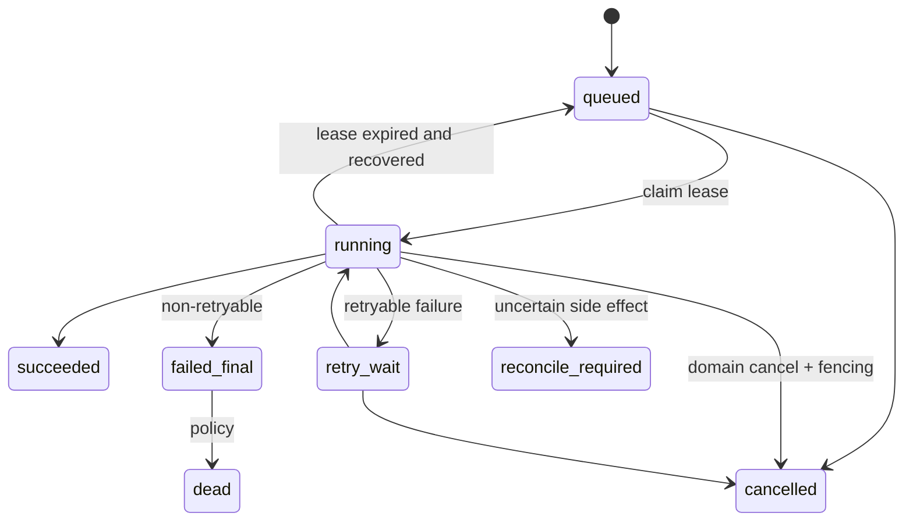
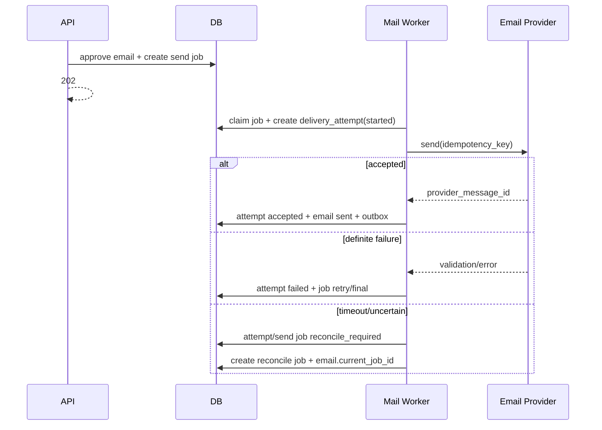

# 06 - 异步任务设计

> 版本：v3.6
> 组件：PostgreSQL Job Queue + Worker Runtime + Progress Event + Outbox
> 不依赖：Redis、RabbitMQ、Kafka
> v3.6：离职回池保持同步原子事务、不创建审批/Handover Job；Disable 不再清理 Assignment；搜索 Worker 记录 Apollo 等 Provider Execution；S4/S5 不进入当前 Job；单资源 Job 使用数据库单活约束
> v3.5：新增自动释放与通知 Job、LLM 主备链策略、邮件 Webhook 事件类型；数据补全完成事务对齐资格快照修正；Handover SLA Job 转 Deferred

---

## 1. 同步与异步边界

### 1.1 判断标准

| 形式 | 条件 | 示例 |
|---|---|---|
| 同步 | 纯数据库短事务，需要立即得到确定结果 | Login、Candidate Select、Claim、Assign、Release、Transfer、Strategic Depart、Stage Change、Task Complete |
| 异步 | 外部调用、媒体处理、长计算、需要重试或宕机恢复 | Search、LLM、富化、报告、邮件生成/发送、ASR |

外部 Provider 调用不得发生在持有数据库锁的事务中。

### 1.2 操作分类

| 操作 | 执行形式 | 响应 |
|---|---|---|
| Candidate Select/Promote | 同步短事务 | 200 + 每项成功/失败结果 |
| Claim/Assign/Release/Transfer | 同步短事务 | 200/409 |
| Strategic Depart Sales | 同步原子事务 | 200/409；User + Session + Assignment + Lead + Audit/Outbox 一起提交 |
| 创建 Search Run | 异步 | 202 + run_id + job_id |
| Candidate Refresh Enrichment | 异步 | 202 + job_id |
| Analysis Report | 异步 | 202 + run_id + job_id |
| Email Draft Generate | 异步 | 202 + email_id + job_id |
| Email Send | 异步 | 202 + email_id + job_id |
| Meeting Upload | 同步保存媒体和记录，异步处理 | 202 + meeting_id + job_id |
| **Manual Note Create（新增 v3.4）** | **异步** | **202 + note_id + job_id** |
| Job/Report/Meeting Query | 同步只读 | 200 |
| **Data Completion（新增 v3.3）** | **异步** | **202 + job_id** |
| **Auto Release Overdue（新增 v3.5）** | **异步（定时 Job）** | **N/A（系统创建）** |
| **Notification（新增 v3.5）** | **异步** | **N/A（系统创建）** |
| **Anomaly Detection（新增 v3.3）** | **异步（定时 Job）** | **N/A（系统创建）** |

未来复杂 Handover SLA 随完整销售管理 Deferred，当前不创建；当前 `DepartSales` 不创建任何 Job。

---

## 2. Job 模型

Job 相关表定义见 `04-数据模型设计.md`：

- `job`
- `job_attempt`
- `job_progress_event`

### 2.1 为什么拆 Attempt 和 Progress

`job.attempt_log JSONB` 不适合作为正式设计：

- 无法高效查询某 Provider 的失败率；
- 无法保证追加式历史；
- 无法对单次 Attempt 建索引；
- 无法表达 SSE Progress；
- 重试会持续扩大一行 JSON。

因此：

```text
job
  当前状态和 Lease

job_attempt
  每次执行的追加式技术事实

job_progress_event
  用户可见进度和 SSE 重连事实
```

### 2.2 Job 状态

```text
queued
running
retry_wait
succeeded
failed_final
cancelled
reconcile_required
dead
```

状态转换：



`failed_final/cancelled/dead/succeeded/reconcile_required` 是该 Job 的终态。人工重试不是状态回跳，而是创建一个新的 queued Job，并设置 `retry_of_job_id=旧 Job`。

`reconcile_required` 表示原 Job 的外部副作用结果不确定。系统创建独立的 Reconcile Job；Reconcile Job 自己进入 succeeded/failed_final，并更新领域资源，但不篡改原 Job 的不确定历史。

### 2.3 Lease/Fencing

领取：

```sql
WITH picked AS (
    SELECT job_id
    FROM ltc.job
    WHERE queue_name = :queue_name
      AND status IN ('queued', 'retry_wait')
      AND run_after <= clock_timestamp()
    ORDER BY priority, created_at
    LIMIT 1
    FOR UPDATE SKIP LOCKED
)
UPDATE ltc.job j
SET status = 'running',
    locked_by = :worker_id,
    lock_token = gen_random_uuid(),
    locked_until = clock_timestamp() + :lease_interval,
    started_at = COALESCE(started_at, clock_timestamp()),
    version = version + 1
FROM picked
WHERE j.job_id = picked.job_id
RETURNING j.*;
```

续约：

```sql
UPDATE ltc.job
SET locked_until = clock_timestamp() + :lease_interval,
    version = version + 1
WHERE job_id = :job_id
  AND status = 'running'
  AND lock_token = :lock_token;
```

0 行表示 Lease 已丢失。Worker 必须停止业务结果回写。

完成：

```text
lock Job
→ verify status=running and lock_token
→ write domain result
→ append outbox/audit/progress
→ set job=succeeded
→ commit
```

### 2.4 Attempt

每次领取 Job 后先追加 `job_attempt(status=started)`。

完成时写：

- Provider；
- Provider Request ID；
- 请求/响应摘要；
- Token；
- 成本；
- 耗时；
- Error；
- Lease Lost。

Attempt 不保存 API Key、Token、完整邮件正文和完整会议转写。

`job_attempt.metrics` 使用固定 `metrics-v1` DTO，不接受任意 Provider JSON。它汇总一次 Job Lease/Attempt 内全部 Provider 调用，不等同于单个 HTTP 请求：

```json
{
  "schema_version": 1,
  "input_tokens": 1200,
  "output_tokens": 350,
  "cached_input_tokens": 0,
  "total_tokens": 1550,
  "latency_ms": 842,
  "cost_amount": "0.012345",
  "currency": "USD",
  "cost_status": "confirmed"
}
```

- Token/Latency 为非负整数，Total 必须等于 Input + Output；
- Search/LLM/ASR/分片调用均计入；Attempt 中途失败也保存此前已经发生的用量和费用；
- 金额使用十进制定点字符串，禁止 JSON float；
- 全部调用 confirmed 才是 confirmed；存在 estimated 且无 unknown 时是 estimated；任一 unknown 则整体 unknown，金额和币种为 null；
- 当前核算币种为 USD；非 USD Provider 必须由 Adapter 提供原币种、USD 换算金额、汇率和汇率时间快照；
- `provider_request_id` 只保存主请求，全部脱敏 ID 写 `response_summary.provider_request_ids`；Provider 原始 Usage 只可脱敏保存在受控子对象，领域汇总只读取 metrics-v1。

### 2.5 Backoff

推荐：

```text
delay = min(base * 2^(attempt_no-1), max_delay) + jitter
```

错误分类：

| 错误 | 是否重试 |
|---|---|
| Timeout/Connection Reset | 是 |
| Provider 429/5xx | 是，尊重 Retry-After |
| JSON Parse | 限次重试，之后 Fallback/Failed |
| Invalid Business Input | 否 |
| Permission/Not Found | 否 |
| Email Provider 结果不确定 | 不直接重试，进入 Reconcile |
| ASR Temporary Error | 是 |
| Unsupported Media | 否 |

### 2.6 人工 Retry 和 Cancel

Retry 必须从领域资源进入：

```text
lock Search Run / Analysis Run / Meeting / Email
→ lock old current Job
→ validate retry policy
→ old Job 保持终态
→ create new queued Job(retry_of_job_id=old Job)
→ resource.current_job_id=new Job
→ resource status=queued
→ audit/progress/outbox
→ one commit
```

Cancel 也必须原子更新领域资源和当前 Job。通用 `/ops/jobs/{id}:retry|cancel` 只是 Strategic/运维入口，必须按 `aggregate_type` 委托所属模块的 Application Port，禁止直接 UPDATE Job。

Running Job 被取消后，Worker 的结果回写会因 `status/lock_token` 校验失败；涉及不可撤销外部副作用的阶段必须使用各领域策略，例如 Email 已进入 `sending` 后不能假装取消，只能进入 Reconcile。

---

## 3. Job 类型

### 3.1 首期 Job

| Job Type | Queue | Aggregate | 说明 |
|---|---|---|---|
| `lead.search_pipeline.v1` | lead | lead_search_run | 搜索主 Pipeline |
| `lead.refresh_candidate.v1` | lead | lead_enrichment_run | 单 Candidate 重新富化/评分 |
| `analysis.generate_report.v1` | analysis | analysis_run | 生成分析报告 |
| `engagement.generate_email_draft.v1` | mail | email_message | 邮件草稿 |
| `engagement.send_email.v1` | mail | email_message | 邮件发送 |
| `engagement.reconcile_email.v1` | mail | email_message | 对账不确定发送 |
| `engagement.process_meeting.v1` | media | meeting | 会议处理 |
| `platform.dispatch_outbox.v1` | event | outbox_event | 分发事件 |
| `platform.process_external_event.v1` | event | external_event | 处理 Webhook |
| `crm.auto_release_overdue.v1` | event | sales_lead | **新增 v3.5：定时（每小时）扫描 3 个工作日未首触达的 claimed Lead 并自动释放** |
| `platform.notify.v1` | event | - | **新增 v3.5：通知发送（飞书 Webhook/邮件网关）** |

需要“同一资源只允许一个活跃执行”的 Job 必须写确定性 `concurrency_key`，数据库使用 active 部分唯一索引兜底：

```text
search:{search_run_id}:pipeline
enrichment:{enrichment_run_id}:refresh
analysis:{analysis_run_id}:generate
meeting:{meeting_id}:process
manual-note:{note_id}:extract
data-completion:{lead_id}:{scale|region}
```

旧 Job 处于 `queued/running/retry_wait/reconcile_required` 时不得创建同 Key Retry；只有旧 Job 进入终态后才允许新 Job 复用该 Key。

### 3.2 Search Pipeline 不过度拆 Job

当前代码的搜索、抽取、联系人补全、D1-D4 和客户规模属于同一用户任务。首期使用一个持久 Pipeline Job：

```text
lead.search_pipeline.v1
  step 1 route_intent
  step 2 execute_providers (Web Search / Apollo)
  step 3 persist_evidence
  step 4 extract_candidates
  step 5 negative_filtering（新增 v3.3）
  step 6 enrich_d1_d4
  step 7 generate_icp
  step 8 generate_scale
  step 9 finalize_run
```

每步写：

- Step Code；
- Progress Event；
- Checkpoint；
- 成功/失败计数。

不首期强制拆成 Search/Extract/Enrich/Score 四个互相编排的 Job。只有某一步确实需要独立扩容、独立重试或队列隔离时再拆。

Provider 调用不是独立 Job，但必须是独立业务执行事实：

```text
短事务：insert search_provider_execution(status=running)
→ 事务外调用 Web Search/Apollo
→ 短事务：写 execution 终态 + Evidence + Progress
```

一次 Pipeline Job 可以串行或并行执行多个 Provider。Retry 新建 `search_provider_execution` 并指向 `retry_of_provider_execution_id`，不覆盖旧行。某个 Provider 失败、其他 Provider 产生有效 Evidence 时 Run 可继续并最终为 `partial`；全部 Provider 失败才进入 `failed`。客户端不能传 Provider，Apollo 不暴露独立入口。

### 3.3 Search Pipeline 部分成功

一个 Candidate 失败不能回滚整批：

```text
Run.completed
  所有目标步骤成功

Run.partial
  部分 Candidate 成功、部分失败

Run.failed
  没有产生可用 Candidate 或主流程不可恢复
```

Candidate 级错误写 Progress Event 和对应 Run 统计。

### 3.4 Candidate Refresh

`lead.refresh_candidate.v1` 的领域资源是 `lead_enrichment_run`：

```text
POST Candidate:refresh-enrichment
→ Candidate.assessments_stale=true
→ create Enrichment Run(status=queued)
→ create Job(aggregate_type=lead_enrichment_run)
→ Run.current_job_id=Job
```

成功时在一个事务发布新 Enrichment/ICP/Scale current，并清除 `assessments_stale`。失败或取消时旧 current 继续可读，但 Candidate 保持 stale、不可 Select。Retry 更新 Enrichment Run 的 `current_job_id` 并创建新 Job；Candidate 已 promoted 时不修改现有 Sales Lead 的 adopted Assessment。

---

## 4. SSE Progress

### 4.1 Event 格式

```text
id: 43
event: candidate_scored
data: {"job_id":"...","candidate_id":"...","total_score":75,"grade":"B"}
```

### 4.2 Last-Event-ID

客户端重连：

```http
GET /api/v1/jobs/{job_id}/events
Last-Event-ID: 43
```

服务端查询：

```text
job_id = ?
AND progress_event_id > 43
ORDER BY progress_event_id
```

### 4.3 Progress 内容

允许：

- 当前步骤；
- 已找到网页数；
- 已抽取候选数；
- Candidate 名称；
- 已完成 D1-D4；
- ICP/Scale 摘要；
- Provider 友好错误；
- Retry 信息。

禁止：

- System Prompt；
- API Key；
- 模型内部敏感推理；
- 未脱敏个人数据；
- 完整网页正文。

---

## 5. Worker Handler

### 5.1 结构

```text
apps/worker/
  src/ltc_worker/
    main.py
    registry.py
    lease.py
    handlers/
      lead_search_pipeline.py
      lead_refresh_candidate.py
      analysis_generate_report.py
      email_generate_draft.py
      email_send.py
      email_reconcile.py
      meeting_process.py
      **data_completion_scale.py（新增 v3.3）**
      **data_completion_region.py（新增 v3.3）**
      **auto_release_overdue.py（新增 v3.5）**
      **notify.py（新增 v3.5）**
      **manual_note_extract.py（新增 v3.4）**
      outbox_dispatch.py
      external_event_process.py
```

`handover_sla_check.py` 随销售管理 Deferred，当前不创建。

### 5.2 Handler 模板

```python
async def handle(job: JobLease, app: ApplicationServices) -> None:
    attempt = await app.jobs.start_attempt(job)
    try:
        input_data = validate_job_payload(job.payload)

        # Provider 调用和长计算在事务外
        external_result = await execute_external_work(input_data, app.providers)

        # 结果回写为短事务
        await app.use_case.publish_result(
            job_id=job.job_id,
            lock_token=job.lock_token,
            result=external_result,
        )
        await app.jobs.finish_attempt(attempt, "succeeded")
    except LeaseLost:
        await app.jobs.finish_attempt(attempt, "lease_lost")
    except RetryableError as exc:
        await app.jobs.retry(job, attempt, exc)
    except Exception as exc:
        await app.jobs.fail(job, attempt, exc)
```

### 5.3 禁止

- Handler import FastAPI Router；
- Handler 直接操作其他模块 ORM；
- 外部调用包在数据库事务中；
- 一个 Transaction 跨越整个 ASR/LLM 请求；
- Lease Lost 后继续回写；
- 把完整 Provider Response 塞进 Job Result；
- 用 Job 代替领域表保存业务结果。

### 5.4 新增 Job 类型（v3.3）

**数据补全 Job**：

| Job Type | Queue | 用途 |
|------|------|------|
| `data_completion.scale.v1` | data | `sales_lead.data_completion_pool=scale_unknown` 时，自动触发 Enrichment + Scale Assessment |
| `data_completion.region.v1` | data | `sales_lead.data_completion_pool=region_unknown` 时，自动触发 Region/Country/Contact 补全 |

补全完成后在同一事务一次性修正资格快照：scale_unknown 替换 `adopted_scale_assessment_id` 为新 current Scale 并同步 `required_sales_tier/allocation_rule_version`；region_unknown 修正 `company.region_code/region_mapping_version` 与 `sales_lead.pool_region_code/pool_region_mapping_version`，若 adopted Scale 有明确 Tier 则同步 `required_sales_tier/allocation_rule_version` 并把 `data_completion_pool` 置 NULL，若 Scale 仍 unknown 则转为同区域 `scale_unknown`。两条路径都追加 Stage Transition（`03-DDD领域驱动设计.md` §6.10 例外）。

**自动释放 Job（v3.5）**：

| Job Type | Queue | 用途 |
|------|------|------|
| `crm.auto_release_overdue.v1` | event | 每小时扫描 `allocation_status=claimed AND first_touch_at IS NULL AND assigned_at 超过 3 个工作日` 的 Lead，逐条独立事务自动释放回池并通知原销售（策略见 `03-DDD领域驱动设计.md` §6.18） |

**通知 Job（v3.5）**：

| Job Type | Queue | 用途 |
|------|------|------|
| `platform.notify.v1` | event | 经 Notification Provider Port（飞书 Webhook/邮件网关）发送通知：自动释放提醒、14 天无活动提醒、登录锁定告警等；不建通知业务表 |

**交接 SLA 检查 Job**：随销售管理 Deferred，启用时恢复 `handover.sla_check.v1` 设计。

**手动记录提取 Job（v3.4，v3.5 修订）**：

| Job Type | Queue | 用途 |
|------|------|------|
| `manual_note.extract.v1` | llm | 调用 LLM 从 `manual_note.raw_text` 提取结构化字段，目标点位来自提取目标目录（`03-DDD领域驱动设计.md` §6.16）。提取成功 → 写 `extracted_fields_json`（含每个目标字段的 `target_version` 快照）→ `confirm_status=pending` 等待批量确认；提取失败 → 保留原文，`confirm_status=pending` 可重试 |

提取流程：
```text
manual_note 创建 → queued Job
  → claim lease → call LLM → validate result
  → success → write extracted_fields_json → complete Job
  → failure → write error → retry with new Job (retry_of_job_id)
```

### 5.5 LLM Provider 主备链

LLM 调用按用途配置主备链（Config-as-Code）：ICP 评分/分析报告 `主模型 → DeepSeek-Pro → DeepSeek-Flash`；邮件生成 `主模型 → DeepSeek-Flash`（<5s 预算）；手动记录提取 `主模型 → DeepSeek-Pro`。Adapter 对同一逻辑调用依次尝试链上模型：主模型超时/限流/5xx 自动降级下一档；降级发生的模型名、原因、耗时计入 `job_attempt.metrics` 与 `request_summary`。业务结果表只记录实际产出内容的 `model_name`，Prompt 版本随调用记录。

---

## 6. Email 发送可靠性

### 6.1 发送流程



### 6.2 为什么不能超时后直接重发

Provider 可能已经接收邮件，但响应在网络中丢失。直接重试可能造成重复邮件。

Reconcile 策略：

1. 使用 Provider Request/Idempotency Key 查询；
2. 等待 Webhook；
3. 超过对账窗口后进入人工处理；
4. 只有确认未发送才重新 Queue。

Inbound Reply 处理完成时，Customer Operation 在同一结果事务中写入 Intent、创建需要的 Follow-up Task 并发布 `engagement.email_replied.v1`。Task 使用确定性 `idempotency_key=email:{email_id}:{email_version}:{action_code}`；Event Consumer 不再次创建 Task。

Webhook 事件类型（`external_event`，验签 + `provider_code + provider_event_id` 去重）至少覆盖：`delivered/opened/clicked/bounced/complaint/unsubscribe`。处理规则：`delivered/opened/clicked` 单调推进 `email_message.status`（不回退），opened/clicked 各发布一次 `engagement.email_opened.v1` / `engagement.email_clicked.v1`（动态加分 I1 的数据源）；`bounced/complaint/unsubscribe` 写 `email_suppression`。无 tracking 能力的 Provider 不伪造 open/click 事件。

---

## 7. Meeting Pipeline

```text
1. validate upload
2. persist media_asset(quarantined)
3. create meeting + job
4. extract audio when video
5. normalize audio
6. split chunks
7. parallel ASR
8. normalize simplified Chinese
9. merge transcript and segments
10. structured summary
11. fallback summary on model failure
12. persist transcript/segments/summary
13. create follow-up task with deterministic idempotency key
14. publish engagement.meeting_analyzed.v1
```

Meeting Task 使用 `idempotency_key=meeting:{meeting_id}:{meeting_version}:{action_item_hash}`。Task 与 Meeting Summary 在同一结果事务写入；Event Consumer 不再次创建 Task。

### 7.1 清理

- 原始会议媒体按 Retention 保存；
- 派生临时 Chunk 处理完成后删除；
- Normalized Audio 是否保留由配置决定；
- 删除 Meeting 为逻辑删除，异步清理媒体；
- Worker Finally 必须清理本地临时文件。

### 7.2 并发

- 同一 Meeting 只允许一个 active Process Job；
- 单活由 `job.concurrency_key=meeting:{meeting_id}:process` 的 active 部分唯一索引硬约束，不依赖应用层先查；
- Retry 创建新 Job，不复用过期 Lease；
- Cancel 原子设置 Meeting/Job=cancelled，Fencing 阻止旧 Worker 回写；
- Delete 只允许 completed/failed/cancelled，活跃 Meeting 必须先 Cancel；
- Segment 使用 `(meeting_id, sequence_no)` 覆盖前先验证 Job Lease；
- 失败记录 Error Code，不丢失原始媒体。

---

## 8. Outbox

### 8.1 写入

业务事务中：

```text
domain writes
+ audit
+ outbox event
+ idempotency result
→ one commit
```

### 8.2 分发

Outbox Dispatcher：

1. Lease 领取 pending Event；
2. 从静态 Event Registry 取得该 Event 的全部必需 Consumer；
3. 在一个短 PostgreSQL 事务中按稳定顺序调用全部 Consumer Application Port；
4. 每个 Consumer 使用 `idempotency_record(event_id, consumer_name)` 去重；
5. 全部 Consumer 领域写入、幂等记录和 Event `published` 一次提交；
6. 任一 Consumer 失败则整体回滚，Event 保持可重试；
7. 不通过 localhost HTTP 调用模块。

当前所有 Consumer 与 Producer 共用同一 PostgreSQL，因此可以完成上述原子提交。Consumer 事务内只允许数据库写入和创建后续 Job，不允许调用 LLM、邮件、ASR 等外部 Provider。未来只有在引入外部消息系统或独立数据库时，才增加按 Consumer 投递状态或 Inbox，而不是当前预建空表。

### 8.3 首期事件

字段级 Payload Schema 以 `03-DDD领域驱动设计.md` §8.1 为准；本节只定义 Worker/Consumer 动作，不维护第二套 DTO。

| Event | Consumer Action |
|---|---|
| `crm.sales_lead_created.v1` | 可选创建首份 Analysis Run；刷新 Pool |
| `crm.lead_assigned.v1` | 更新 Workspace、任务负责人 |
| `crm.lead_released.v1` | 取消失权未开始任务；刷新 Pool |
| `crm.lead_transferred.v1` | 转移未完成任务和 Workspace Owner |
| `crm.pipeline_changed.v1` | 刷新 Funnel；按策略刷新 Analysis |
| `analysis.report_generated.v1` | 刷新 360；可创建报告跟进 Task |
| `engagement.email_sent.v1` | Sales CRM Consumer 调用 Pipeline Command，首次触达推进 Contacted |
| `engagement.email_replied.v1` | Sales CRM Consumer 推进 Engaged；按策略刷新 Analysis |
| `engagement.meeting_analyzed.v1` | Sales CRM Consumer 推进 Meeting；按策略刷新 Analysis |
| `engagement.task_completed.v1` | 刷新 Sales Workspace 和任务指标 |
| `iam.user_disabled.v1` | 只刷新账号状态 Read Model；不得释放 Assignment、清 Task Assignee 或取消业务 Job |
| `iam.sales_departed.v1` | 刷新 Strategic 账号/池统计并创建离职完成通知；客户回池已在同步 Depart 事务完成，不由 Consumer 再执行 |
| `engagement.email_opened.v1` / `engagement.email_clicked.v1` | Sales CRM Consumer 调用 `ApplyDynamicIntentBonus`（I1，每封邮件合计最多 +2）；刷新 Workspace |
| `crm.dynamic_intent_bonus_applied.v1` | `a_segment_upgraded=true` 时：Customer Analysis 创建 Analysis Run、Customer Operation 创建跟进 Task；刷新 Read Model |

### 8.4 Pipeline 单一写入口

Pipeline 只有一个写入口：Sales CRM 的 `ChangePipelineStage/PipelineTransitionPolicy`。

- 用户在 UI 显式改阶段：API 同步调用该 Command；
- Email/Meeting 等自动事实：Customer Operation 只发布 Outbox Event；
- Sales CRM Consumer 收到 Event 后调用 `AdvancePipelineFromEvent`；
- Customer Operation 不得在写 Email/Meeting 的事务中直接更新 Sales Lead；
- 同一事实不能同时走同步调用和 Event，两条路径并存会造成重复 Transition。

用户 DTO 携带 `expected_version`；Event DTO 不伪造客户端版本，而是携带 `event_id/source_type/source_resource_id/occurred_at/correlation_id`，Consumer 锁定 Sales Lead 后读取当前版本。两类入口共享同一个 `PipelineTransitionPolicy`。

自动事件最小 Payload 和目标：

| Event | 必填 Payload | CRM 目标 |
|---|---|---|
| `engagement.email_sent.v1` | `company_id, lead_id, email_id, contact_id, delivery_attempt_id, sent_at` | `new → contacted`，仅首次触达 |
| `engagement.email_replied.v1` | `company_id, lead_id, email_id, contact_id, intent_level, replied_at` | `new/contacted → engaged` |
| `engagement.meeting_analyzed.v1` | `company_id, lead_id?, meeting_id, meeting_version, completed_at` | 有 Lead 时：`new/contacted/engaged → meeting` |

Consumer 规则：

- 以 `event_id + consumer_name` 幂等；
- Stage Transition 对 Email/Meeting/Task 使用专用 Source FK + `to_pipeline_stage` 唯一；
- 任意 `lead_id` 为空的 Meeting 只进入 Company Timeline/Analysis，不推进 Pipeline；
- 自动事件不允许阶段倒退；
- 已在目标或更后阶段时视为幂等成功；
- Consumer 必须再次验证 Event 资源与 `company_id + lead_id` 同源；资源自身 `lead_id` 为空时不得推进 Pipeline。

---

## 9. Worker Queue

推荐逻辑队列：

| Queue | Job | 初始并发原则 |
|---|---|---|
| `lead` | Search/Refresh | Search Provider 限流优先 |
| `analysis` | Report | LLM 成本和限流优先 |
| `mail` | Draft/Send/Reconcile | Send 与 Draft 可分 Worker Pool |
| `media` | Meeting | CPU/IO/ASR 限制 |
| `event` | Outbox/External Event/Auto Release/Notify | 轻量高频 |
| `data` | 数据补全（scale/region） | 低频后台，避开高峰 |
| `llm` | 手动记录提取等轻量 LLM 调用 | LLM 限流优先 |

并发数是部署配置，不写死在领域模型中。

### 9.1 优雅关闭

```text
SIGTERM
→ 停止领取新 Job
→ 继续续约正在执行的 Job
→ 在 graceful timeout 内完成
→ 未完成则停止续约
→ Lease 到期后由其他 Worker 回收
```

---

## 10. 可观测性

Worker 日志必须包含：

- `job_id`
- `attempt_id`
- `job_type`
- `queue_name`
- `aggregate_id`
- `correlation_id`
- `provider_request_id`
- `worker_id`
- `duration_ms`
- `error_code`

指标：

- Queue Depth；
- Oldest Queued Age；
- Running Job；
- Lease Expired；
- Retry Rate；
- Final Failure；
- Provider Latency/Error；
- Token/Cost；
- Email Uncertain；
- Meeting Duration；
- Outbox Pending/Dead；
- SSE Event Lag。

---

## 11. 验收测试

- [ ] 两个 Worker 不会领取同一 Job。
- [ ] Lease Lost Worker 无法提交领域结果。
- [ ] Retry 产生独立 Job Attempt。
- [ ] 人工 Retry 创建新 Job，旧 Job 保持终态并通过 retry_of_job_id 可追溯。
- [ ] 同一资源的确定性 `concurrency_key` 在 active 状态最多一条 Job，并发创建由数据库唯一约束拦截。
- [ ] Resource Cancel 与 Job Cancel 同事务，不出现一边 running、一边 cancelled。
- [ ] Search SSE 断开后能从 Last-Event-ID 续接。
- [ ] Search 部分 Candidate 失败时 Run=partial，成功数据保留。
- [ ] Web Search 成功而 Apollo 失败时保留成功 Evidence、记录两条 Provider Execution，Run 最终为 partial。
- [ ] Provider Execution 保存脱敏请求 Hash、状态、外部请求 ID、延迟/成本和错误，Retry 不覆盖历史。
- [ ] S4/S5 请求返回 `SCENE_NOT_SUPPORTED`，不创建 Search Run、Provider Execution、Job 或 Assessment。
- [ ] Search Pipeline 不把四个步骤过度拆成互相难以恢复的 Job。
- [ ] Email Timeout 进入 Reconcile，不直接重复发送。
- [ ] Meeting Summary 失败时保留 Transcript 并使用 Fallback。
- [ ] Outbox 与业务写入同事务。
- [ ] Consumer 重复收到事件不会重复创建 Task/Run。
- [ ] 同一 Event 的全部必需 Consumer 成功后才标记 published。
- [ ] 任一 Consumer 失败时其他 Consumer 写入与 published 一起回滚。
- [ ] 同一 Email/Meeting 事实只生成一条 Pipeline Transition。
- [ ] Email Reply/Meeting Summary 重放不会重复创建 Follow-up Task。
- [ ] 跨 Company 的 Event Payload 被 Consumer 拒绝。
- [ ] 禁用 Sales 后只撤销登录；active Assignment、Task Assignee 和业务 Job 保持不变。
- [ ] disabled Sales 后续执行 Strategic Depart 时仍能在同步事务内完成全部客户回池。
- [ ] Strategic Depart 不创建 Job，且 User/Session/Assignment/Lead/Audit/Outbox 在一个事务中全部成功或全部回滚。
- [ ] Depart 成功后每条 Lead 保留原 `required_sales_tier/pool_region_code/allocation_rule_version` 并回到 claimable 池。
- [ ] Provider 调用不发生在数据库事务中。
- [ ] Job Result 不替代领域表。

---

## 12. 后续季度自动收集（当前不实现）

后续 Strategy Planning 启用后，预计增加：

```text
strategy.plan_campaign.v1
strategy.replan_campaign.v1
strategy.refresh_resource_snapshot.v1
```

Quarterly Campaign Worker 只负责：

1. 读取已激活 Directive Snapshot；
2. 计算各 Region Target 和缺口；
3. 为缺口创建标准 `lead.search_pipeline.v1` Search Run；
4. 汇总 Candidate/ICP/Scale/Selection/Pool 完成度；
5. 更新只读策略资源视图。

它不能：

- 直接 INSERT Candidate；
- 跳过 Evidence/Observation；
- 自动 Select Candidate；
- 自动 Claim/Assign；
- 修改已完成 Campaign 历史；
- 把策略建议当作业务事实。
