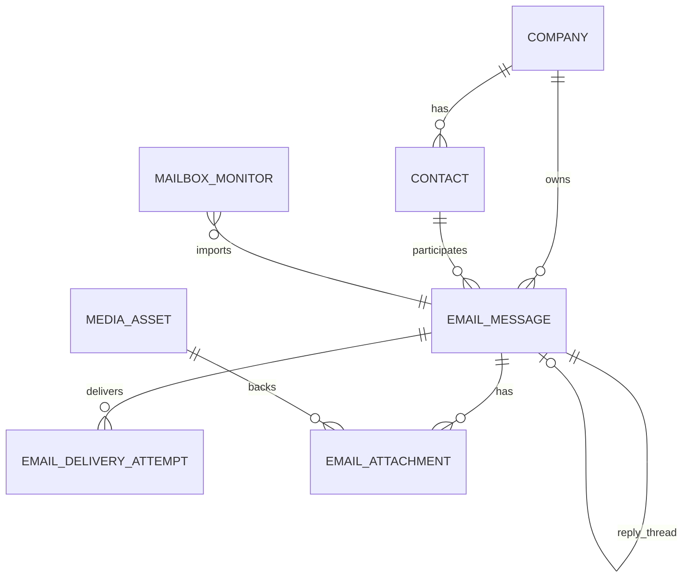

# 04 - 数据模型设计与字段说明

> 版本：v3.7  
> 数据库：PostgreSQL 16  
> Schema：`ltc`  
> 说明：本版把邮件收发相关表集中到同一份说明里，便于一起看监控配置、收信、发信、投递记录和附件落库链路。

---

## 1. 本版范围

本版重点说明以下邮件相关表：

- `ltc.mailbox_monitor`
- `ltc.company`
- `ltc.contact`
- `ltc.email_message`
- `ltc.email_delivery_attempt`
- `ltc.email_attachment`
- `ltc.media_asset`

其中：

- `mailbox_monitor` 负责收信监控配置
- `email_message` 是邮件主表，收信和发信都落这里
- `email_delivery_attempt` 记录每次发信尝试
- `email_attachment` 和 `media_asset` 记录附件和文件资源
- `company`、`contact` 是邮件消息的业务归属对象

---

## 2. 邮件链路总图

---

## 3. 表说明

### 3.1 `ltc.mailbox_monitor`

**用途**：配置要轮询的邮箱账号。收信服务定时读取这张表，按账号去 IMAP 服务器拉取新邮件。

| 字段 | 含义 |
|---|---|
| `mailbox_monitor_id` | 监控配置主键 |
| `provider_code` | 当前为 `imap` |
| `host` | IMAP 服务器地址 |
| `port` | IMAP 端口 |
| `username` | 邮箱账号 |
| `secret_env_var` | 兼容旧实现的密钥变量名 |
| `secret_value` | 当前实际保存的密码/授权码 |
| `mailbox_name` | 邮箱文件夹，默认 `INBOX` |
| `enabled` | 是否启用轮询 |
| `poll_seconds` | 轮询间隔 |
| `last_uid` | 上次处理到的 UID |
| `last_polled_at` | 上次轮询时间 |
| `version` | 乐观锁版本号 |
| `created_at` / `updated_at` | 创建与更新时间 |

**说明**：

- 目前 163 和腾讯企业邮箱都在这张表里各自一条配置
- 收信是否会写库，取决于这条监控配置是否启用
- 当前实现里，密码/授权码直接保存在 `secret_value`

### 3.2 `ltc.company`

**用途**：邮件归属的公司对象。无论是发信还是收信，邮件最终都要落到某个公司下面。

邮件相关字段重点是：

- `company_id`
- `company_name`
- `normalized_company_name`
- `primary_domain`
- `lifecycle_status`

**说明**：

- 发信时，系统会先按公司名或域名找已有公司
- 找不到才新建公司
- 这样避免同一公司被重复建档

### 3.3 `ltc.contact`

**用途**：公司下的联系人。邮件收发最终都要关联联系人。

邮件相关字段重点是：

- `contact_id`
- `company_id`
- `full_name`
- `normalized_name`
- `primary_email`
- `normalized_email`
- `email_status`
- `source`
- `status`

**说明**：

- 发信时，会为收件人找或建联系人
- 收信时，会为发件人找或建联系人
- `source='operation'` 表示来自运营邮件链路

### 3.4 `ltc.email_message`

**用途**：邮件主表。收信、发信、回复、线程关系都在这里统一记录。

核心字段如下：

| 字段 | 含义 |
|---|---|
| `email_id` | 邮件主键 |
| `company_id` | 所属公司 |
| `lead_id` | 可选，关联销售线索 |
| `contact_id` | 可选，关联联系人 |
| `parent_email_id` | 回复链上的父邮件 |
| `thread_key` | 线程键 |
| `direction` | `inbound` / `outbound` |
| `purpose` | 发信用途 |
| `status` | 邮件状态 |
| `from_address` | 发件人地址 |
| `intended_to_address` | 计划发送到的地址 |
| `delivered_to_address` | 实际投递地址 |
| `cc_addresses` | 抄送列表 |
| `subject` | 主题 |
| `body_text` / `body_html` | 正文 |
| `intent_level` | 收信意图级别 |
| `intent_payload` | 意图结构化内容 |
| `next_action` | 下一步动作 |
| `approved_by` / `approved_at` | 审批信息 |
| `generation_prompt_version` / `generation_model` | 生成来源信息 |
| `provider_code` | 发送/接收提供方 |
| `provider_message_id` | 平台侧消息 ID |
| `provider_request_id` | 平台侧请求 ID |
| `message_id_header` | 邮件头 Message-ID |
| `in_reply_to` | 邮件头 In-Reply-To |
| `current_job_id` | 当前关联任务 |
| `idempotency_key` | 幂等键 |
| `sent_at` / `received_at` / `replied_at` | 发送、收到、回复时间 |
| `version` / `created_at` / `updated_at` | 版本与时间戳 |

**状态规则**：

- `direction='outbound'` 时，状态可以是 `draft`、`queued`、`sending`、`sent`、`delivered`、`replied`、`failed` 等
- `direction='inbound'` 时，状态通常是 `received`、`processing`、`processed`、`failed`

**使用方式**：

- 发信成功后写一条 `outbound`
- IMAP 拉到新邮件后写一条 `inbound`
- 回复邮件通过 `parent_email_id` 和 `thread_key` 串起来

### 3.5 `ltc.email_delivery_attempt`

**用途**：记录每一次发信尝试，不管最终成功还是失败。

| 字段 | 含义 |
|---|---|
| `delivery_attempt_id` | 投递尝试主键 |
| `email_id` | 对应的邮件 |
| `attempt_no` | 第几次尝试 |
| `provider_code` | 发送提供方 |
| `idempotency_key` | 幂等键 |
| `provider_request_id` | 提供方请求 ID |
| `provider_message_id` | 提供方消息 ID |
| `status` | started / accepted / delivered / failed 等 |
| `request_payload` | 请求内容快照 |
| `response_payload` | 响应内容快照 |
| `error_code` / `error_message` | 失败原因 |
| `started_at` / `accepted_at` / `completed_at` | 时间点 |

**说明**：

- 一封发信可以有多次尝试
- `email_message` 是结果主记录
- `email_delivery_attempt` 是过程记录

### 3.6 `ltc.email_attachment`

**用途**：把邮件附件和文件资源关联起来。

| 字段 | 含义 |
|---|---|
| `email_attachment_id` | 附件主键 |
| `company_id` | 所属公司 |
| `email_id` | 所属邮件 |
| `media_asset_id` | 对应资源文件 |
| `disposition` | `attachment` / `inline` |
| `content_id` | 内联附件标识 |
| `filename` | 文件名 |
| `created_at` | 创建时间 |

### 3.7 `ltc.media_asset`

**用途**：统一存放文件资源元数据。邮件附件只是它的一种使用场景。

邮件相关重点字段：

- `media_asset_id`
- `company_id`
- `asset_kind`
- `storage_backend`
- `storage_key`
- `original_filename`
- `mime_type`
- `size_bytes`
- `sha256`
- `status`
- `validation_payload`

**说明**：

- 邮件附件的 `asset_kind` 使用 `email_attachment`
- 当前实现里，附件先生成 `media_asset`，再写 `email_attachment`

---

## 4. 收信流程

1. `mailbox_monitor` 里找到启用的邮箱
2. IMAP 拉取邮件
3. 按发件人邮箱查找或创建 `company`、`contact`
4. 写入一条 `email_message(direction='inbound')`
5. 如果是回复邮件，再通过 `in_reply_to` / `thread_key` 关联线程

---

## 5. 发信流程

1. 先根据客户名或邮箱域名找 `company`
2. 再找或创建 `contact`
3. 写入 `email_message(direction='outbound')`
4. 写入 `email_delivery_attempt`
5. 如果有附件，再写 `media_asset` 和 `email_attachment`

---

## 6. 现在这版的注意点

- 密码/授权码目前保存在 `ltc.mailbox_monitor.secret_value`
- `secret_env_var` 只是兼容字段，不是当前唯一来源
- 收发邮件最终都落到 `email_message`
- 附件不直接存正文里，而是走 `media_asset` + `email_attachment`
- `company` 和 `contact` 不是邮件专表，但它们是邮件归属的核心业务对象

